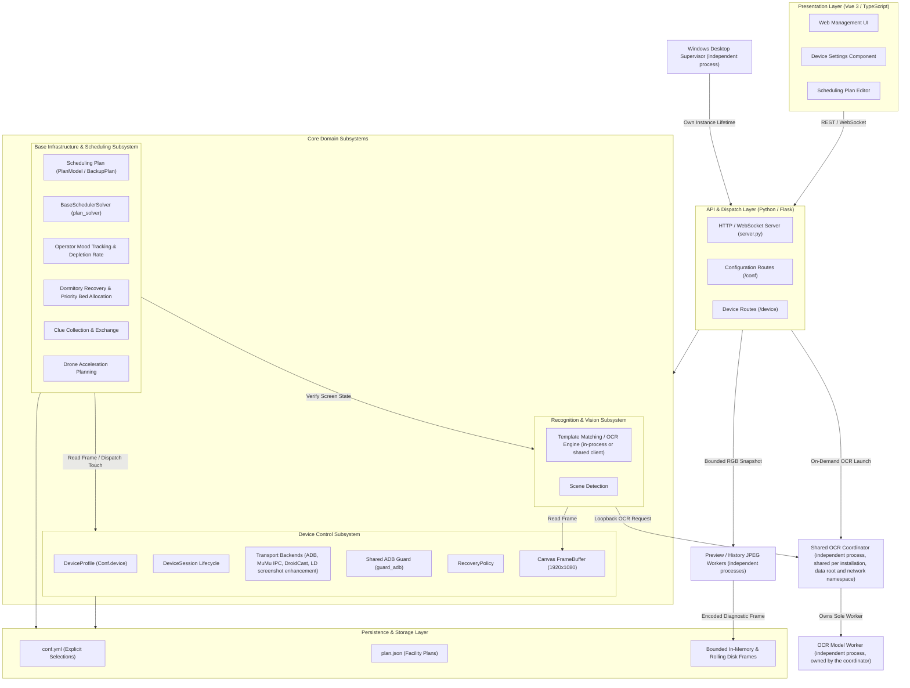

# System Panorama Architecture

Authoritative architectural specification of Arknights Mower, documenting subsystem boundaries, data flows, and invariant enforcement.

---

## 1. System Decomposition

Arknights Mower consists of four decoupled layers:

### 1.1 Presentation Layer (`ui/`)
- Built with Vue 3, Vite, Naive UI, and Pinia.
- Translates user intent into declarative API payloads.
- Maintains ephemeral discovery lists without persisting unconfirmed candidate instances.
- Directly exposes configurable recovery policies (`recovery_timeout`, `recovery_attempts`, `recovery_local_wait`).

### 1.2 API & Dispatch Layer (`server.py`)
- Provides RESTful JSON endpoints and real-time WebSocket feeds.
- Implements `GET /conf` on-the-fly migration, `PATCH /conf` partial updates, and `POST /conf` backward compatibility.
- Dispatches scheduling runs and orchestrates graceful shutdown across threads and child processes.
- The Windows desktop entry keeps its supervisor outside this process; [Main Instance Process Recovery](subsystems/process-recovery.md) defines ownership and safe dispatch recovery.

### 1.3 Core Subsystems (`arknights_mower/`)
- **[Device Control Subsystem](subsystems/device-control.md)**: Manages emulator discovery, socket-level transport, standard canvas frame acquisition, readiness verdicts, and bounded crash recovery.
- **[Base Infrastructure & Scheduling Subsystem](subsystems/base-scheduler.md)**: Drives automated base operations: operator mood evaluation, empirical depletion rate calculation, dormitory recovery ordering, dynamic shift transitions, clue party management, and drone acceleration.
- **[MAA Integration Subsystem](subsystems/maa-integration.md)**: Consumes MAA core callbacks across a MAA run boundary, translating task-chain transitions and whitelisted milestones into runtime-log lines while recurring telemetry stays at DEBUG.
- **[Recognition Subsystem](subsystems/recognition.md)**: Performs template matching and neural OCR over immutable 1920×1080 canvas frames, with bounded OCR detector inputs. By default (`MOWER_OCR_MODE=auto`), OCR execution uses the in-process engine for a single live Mower instance and the [Independent Shared OCR](subsystems/recognition.md#independent-shared-ocr) service when at least two live instances share an installation and data root; `local` and `shared` force one path. On the shared path, an independent coordinator process owns one model worker process, and separate network namespaces do not share that service.

### 1.4 Persistence & Storage Layer
- Stores explicit user configuration in `conf.yml` via [`DeviceProfile`](../arknights_mower/utils/config/device_profile.py).
- Stores base layouts and shifts in `plan.json` via [`PlanModel`](../arknights_mower/utils/config/plan.py).
- Maintains bounded diagnostic frame buffers with deterministic ring-buffer eviction and rolling disk cleanup.

---

## 2. Find the implementation and verification

Start with the affected user operation. The linked contracts provide current behavior and focused test choices; [Coding Standards](../CODING_STANDARDS.md) owns global guarantees.

| Task | Source entry | Contract or procedure |
| :--- | :--- | :--- |
| Change device settings, discover an instance or recover a connection | [`server.py`](../server.py), [`DeviceControl`](../arknights_mower/utils/device/application.py) | [Device Control task entry](subsystems/device-control.md#start-with-the-affected-operation), [connection diagnosis](cookbook/device-troubleshooting.md) |
| Change plan validation, shift projection or confirmed staffing | [`BaseSchedulerSolver`](../arknights_mower/solvers/base_schedule.py), [`Operators`](../arknights_mower/utils/operators.py) | [Base Scheduling task entry](subsystems/base-scheduler.md#start-with-the-affected-operation) |
| Change OCR engine selection, shared OCR service lifetime or recognition memory bounds | [`rapidocr.py`](../arknights_mower/utils/rapidocr.py), [`ocr_shared.py`](../arknights_mower/utils/ocr_shared.py), [`ocr_service.py`](../arknights_mower/utils/ocr_service.py) | [Recognition](subsystems/recognition.md), [Independent Shared OCR](subsystems/recognition.md#independent-shared-ocr); focused offline verification in [`shared_ocr_tests.py`](../arknights_mower/tests/shared_ocr_tests.py), [`ocr_gate_tests.py`](../arknights_mower/tests/ocr_gate_tests.py) and [`runtime_memory_tests.py`](../arknights_mower/tests/runtime_memory_tests.py) |
| Change the settings or plan editor UI | [`ui/src/components/`](../ui/src/components/), [`ui/src/stores/`](../ui/src/stores/) | [Frontend development and focused tests](../ui/README.md), [UI contract](../ui/AGENTS.md), [saved configuration selection and activation](subsystems/config-profiles.md) |
| Change desktop title bars, native window controls or saved window size | [`webview_ui.py`](../webview_ui.py), [`window_shell.py`](../arknights_mower/utils/window_shell.py) | [Desktop Window](subsystems/desktop-window.md) |
| Change shipped files or software/resource updates | [`scripts/`](../scripts/), [`software_update.py`](../arknights_mower/utils/software_update.py), [`resource_update_job.py`](../arknights_mower/utils/resource_update_job.py) | [Packaging](cookbook/packaging.md), [software update](subsystems/software-update.md), [resource update](subsystems/resource-update.md) |
| Change MAA core activation or worker lifetime | [`maa_runtime.py`](../arknights_mower/utils/maa_runtime.py), [`maa_process.py`](../arknights_mower/utils/maa_process.py), [`maa_backup.py`](../arknights_mower/utils/maa_backup.py) | [MAA runtime](subsystems/maa-runtime.md), focused worker and scheduler suites under `arknights_mower/tests/maa_*tests.py` |
| Change documentation or agent instructions | [`scripts/verify_governance.py`](../scripts/verify_governance.py) | [Task selection and verification](../.agents/AGENTS.md), [documentation routing](../.agents/skills/mower-doc/references/doc-hierarchy.md#routing-rules) |

Run focused Python checks from the repository root and frontend checks from `ui/`, as specified by the linked procedure. Offline tests verify the behavior exercised by their fixtures; document checks verify structure and links. Neither establishes a successful game operation. Report observed device results and remaining uncertainty separately.

---

## 3. Cross-Cutting Architectural Patterns

### 3.1 Monotonic Deadline Budgets
All socket connections, ADB commands, emulator CLI interactions, and instance recoveries execute within explicit time limits. The system uses monotonic deadlines (`deadline = time.monotonic() + budget`) rather than unbounded polling loops.

### 3.2 Guaranteed Compensation
Every acquired runtime resource (temporary screen geometry overrides, child processes, open socket handles, file locks) registers cleanup and compensation with [`PreparationSession`](../arknights_mower/utils/device/preparation.py), [`close_process`](../arknights_mower/utils/device/owned.py), or dedicated process termination handlers. Compensation executes unconditionally upon normal exit, exceptions, or cancellation signals.

The on-demand shared OCR coordinator and its model worker are an explicit exception to child-process compensation. They are independent of the launcher: closing the manager or the instance that started the service leaves it available to other instances sharing the installation, data root and network namespace. The instance only reaps the launched process's exit status and must not close the shared service as its own child process or register `close_process` (or another own-child termination) for it. The coordinator owns and compensates its model worker. Only the registered [software-update shutdown](subsystems/software-update.md#shared-ocr-update-lifecycle) path stops it. [Independent Shared OCR](subsystems/recognition.md#independent-shared-ocr) owns the service's lifetime, admission and failure behavior; [Main Instance Process Recovery](subsystems/process-recovery.md#shared-ocr-service-boundary) owns the instance boundary.

### 3.3 Structured Verdicts
External device interactions produce structured status verdicts ([`ReadinessResult`](../arknights_mower/utils/device/session.py)) containing concrete classifications (`absent`, `offline`, `booting`, `ready`) and remediation guidance rather than unhandled tracebacks.

### 3.4 Standard Canvas Frame Contract

Recognition models operate exclusively on standard 1920×1080 pure RGB matrices. Recognition failures return structured verdicts without blocking the scheduler dispatch loop. The capture boundary is defined in [Device Control](subsystems/device-control.md#4-capture-frame-contract--storage); [`recognize.py`](../arknights_mower/utils/recognize.py) and [`BaseSchedulerSolver`](../arknights_mower/solvers/base_schedule.py) implement recognition and scheduling dispatch.
