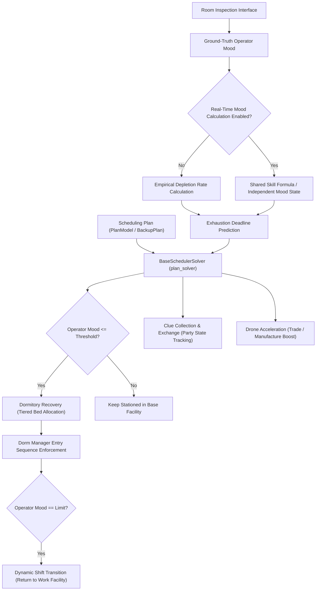

# Base Infrastructure & Scheduling Subsystem Specification

Authoritative specification of the Base Infrastructure & Scheduling Subsystem, governing operator assignments, mood mechanics, dormitory allocation, shift transitions, and facility automation.

## Manual Queue Tasks

The task dialog admits a configured daily run, recruitment, Skland signing, credit shopping, mail collection, base reports, friend visits, daily and weekly rewards, the current stage plan, and each supported long task. A single selection runs once using its current parameters and selected runner without requiring its automatic-enable switch. The combined daily selection includes enabled daily work and stage plans, excludes long tasks, and retains its remaining steps across device recovery and dependency waits. Manual selections do not change saved automation settings.

The task category menu has one daily-work entry. Its second selector defaults to all configured daily work and offers each individual daily action. Stage plans and long tasks retain separate category entries. The daily sub-selection determines the queued task type; switching to another category ignores it, and clearing the form restores the combined daily selection.

Manual tasks carry no room arrangement or caller-supplied metadata. Adding one requires the existing Web UI token and wakes the scheduler. Execution requires a five-minute margin before the next dispatchable task, excluding the current manual task. MAA daily work yields at that margin, MAA long work yields thirty seconds before the next task, and local stage work uses its existing operation deadline. Each manual dispatch also has a fixed twenty-four-hour execution limit when no earlier task exists. Dependency waits retain the original task, timestamp and remaining steps; unchanged dispatch and elapsed time do not release a wait. Completion or rearrangement of the blocking task, or a configuration change, permits reconsideration without a polling task. Manual MAA execution returns to the queue without entering the automatic idle-sleep path or starting another configured long task.

[`manual_tasks.py`](../../arknights_mower/solvers/manual_tasks.py) owns selection and remaining steps; [`manual_task_tests.py`](../../arknights_mower/tests/manual_task_tests.py) verifies queue dispatch, authentication, runner selection and unchanged-dependency retention offline. Existing scheduling and configuration concepts retain their meanings.

<a id="manual-maintenance-windows"></a>
## Manual Maintenance Windows

The task dialog also admits flash updates and server downtime with a selected start and an integer duration, defaulting to ten minutes. Flash updates allow 1–10080 minutes and offer preparation followed by pause, or direct pause. Preparation reuses the existing maintenance Drone Acceleration and mastery support handoff scheduling. Direct pause does not advance either operation for that window. Server downtime allows 0–10080 minutes: a positive duration schedules a later start, while zero closes the Mower process without a scheduled start. Server downtime uses preparation and supplies the existing major-maintenance condition, so applicable maintenance backups activate before stopping at their own lead times; creating a task does not force an immediate backup transition.

The queue owns these windows and preserves their start, duration and mode through saved-state recovery and software-update replanning. Adding a window requires the existing Web UI token, clears caller-supplied room arrangements and metadata, and wakes maintenance evaluation. A zero-duration server task also requires the instance's existing process-control permission when manager-owned settings are hidden. Manual flash updates pause dispatch until their exact end, with no announced flash probe or half-hour early login. At the selected start, manual server downtime first checks the applicable maintenance backup through the existing selection and preparation flow. It waits for queued advance runs, original-roster restoration and actual backup arrangement tasks to finish before saving the task state and stopping the automation worker. The stop task keeps its original timestamp while preparation is pending, remains active beyond its nominal end, and is excluded from dispatch so its own prerequisites can execute. A retained preparation failure keeps the stop pending while unrelated tasks remain dispatchable; elapsed time alone does not authorize a retry or shutdown. After device cleanup, a positive-duration task reuses the server's scheduled-start timer to continue the saved queue at the selected start plus duration. The stopped state and countdown appear through the existing status and scheduled-start controls. Cancelling the reservation prevents automatic startup; an explicit stop during the handoff also cancels it. Timers remain process-local, so closing the application cancels the reservation. A zero-duration task is consumed before saving the remaining queue and requests the existing process shutdown lifecycle, without creating a timer. The desktop launcher exits through that lifecycle; an external WSGI host remains responsible for terminating its hosting process. If saving the task state fails, the worker stops without closing the process or scheduling a restart and reports that manual recovery is required.

Startup during manual server downtime returns to the stopped state before OCR or device initialization: a positive duration schedules only the remaining time, and zero requests process shutdown. This startup boundary does not log in to perform a fresh backup arrangement during downtime; backup preparation must complete while the scheduler is running before it stops. A flash wait yields at an overlapping manual server downtime's start instead of delaying the stop until the flash ends. Official announcements retain their existing handling, including the client-update stop. A nearer manual flash does not hide a later major update's preparation threshold or its scheduled wakeup. Expired manual windows leave the queue without deleting other pending tasks. These are operational additions to existing scheduling concepts; glossary definitions remain unchanged.

[`manual_maintenance_tests.py`](../../arknights_mower/tests/manual_maintenance_tests.py) verifies authentication, queue recovery, preparation, exact-end flash waiting, server stop handoff and maintenance-condition timing offline. [`scheduled_start_tests.py`](../../arknights_mower/tests/scheduled_start_tests.py) verifies stopped status, countdown, saved-queue startup and cancellation. [`TaskDialog.test.js`](../../ui/src/components/TaskDialog.test.js) covers form defaults and submitted choices.

## Start with the affected operation

| Operation | Implementation entry | Focused offline verification |
| :--- | :--- | :--- |
| Validate a main or backup Scheduling Plan | [`/validate-plan`](../../server.py), [`build_global_plan` and `Operators.validate_backup_plans`](../../arknights_mower/utils/operators.py), [`PlanModel`](../../arknights_mower/utils/config/plan.py) | [`backup_validation_tests.py`](../../arknights_mower/tests/backup_validation_tests.py), [`backup_condition_coverage_tests.py`](../../arknights_mower/tests/backup_condition_coverage_tests.py) check merged plans and supported activation conditions. |
| Project a complete shift before device input | [`BaseSchedulerSolver._prepare_shift_cycle`](../../arknights_mower/solvers/base_schedule.py), [`Operators.project_arrangements`](../../arknights_mower/utils/operators.py) | [`shift_cycle_convergence_tests.py`](../../arknights_mower/tests/shift_cycle_convergence_tests.py), [`shift_backup_convergence_tests.py`](../../arknights_mower/tests/shift_backup_convergence_tests.py) check projected arrangements and preservation of Actual Occupancy. |
| Confirm a group's return or defer a blocked shift | [`BaseSchedulerSolver._complete_group_shift` and `_suspend_group_shift`](../../arknights_mower/solvers/base_schedule.py) | [`group_shift_confirmation_tests.py`](../../arknights_mower/tests/group_shift_confirmation_tests.py), [`shared_shift_retry_tests.py`](../../arknights_mower/tests/shared_shift_retry_tests.py) check observed confirmation, waiting tasks and retries. |
| Allocate or confirm Dormitory Recovery | [`dorm_recovery.py`](../../arknights_mower/utils/dorm_recovery.py), [`resting_priority.py`](../../arknights_mower/utils/resting_priority.py), [`BaseSchedulerSolver`](../../arknights_mower/solvers/base_schedule.py) | [`dorm_admission_priority_tests.py`](../../arknights_mower/tests/dorm_admission_priority_tests.py), [`dorm_recovery_tests.py`](../../arknights_mower/tests/dorm_recovery_tests.py) check admission and confirmation through scheduler callers. |

Run only the relevant files from the repository root, for example:

```bash
python -m pytest arknights_mower/tests/shift_cycle_convergence_tests.py arknights_mower/tests/group_shift_confirmation_tests.py -q
```

Fixtures replace device input and game observations. Passing projection or confirmation tests does not establish current in-game staffing, recognition accuracy or successful arrangement on a real account. For an incident, retain the effective Scheduling Plan, pending task, observed occupants and relevant logs; use the tests to reproduce the policy before attributing the game result.

---

## 1. Domain Model & Workflow



---

## 2. Core Concepts & Functional Contracts

### 2.1 Scheduling Plan (`Scheduling Plan`)

The shared roster precheck checks training-slot eligibility in main and backup assignments, every binding replacement, and explicit backup staffing tasks. The [training-slot validation decision](../../.agents/notes/implemented/bug-fix/2026-10-09-training-slot-validation.md) defines cache, synchronization and exemption behavior. The [inventory synchronization contract](growth-planning.md#inventory-synchronization-and-mastery-payments) owns material calibration and refresh entry points.
Income snapshot validation uses the same native checker with detached configuration and roster-mode exceptions defined in [Income Image Export](plan-editor.md#income-export). Manual saved-plan and startup validation retain their existing roster refresh policy.

- Running-plan restoration restores the baseline, backups and advanced settings captured at scheduler startup. The advanced-settings snapshot comes from the actual global configuration rather than editable plan metadata. The endpoint preserves unrelated global settings, rejects missing or invalid snapshots before writing, and compensates either file-write failure with the original models and file bytes. The frontend pauses and drains autosave, reloads configuration and plan after success, and keeps autosave paused until a page refresh if either read fails. The [restore-cohesion decision](../../.agents/notes/implemented/simplification/2026-10-06-running-plan-restore-cohesion.md) records the regression coverage.
- Manual and startup validation check the baseline once, then check each distinct effective schedule from possible backup activation combinations with `Operators.init_and_validate`, the same merged-plan checker used by runtime `Operators.swap_plan(..., refresh=True)`. Successful results are reused only within that validation call, keyed by ordered facilities and slots, all bindings, products, every merged configuration field and maintenance primary slots. Checks retain declaration-order overrides and whole-slot `Current` inheritance, including replacements. Independent operator models preserve actual occupancy and active conditions; failures identify the active backups. Reported counts include baseline validation and distinct merged-schedule checks. The manual endpoint delegates baseline validation to this checker, and the UI permits only one in-flight manual request. The [validation reuse decision](../../.agents/notes/implemented/simplification/2026-10-11-zero-mood-validation-reuse.md) defines verification.
- Static trigger analysis shares known operator working/resting states, room string comparisons, same-room facility-product comparisons and clue-party null checks through supported Boolean logic. Unsupported, missing, time-dependent and state-mutating conditions retain independent activation choices. The validator excludes only logically impossible combinations, admits at most 16384 distinct activation combinations and analyzes at most 262144 symbolic states. Results distinguish `passed`, `failed` and `incomplete`; only `passed` has `success: true`. Startup condition analysis and combination checks share a five-second monotonic deadline after ownership and baseline validation. Manual validation has no elapsed-time limit. Checkpoints stop after the current synchronous parse, sort or merged-plan check; ownership synchronization and baseline validation remain outside the time budget. The [startup deadline decision](../../.agents/notes/implemented/feature/2026-10-06-backup-validation-deadline.md) defines verification. Exceeding any budget returns `incomplete`: manual validation displays a warning and startup logs the warning and continues. Ownership and baseline errors, confirmed merged-plan conflicts and unexpected validation exceptions remain blocking. Runtime checks still validate active combinations before changing operators. The [budget warning decision](../../.agents/notes/implemented/feature/2026-10-02-backup-validation-warning.md) defines these caller contracts. There is no fixed backup-count limit: 14 independent conditions fit the combination budget, and shared or mutually exclusive conditions permit more backups. Static validation does not prove future dynamic convergence. The [validation decision](../../.agents/notes/implemented/bug-fix/2026-10-02-backup-validation-coverage.md) records the regression.
- Configures assigned primary operators, operator groups, replacements, products, and resting rules across all base facilities. Working primaries configured in `workaholic` may omit ordinary replacements when ungrouped or when every member of that binding is configured for zero-mood work. Entirely zero-mood working groups require no bed capacity or replacement for an omitted candidate list; supplied ordinary candidate lists retain unique matching; mixed groups require replacements for every member. Multiple bindings are checked independently, including shared followers. Supplied replacement names, dormitory group constraints and Fiammetta charging targets retain their validation rules; a measured mood of zero alone grants no exemption.
- Working-cover admission exempts names in the effective merged `workaholic` configuration from personal mood-floor rejection and exhaustion-based priority demotion. It also admits a slot's only configured ordinary cover at its mood floor. The ordinary set excludes `Free` and trade order agents and, for shared primaries, intersects all resting bindings before counting candidates. Occupied or reserved alternatives remain part of the configured set; filtering a multiple-candidate list down to one available name grants no sole-cover exemption. Ordinary shifts, exhausted-shift coordination, correction, backup transitions and rescue handoff use the same admission rule. Occupancy, reservations, unique matching, mastery protection, full-recovery locks and shared-binding compatibility remain binding; crafting and mastery retain their specialized mood checks. The [zero-mood decision](../../.agents/notes/implemented/simplification/2026-10-11-zero-mood-validation-reuse.md) records rationale and verification.
- Manages the baseline master plan (`plan1`) and condition-triggered backup plans (`backup_plans`).
- Condition triggers monitor facility state, clue party status (`party_time`), and operator exhaustion. After backup conditions converge, ordinary planning reuses an existing dispatchable default-state empty task due no later than the requested wake, excluding the current task; specialized tasks and later deadlines remain unchanged, and physical arrangement completion retains its planning responsibility.
- Optional automatic rescue evaluates initialization observations against individual rescue lines and shared native rotation projection. Unknown observations and incomplete projections do not establish recovery blockage. Cached startup still checks actual staffing before planning temporary assignments.
- Each automatic rescue episode persists unfinished local staffing, uses an independently configured rescue schedule for ordinary working facilities, and freezes normal backup transitions and ordinary working shifts. Fiammetta, crafting and mastery retain specialized temporary swaps; explicit rescue trade order agents stay reserved for normally eligible order runs without suppressing ordinary order and product collection during ordinary observations or dormitory rotation. Collection shares existing scheduler and dormitory-rotation wakeups and retains the ordinary collection cooldown.
- Every automatic rescue tick reconciles personal mood-limit release deadlines through the existing strict-release planner, reusing unchanged tasks and their reserved operation starts, after due room observations and before bed reservations; ordinary working shifts remain frozen. Automatic rescue retains configured operator identities and personal limits while manager positions provide episode-local recovery capacity, including the configured Fiammetta position when primaries await beds. Pending strict releases reserve their occupants and original beds; completed personal-limit recovery outside dormitory retention cannot re-enter emergency beds or manager positions. Completion markers and predicted mood do not establish measured rescue targets. Strict releases read departing mood before selection even when idle recovery is disabled. Predicted idle targets lose only their unverified timestamp and release marker so bed planning can obtain a real reading. Trade order and Fiammetta compensation preserves explicit vacant slots from observed temporary staffing, while `Free` remains a filling request. The [specialized boundary decision](../../.agents/notes/implemented/bug-fix/2026-10-02-emergency-specialized-boundaries.md) and [measured-handoff decision](../../.agents/notes/implemented/bug-fix/2026-10-02-emergency-measured-handoff.md) define verification.
- Correction, backup transitions and handoff suppress completed personal-limit residents outside dormitory retention from vacant dormitory positions while applying the rescue bed priority to Fiammetta and preserving unfinished recovery primaries during manager restoration. Started trade order retries retain compensation snapshots and original-worker reservations; occupied workers remain at their other working facilities until release. Staffing arrangements preserve unfinished group positions and yield before strict release operation windows; failed handoff reopens beds and restores deadlines only for matching actual occupants. The [rescue admission and dispatch decision](../../.agents/notes/implemented/bug-fix/2026-10-02-emergency-admission-dispatch.md) defines regression coverage.
- History-derived targets use compatible measured segments and native recovery opportunities. Insufficient history uses the normal shift-off threshold. Eligible normal standby operators instead use their personal rescue thresholds; full-recovery requirements retain personal mood caps. Actual observations confirm each primary's recovery target and permit reserved standby; automatic rescue restores ready groups at final handoff when complete normal replacements and available beds from the normal schedule cover unfinished resting groups; manager positions temporarily opened by rescue do not increase normal bed capacity. Handoff and final readback verify current coverage without forecasting the next rotation; unknown recovery times or depletion rates do not independently block exit. Restarts reconcile actual staffing and retain only unfinished arrangements.
- Automatic rescue room readback invalidates measured mood timestamps for unexpectedly absent occupants. During an explicit recovery-target release, complete readback matching the final dormitory arrangement preserves the departing member's measured mood and timestamp only when that member is absent and the measured target is met; standby stops the former recovery-rate projection. Partial or mismatched readback, unknown mood and predicted mood do not establish completion. The handoff arrangement uses a dedicated ordinary `SchedulerTask`; its `finally` boundary restores the prior task before room readback and final scheduling, including after deferral and errors. The [observation and handoff decision](../../.agents/notes/implemented/bug-fix/2026-10-02-emergency-observation-handoff.md) records the original absence-invalidation and task-context rationale.
- Automatic rescue opens configured manager positions as recovery capacity, including the configured Fiammetta position when primaries await beds, and uses shared dormitory recovery priorities. As recovery demand falls, each dormitory restores one group-recovery manager, followed by one single-target manager if beds remain, without displacing unfinished recovery primaries. Collection and room reads use the strict-release operation allowance and persist unread rooms before yielding. Final readback confirms native feasibility and pending specialized restoration before exit. The [handoff fill cancellation decision](../../.agents/notes/implemented/bug-fix/2026-10-02-emergency-handoff-fill-cancellation.md) defines removal of obsolete episode filling before return. The [startup progress lifecycle decision](../../.agents/notes/implemented/bug-fix/2026-10-02-rescue-startup-progress-lifecycle.md) defines disabled-setting continuation and completed-snapshot invalidation. The [startup release window decision](../../.agents/notes/implemented/bug-fix/2026-10-02-rescue-startup-release-windows.md) defines initialization progress without a rescue episode. The [measured release and compensation decision](../../.agents/notes/implemented/bug-fix/2026-10-02-emergency-measured-release-compensation.md) defines room-level replanning and expired-order restoration. The [rescue observation budget decision](../../.agents/notes/implemented/bug-fix/2026-10-02-emergency-observation-budget.md) defines regression coverage.
- Automatic rescue freezes the normal schedule and applies the effective rescue roster to all ordinary workstations before planning dormitory filling. Rescue backups use the shared condition evaluator at entry and overlay the rescue main plan in configured order. Their `Current` slots inherit the preceding rescue roster. Missing rooms, duplicate workers and incorrect slot counts defer entry with a concrete configuration warning. Primaries explicitly assigned to rescue work receive a startup overlap warning and stay outside the episode recovery targets. Partial arrangements resume only outstanding rooms. Measured-ready recovery primaries leave dormitories into reserved standby until final restoration.
- The [configured rescue schedule decision](../../.agents/notes/implemented/simplification/2026-10-04-configured-rescue-schedule.md) defines limits, observation cadence, and handoff.
- The maintenance condition edits as one row with an advance-hour value, defaulting to 0.5 hours. Existing `op_data.major_maintenance_remaining_hours() <= hours` conditions retain their saved thresholds, including nested combinations. The scheduler queues one threshold check. The condition is false at and after announced downtime start, including while the announcement remains cached; unknown maintenance and flash updates also do not activate it. Major downtime saves state and stops the automation thread. After the client update and task restart, the first normal backup check exits the maintenance backup; no exit shift runs during downtime.
- Entry with effective trade order primaries first runs any other trade order agents in those primaries' effective replacement lists, once per affected trading post, using Drone Acceleration. These immediate adjusted RUN_ORDER tasks use the final merged slots even when the previous schedule has no order task for that room; Orundum trading posts remain excluded. The batch preserves pending tasks and original-roster restoration through repeated checks and queue recovery, suppresses new ordinary orders, and finishes before maintenance primaries activate. Without such replacements, entry switches directly. Activation cancels ordinary RUN_ORDER and order-time refresh tasks across all trading posts, including previously advanced and future tasks. Existing original-roster restoration remains mandatory and unrelated tasks remain queued. Final active backup precedence applies: Current preserves maintenance-primary permission and replacements, while a later explicit assignment replaces them. Entry without effective trade order primaries reuses the existing pre-maintenance order window and Drone Acceleration, retains retry delays and completes roster restoration before switching; new order creation pauses during this batch, and other queued orders are not pulled into it.
- Room arrangement and confirmation use RUN_ORDER task identity for temporary trade-order staffing and countdown calibration. Adjusted orders retain the advanced deadline and confirm without ordinary order waiting before Drone Acceleration. Maintenance primary arrangements use ordinary staffing confirmation.
- An active backup containing this condition permits Proviso, Tequila, Pepe, and Closure in its explicit primary slots, with ordinary replacements still required. Any retained trade order primary pauses every trading post's order tasks and order-time refresh tasks. Later explicit overrides replace this permission; `Current` inherits it. Exit or removal of all such primaries resumes order creation. A maintenance backup without trade order primaries keeps normal order runs.
- Decision records: [Maintenance backup ordering](../../.agents/notes/implemented/feature/2026-09-30-maintenance-backup-ordering.md) and [Maintenance cutoff and condition evaluation](../../.agents/notes/implemented/bug-fix/2026-09-30-maintenance-cutoff-condition-evaluation.md).

### Backup product and replacement transitions

When a slot retains its primary, facility type and ordered group bindings, product or replacement-list changes prefer to preserve its primary's shift state, recovery bed and deadline. Working primaries remain at their slots; unobserved slots retain initialization correction. Matching maximizes available covers across affected slots before recalling eligible primaries early for the remaining shortages. Current valid covers have priority. Cover selection and recalls respect mastery protection, task and product reservations, occupied recovery beds and unrelated working assignments. Ordinary return tasks are derived schedules and are rebuilt after a recall; locked product shifts remain protected. Infeasible arrangements defer the transition and retain active backup conditions and queued staffing tasks. Product observation and switching retain their existing execution boundary. Binding changes outside the off-duty admission rule below retain their existing behavior; explicit entry staffing tasks retain precedence. Same-primary relocations between ordinary workstations of the same facility type preserve resting primaries through cover matching; working primaries move to their new posts. Exit restoration uses covers instead of forcing resting primaries to work, including unchanged slots touched only by a deactivated staffing task. Dormitory group slots follow the group state; primaries without recovery retain task-exit restoration. Required dorm layout changes retain recovery ownership and require fresh deadlines for moved residents; normal dorm priority handling remains active after the transition. The [relocation decision](../../.agents/notes/implemented/simplification/2026-10-06-backup-relocation-rest-state.md) records regression coverage. Normal backup checks and full shift projections share this rule. The [product rest state decision](../../.agents/notes/implemented/simplification/2026-10-06-backup-product-rest-state.md) records verification; the [replacement transition decision](../../.agents/notes/implemented/simplification/2026-10-06-backup-replacement-state.md) defines the shared transition boundary.

An off-duty ordinary working primary newly assigned to an already resting group follows that group's rest state when it was absent from the previous effective roster or belonged to another group. Restoring its primary identity and arranging off-shift recovery converge in the same final arrangement, with the matched cover at the workstation. Backup transitions first match the slot's available covers. A member without a recovery bed needs a complete ordinary recovery arrangement unless its timestamped mood already reaches its personal upper limit while idle. Existing recovering members retain their beds; new admissions respect task and product reservations and training protection. Infeasible recovery preserves active conditions and queued tasks. Explicit entry staffing tasks retain precedence, and unavailable covers retain the constrained recall rules. Both ordinary backup checks and complete shift projections apply this rule.

### 2.1.1 Multiple Group Bindings

`Plans.group` and `Plans.replacement` retain the first column. `Plans.group_bindings` stores additional `{group, replacement}` columns and defaults to an empty list. Each operator owns one facility slot. Startup and manual validation require distinct group names, allowing one empty binding, and replacements for every binding under the existing zero-mood exemptions. Existing primary/replacement identity checks apply to every column.

A working shared primary with an empty binding can take individual shifts using that column's replacements and its own mood thresholds. Named resting bindings take precedence: their replacement lists intersect without the empty column, and individual returns cannot replace their covers. Group departures preserve an existing recovery bed and its individual return window instead of allocating a second bed. Once the final named group returns, a still-recovering primary uses its empty-column cover until its individual return; an idle primary can return normally. Empty bindings do not create a group state or make the shared primary a named group's shift anchor. Existing recovery tiers, standby admission and bed takeover, exhaustion, full-recovery and zero-mood settings remain binding. A standby shared primary can lose its bed to a higher-priority primary without recalling its named groups. Ordinary occupancy changes still refresh observed recovery deadlines. Configurations without an empty column retain group-following behavior. [Focused offline tests](../../arknights_mower/tests/multi_group_individual_rest_tests.py) cover individual shifts, named-cover precedence, preserved recovery, execution preparation and standby displacement.

`Operators.init_and_validate` requires at least one member accepted by `is_group_shift_anchor` in groups containing a non-workaholic working member, across primary and additional bindings and every effective backup combination. A qualifying member is a fixed working primary, neither a dormitory primary, a zero-mood worker, a shared primary nor an eligible standby. Groups whose working members all work at zero mood may validate without an anchor and still require complete replacement matching; dormitory-only groups remain invalid. Groups requiring an anchor fail without one even with sufficient beds. Exhausted-shift and full-recovery requirements retain their existing precedence over standby eligibility; ungrouped standby remains supported. The [protected-bed decision](../../.agents/notes/implemented/bug-fix/2026-10-09-protected-dorm-bed-tiers.md#group-validation-boundary) records the rationale and regressions.

Manual validation waits for pending Vue updates and successfully saves the current Scheduling Plan through its serialized save queue before requesting server validation. A save failure reports an error and stops that validation request. This applies to both normal and rescue Scheduling Plan pages.

Schedule membership and role queries collect the ordered union of all binding replacements. Ownership validation, mastery exclusions, workshop recommendations, resting priority, normal staffing identity during rescue, and trade order detection use that union within their existing table and facility scope. Mastery retains the training-room exception; workshop recommendations retain dormitory and workshop exceptions. Runtime group replacement matching retains its per-group lists and common-candidate intersection. The [complete membership decision](../../.agents/notes/implemented/bug-fix/2026-10-07-plan-binding-membership.md) records the consumer audit and verification.

Each group has an independent confirmed on/off-shift state. A group changes state after its arrangement targets are confirmed; planning, failed selection and skipped rooms leave that transition pending. Pending transitions and expected targets survive task serialization. Legacy runtime snapshots infer initial state from ordinary single-group anchors; followers, workaholics and fixed dormitory residents do not supply group state.

Before a state-changing ordinary work arrangement executes, the common group preparation boundary completes its single-binding member targets. Returns restore their fixed slots; incomplete departures use the existing replacement matching and bed planner on an isolated occupancy projection, preserving already named destinations. Both full convergence and fast paths use this boundary. Explicit backup staffing, standby membership and training protection retain their existing rules. A training-only adjustment does not expand into other facilities. A configured cover already at its exact target qualifies for ordinary matching; a cover at another occupied slot remains unavailable. Individual slot correction does not establish a group return or suppress the group's low-mood departure. A genuine group return retains same-cycle departure protection. The [explicit group-state decision](../../.agents/notes/implemented/simplification/2026-10-07-explicit-group-shifts.md) records the repair and focused evidence.

An unconfirmed started shift blocks arrangements sharing its group, affected shared-primary slot, named target slot or involved occupant. Other groups continue; different shared slots do not create dependencies through a third group. Conflicts enter the existing suspended queue with references to their predecessors, preserving the task and its timestamp. Confirmation releases them immediately after target revalidation, without a one-minute timer. Failed predecessors keep their dependents suspended. Task serialization preserves these references together with expected targets; removed predecessors require fresh target validation before admission. Independent started shifts contribute their pending group transitions together to occupancy and recovery correction. Incompatible shared replacements still wait for the blocking groups to return and complete matching to succeed. Shared replacement matching, return-task generation and predecessor checks receive the same protected-training exclusions as ordinary arrangements. Protected shared primaries neither request covers nor create cross-group dependencies; remaining ordinary targets retain their original time and confirmation requirements.

After cache-free occupancy observation, dormitory correction checks every resting binding of a shared primary, including explicit pending correction returns. The active binding column does not decide whether its fixed dormitory slot requires a replacement. Same-group working-primary replacements qualify through the dependent binding, while common-candidate matching, unavailable-candidate checks and final-dependent-group return remain binding. Correction does not commit group state or change Actual Occupancy. The [cold dormitory correction decision](../../.agents/notes/implemented/bug-fix/2026-10-11-cold-dorm-binding-correction.md) records the regression evidence.

Execution preparation applies legal dynamic-recovery cancellation and facility protection to both the remaining arrangement and its pending named confirmation targets. This synchronization runs again when live facility observations change protection. Reaching a personal mood cap or becoming excluded cancels the matching dynamic recovery target before dormitory selection; legal bed compaction relocates surviving targets with their named occupants. Confirmed personal-limit departure also cancels the departed operator's dynamic recovery targets in queued and suspended group shifts, without recreating completed rooms or selecting the released bed again. Partial or mismatched readback does not authorize that cancellation. Cancelling an unexecuted recovery target preserves the operator's working depletion rate. Final group confirmation only compares observed occupants with recorded targets; it does not change targets based on current mood, exclusions or facility protection. All remaining original named confirmation targets take precedence over execution admission and filler choices. `_check_group_shift_targets` restores conflicting names in both the execution roster and remaining task, removes duplicate uses of those names from filler positions and continues the same arrangement without changing its time or setting the global stop signal. Other explicit targets remain in place; released filler positions use the existing Free selection. Before game submission, a repaired final selection-page roster triggers immediate clearing, reselection and verification of the actual cards. Conflict diagnostics identify the task, room, differing positions and names, restored roster, reason and pending group transitions. The existing runtime snapshot saves restored task targets without changing confirmed group state; save failure reports the in-memory-only state while execution continues. Completed work rooms stay removed and group state commits only after observed confirmation. Bed-loss compensation gives the original arrangement's named targets precedence over supplemental recalls. A return slot already naming someone else, or another named destination for the recalled operator, skips that operator's supplemental return while other nonconflicting returns proceed. Skipped recalls retain their recovery records and queued returns. Successful compensation releases old recovery positions without clearing explicit return destinations or named arrivals; a retained `Current` occupant of a released old bed becomes `Free`. Temporary single-target recovery rosters and training-room per-slot selection are exempt from restoring the final roster and cannot cancel its confirmation targets. Execution preparation records protected training slots before final confirmation; ordinary observed-occupancy mismatches retain confirmation retries. Fixed dormitory posts and unconfirmed working slots retain their targets. Shared replacement ordering keeps all compatible alternatives after current and requested covers. Execution excludes reservations held by other tasks while retaining access to its own product-shift reservations; a name reserved by both remains unavailable. The [retry confirmation decision](../../.agents/notes/implemented/bug-fix/2026-10-07-group-shift-retry-confirmation.md) records these boundaries and regression tests. The [shared source-release decision](../../.agents/notes/implemented/bug-fix/2026-10-08-shared-shift-source-release.md) covers simultaneous fixed-post moves and conflict retry deadlines.

Tasks with pending group confirmation retain their identity, retry time and remaining targets during return-queue rebuilding and operator-specific return cancellation, even without an active backup transition. Backup condition evaluation waits for that confirmation. Once confirmation completes, ordinary queue rebuilding resumes. Shared replacement revalidation permits a zero-mood common candidate when slot occupancy and reservation checks allow it; this revalidation does not add a mood-based rejection.

Group-mood condition editing lists distinct nonempty group names from the local main and all backup Scheduling Plans, including every binding column, independently of the table being edited. Normal and rescue plan stores retain separate catalogs; the staffing editor retains its current-table groups. Switching tables or editing the catalog does not rewrite saved condition expressions. This authoring catalog supplies names only; runtime minimum and maximum mood still use `Operators.is_group_shift_anchor` and exclude multiple-group followers.

<a id="backup-condition-functions"></a>
**Backup Condition Functions**: Backup and group conditions support nested `max`, `min`, `sum`, `any`, `all` and `abs` function nodes alongside existing binary expressions. A function node stores its name in `function` and its ordered arguments in `args`; arguments are value strings, binary expressions or function nodes. `max`, `min`, `sum`, `any` and `all` require at least one argument; `abs` requires exactly one. New functions start with one argument. The editor replaces the function's operator row with argument rows without numbered labels. Like the multiple-group binding controls, the first row has an add button on its right and subsequent rows have remove buttons; `abs` has one argument without add or remove buttons. Serialization emits comma-separated calls for multiple `max` and `min` arguments, a single list argument for single-item `max` and `min` or any `sum`, `any` and `all` arguments, and a single value for `abs`. Single-item `max` and `min` return the value of that item. Configuration validation rejects unsupported functions and invalid argument counts. Saving, reopening, operator replacement, facility swapping and local simulation preserve nested arguments; existing binary conditions retain their format. Runtime evaluation permits only these additional builtins and list literals within the existing expression permissions. Function argument lists evaluate eagerly before `any` or `all` reduces their truth values. The [expression tests](../../arknights_mower/tests/logic_expression_tests.py), [runtime evaluation tests](../../arknights_mower/tests/backup_expression_cache_tests.py) and [editor tests](../../ui/src/components/TriggerEditor.test.js) verify the respective boundaries offline.

Groups sharing a primary can rest concurrently when every shared slot has a replacement compatible with all resting bindings. Candidate lists intersect across the complete dependent group set, and replacement matching prevents reuse across different slots. A disjoint intersection defers the new group. A shared recovering primary keeps one bed, including when multiple groups enter the same unexecuted plan. Shared primaries configured to work at zero mood use no recovery beds. Group mood extrema, average working mood, off-shift triggers, exhaustion triggers and group return deadlines exclude multiple-group followers; measured individual mood and personal dormitory release limits remain available.

A group defers its entire off-shift arrangement while any member occupies another group’s working slot as a configured primary replacement, even when the shared primary’s own replacement lists are compatible. Admission checks observed positions and working assignments already selected in the current planning round before allocating beds. An explicit replacement or primary return at every occupied source slot releases the member within the same arrangement; `Current` retains the occupation. Same-group working exchanges remain valid. Queued off-shift tasks recheck this occupation before execution and use the existing group suspension and confirmed-return flow; failed admission preserves plans, replacement selections, beds and confirmed state. The [same-group replacement decision](../../.agents/notes/implemented/simplification/2026-10-12-same-group-primary-replacements.md) records the regression evidence.

A returning group retains shared replacements required by other resting groups. The last dependent group restores the shared primary unless its empty binding retains an individual recovery episode. Return planning uses isolated group state, and execution revalidates queued returns against groups that start resting later. Bed-loss compensation applies the same rule using explicit arrangements, pending transitions and every group recalled in that compensation; retained shared members keep their recovery records and queued returns, and their primary slots do not overwrite named recovery targets. Fixed dormitory followers follow the same compatibility rule without an extra recovery bed. A shared `Free` binding keeps the temporary bed open until the final dependent group returns; closing it rebalances occupants. Same-group working primaries remain valid dormitory replacements under each configured binding and retain fixed recovery tracking. The [secondary binding decision](../../.agents/notes/implemented/bug-fix/2026-10-06-secondary-binding-dorm-replacements.md) defines membership validation.

Ordinary admission includes configured followers outside the active member list. Capacity checks use the target binding, while complete admission validates the common replacement set and reserves each primary once. The active membership column adapts existing bed helpers and does not determine group state. Successful planning restores that column as well as failed planning. Backup refresh and saved-state restoration retain confirmed group state; unavailable backup replacements defer a transition while a shared primary remains required. Explicit backup staffing retains the existing configuration override boundary.

`Operators.group_shift_state` and the active membership map are isolated in occupancy projections and never rewrite the Scheduling Plan. Training-room `Current` placeholders reach the live room reader without substitution from stale occupancy. The [explicit group-state decision](../../.agents/notes/implemented/simplification/2026-10-07-explicit-group-shifts.md) records the implementation and tests.

### 2.2 Operator Mood & Depletion Rate
- <a id="charging-curve-spacing"></a>Both grouped and selected-operator curves omit Fiammetta's ordinary observations less than ten minutes after a `fiammetta_charge` point; observations exactly ten minutes later are visible. Exchange events retain their timestamps and charged-operator annotations, and a later exchange starts another window. Filtering precedes the selected curve's sample limit, uses stored events outside the displayed range and leaves raw observations, work/rest ratios and scheduling untouched. Legacy histories without event columns retain all points. The [charging curve spacing decision](../../.agents/notes/implemented/bug-fix/2026-10-08-fiammetta-aligned-mood-history.md#curve-spacing) records verification.
- Default mood reports project each configured multiple-group operator into every bound group using complete seven-day history, including samples recorded under former groups or before binding. Main and backup declarations supply report membership without changing scheduler state; unrelated operators retain their existing membership and filters. Shared dormitory residents remain eligible for these reports. The [complete shared mood curves decision](../../.agents/notes/implemented/bug-fix/2026-10-13-complete-shared-mood-curves.md) defines verification.
- Charging history reconstructs Fiammetta's before mood as 24 from the full-mood charging requirement after both exchange participants are observed. Both operators share the before display time and the after display time one second later. Fiammetta's points retain the charged operator annotation and `fiammetta_charge` marker; actual samples and recovery deadlines remain separate. Incomplete observations and ordinary roster restoration add no synthetic before points. The [aligned charging history decision](../../.agents/notes/implemented/bug-fix/2026-10-08-fiammetta-aligned-mood-history.md) defines offline verification.
- Tracks operator mood within the numerical range of 0 to 24.
- Captures ground-truth mood values during room inspection.
- Reuses recognized selection-card faces for candidate screening and ordering: green is 24, red is 0, and yellow uses approximate white-bar length strictly between these endpoints. Estimates remain separate from measured mood and expire after one hour. Actual mood readings and position changes invalidate only the observed operator; cached occupancy reads preserve estimates. Craft completion, completed group shifts, and training assistant releases reopen idle search and refresh only the affected candidates. The hourly exhausted-search reset clears the whole candidate snapshot. Unreadable cards remain unknown, and mandatory personal limits require room readings. The [selection-card decision](../../.agents/notes/implemented/simplification/2026-10-01-selection-card-mood.md) defines verification.
- With “实时心情计算调控” disabled, computes empirical depletion rate dynamically between consecutive inspections (`(m1 - m2) / delta_t`). The enabled mode follows [Real-Time Mood Calculation](#calculated-mood-test).
- Evaluates predicted exhaustion deadlines to dispatch timely dynamic shift transitions before morale depletion occurs.

With “实时心情计算调控” disabled, exhausted-shift preparation starts ten minutes before the applicable personal-limit deadline when the operator or its configured group requires full recovery, and thirty minutes before it otherwise. An unrelated group's name does not change this margin.

<a id="fractional-working-mood"></a>
Room readings of zero can represent positive working mood below one. In the Control Center, Reception Room, Office and ordinary production facilities, the room reader checks that occupant's working countdown before committing such a reading. A positive countdown and a valid positive consumption rate supply the fractional mood as remaining hours multiplied by the rate; the result must be strictly between zero and one. Enabled real-time calculation uses the isolated model's current positive-mood skill effects; disabled mode uses valid empirical consumption evidence from the same working position. The corrected value supplies the readback, recorded sample and model calibration together, without learning a new empirical rate from that derived sample or using it as the baseline for the next rate sample. Empirical-rate learning resumes only between eligible real readings at the same working position. The reader reuses the countdown within the same room visit. Positive mood readings do not add countdown reads. Dormitories, training, crafting, recycling and Fiammetta retain their own timing rules.

A positive countdown with missing or conflicting consumption evidence does not establish zero mood. The reader preserves the previous sample and timestamp, marks current working mood unconfirmed and returns an unknown value; strict observation follows the existing recognition-failure handling. Repeated unchanged uncertainty creates neither a new deadline nor a polling task. A valid later observation clears the uncertainty. An absent or zero countdown retains the existing exhaustion confirmation through room, occupant and zero-mood revalidation, allowing genuinely exhausted workers to leave without requiring a timer that the game no longer displays.

<a id="calculated-mood-test"></a>
#### Real-Time Mood Calculation

“实时心情计算调控” appears in Scheduling Plan advanced settings and defaults to false, including configurations without the field. [`Conf.test_mood_calculation`](../../arknights_mower/utils/config/conf.py) owns the saved selection; [`plan_advanced.py`](../../arknights_mower/utils/config/plan_advanced.py) includes it in advanced-setting snapshots and transfers. Disabled mode keeps the existing recognition and empirical-rate paths. Enabled mode supplies calculated mood and recovery or exhaustion deadlines to ordinary scheduling, including replacement checks, dormitory candidates, group returns and recall estimates.

[`runtimeMood.ts`](../../ui/src/riic/runtimeMood.ts) adapts observed facility rosters, levels, products, mood and confirmed recovery targets to the income engine's `currentMoraleRates` and `evaluateDormitoryRecovery`. Skill thresholds and passive single-target retention are shared with the income simulator. Facility levels come from the running plan's startup snapshot; editing the saved plan does not change the running model. Operators with a valid Skland growth cache use skills unlocked at the cached elite phase and level; operators missing that cache use full-growth skills. Later cache updates refresh these skill inputs. Assumed growth and ownership are not written into BOX. Dormitory atmosphere uses the maximum for its configured level, 1,000 points per level. The setting help discloses both assumptions. The shared engine still reports unquantified skills; the native runtime logs those reports, so sharing formulas does not establish complete skill coverage. An unrecognized occupied facility leaves its operator's calculated rate and scheduling mood unknown.

[`CalculatedMood`](../../arknights_mower/utils/calculated_mood.py) owns a separate Python state containing its clock, mood values, observation times, positions and operation events. Calculated values do not overwrite `Operator.mood`, measured timestamps or empirical depletion rates. Room observations, including [fractional working mood supported by a countdown](#fractional-working-mood), calibrate the corresponding model values; the initial ascending-mood selection-page scan supplies missing values without converting estimates into room measurements. Initialization, including restart with a compatible model, forces the normal base-facility room pass before the bounded card scan, covering rooms omitted from the plan and bypassing recent-mood cache limits. Existing unavailable-facility handling remains effective. Afterwards, ordinary scheduling does not open rooms or selection pages solely to refresh this model, except to confirm a predicted personal floor before an exhausted shift or working-replacement handoff. Normal room operations force fresh mood readings, including both training-room slots. Training scheduling and its protection rules retain their existing owner.

Configured exhausted shifts use the calculated time to each working primary’s personal lower limit. Relevant model inputs and actual observations update unstarted deadlines; advancing the clock alone does not recalculate an unchanged appointment. Scheduling does not enter rooms near that limit to read a working countdown or apply the legacy ten- or thirty-minute advance. Due unstarted tasks confirm calculated arrival at the limit through a strict occupant and mood observation before planning the handoff. A higher measured mood supplies a new model deadline; unknown inputs and failed observations retain the original task under the existing observation-dependency and failure rules. A relevant model-input change or new successful observation can release the retained task. If it then needs a future deadline, a successor carries that appointment without rewriting the original retained timestamp. Already-started arrangements retain their remaining work. Fiammetta charging appointments use her calculated full-mood deadline without a separate dormitory visit; actual charging retains its existing position checks and before-and-after observations.

Occupancy projections copy the model, and future-value and deadline calculations advance copies. Runtime snapshots save the model as plain data separately from operator measurements and omit operator references to runtime models and configuration. This permits older versions to deserialize observed occupants and pending tasks without importing the new calculation class. Restoration rebinds operators to the restored model and accepts its baseline only when its schema and bundled-rule hash match; otherwise it initializes a fresh model. An unfinished operation event makes its affected values unknown on restart until another observation calibrates them. All enabled restarts perform the initialization observation pass while preserving started tasks and their timestamps.

Normal dispatch and observations feed the existing planning paths. Before the first physical arrangement confirmation, [`_validate_calculated_arrangement`](../../arknights_mower/solvers/base_schedule.py) checks changed mood conditions, required recovery, departure limits and replacement endurance. Invalid unstarted ordinary intent returns to planning before confirmation. Before the first physical confirmation, the task saves its started and retained-execution state; a failed save prevents that submission. Started arrangements, explicit backup staffing, product locks and restoration work retain their existing remaining-work, compensation and reservation handling instead of discarding completed rooms.

Crafting records its pending mood event before submitting the batch; a failed save prevents submission. Only a confirmed successful batch applies its successful count multiplied by the effective fixed skill cost. The event journal prevents duplicate settlement, including when a room observation already contains that operation. After success, the crafter's model value becomes unknown until the normal workshop readback calibrates it, allowing observed conditional reductions or refunds to take precedence. Failed or unreadable mood does not become zero or a measured value. The original task and inventory failure handling retain their own rules.

INFO timing logs summarize model synchronization and mood prediction once per outer scheduling batch, counting nested model calls once and excluding device navigation and waiting. Backup convergence has a separate INFO summary for the complete active calculation, including projection copies and all convergence rounds; nested convergence contributes to the same summary. The summary includes the result on normal completion or interruption. Skipped convergence emits no timing summary, and backup timing remains available when real-time mood calculation is disabled.

[`build_mood_runtime.mjs`](../../scripts/build_mood_runtime.mjs) bundles the shared TypeScript dependencies into `arknights_mower/data/mood/runtime.js`, with source hashes and the upstream license. Python executes the shipped artifact in embedded `quickjs-ng`; users need neither Node.js nor an open browser. The wrapper checks the artifact hash and bounds each evaluation by memory, stack and execution time. The [shared-runtime decision](../../.agents/notes/implemented/architecture/2026-10-25-shared-runtime-mood-engine.md) retains the architectural reasons, observed verification and accepted limits.

[`calculated_mood_tests.py`](../../arknights_mower/tests/calculated_mood_tests.py) exercises the embedded runtime, collected package resources, initialization, normal training reads, first confirmation and crafting through their production callers. [`calculated_mood_startup_tests.py`](../../arknights_mower/tests/calculated_mood_startup_tests.py) checks actual startup restoration and SQLite snapshot compatibility. [`mood_calculation_consumers_tests.py`](../../arknights_mower/tests/mood_calculation_consumers_tests.py) and [`mood_calculation_projection_consumers_tests.py`](../../arknights_mower/tests/mood_calculation_projection_consumers_tests.py) cover replacement, recovery, recall and native-rotation consumers. The [calculated exhausted-shift regressions](../../arknights_mower/tests/calculated_exhaust_dispatch_tests.py) cover deadline scheduling, strict floor observations and charging appointments. Timing assertions in the model, [backup snapshot](../../arknights_mower/tests/backup_snapshot_tests.py) and [shift convergence](../../arknights_mower/tests/shift_backup_convergence_tests.py) suites verify aggregation, skipped work and failure cleanup. These are offline checks; game skill accuracy and real-device arrangements remain unobserved.

<a id="predictive-mood-control"></a>
#### Ordinary Shifts with Calculated Mood

“实时心情计算调控” supplies the mood values and deadlines described in [Real-Time Mood Calculation](#calculated-mood-test) to the existing ordinary rotation rules. Ordinary departures follow the configured mood threshold, candidate order, complete replacement matching and bed admission. Exhausted-shift departures retain their personal lower limits; personal upper limits, explicit full recovery, group recovery waits, protected beds, dormitory isolation, training protection and critical task admission continue to apply.

The model calculates ordinary threshold, exhausted-shift and recovery times, and evaluates mood-dependent backup conditions through the existing planning paths. Scheduling does not compare earlier departures with ordinary threshold departures or enumerate future arrangements to improve subsequent rotation continuity. Existing replacement handoffs, ordinary rescue recalls and due exhausted-shift support retain the admission and recovery rules in [Shared Replacement Coordination](#shared-replacement-coordination).

Pending-work synchronization discards old predictive events or evidence when their tasks have neither started nor retained execution, including predictive tasks that later gained backup or product flags. Ordinary planning selects any new departure under its normal thresholds. Started arrangements and retained execution failures preserve their existing obligations, remaining work and timestamps. Explicit staffing, special tasks and product reservations without predictive evidence retain their normal handling. This cleanup creates no replacement polling or retry task. [Income simulation](plan-editor.md#predictive-mood-control-simulation) also follows ordinary threshold rules with calculated mood. The [calculated ordinary-rotation regressions](../../arknights_mower/tests/calculated_mood_rotation_tests.py) exercise threshold admission and old predictive-task cleanup through scheduler callers.

### Group Recovery Completion

Every working primary explicitly requiring full recovery must reach their personal target, including low-priority and shared primaries. Group recovery spread compares only non-standby working primaries bound to this group alone. Once the configured spread threshold is exceeded, the group waits for all such primaries to finish recovery, subject to its configured extra-wait cap. The default threshold is 60 minutes; saved explicit thresholds are preserved. The extra-wait setting accepts 0–24 hours, including fractions; zero means unlimited. A positive value limits only the triggered spread wait, measured from this cycle's ordinary projected return time including its existing eight-minute advance. The actual return is the later of all explicit full-recovery deadlines and the capped spread deadline. If spread recovery finishes first, return need not wait until the cap. Explicit full-recovery selections never expire at that cap, including when their recovery time is unknown. Standby operators, replacements, fixed dormitory managers and workaholics do not extend the group wait. Explicit full-recovery settings retain precedence over standby eligibility. Completed members may yield beds without cancelling the remaining group requirement. A shared worker with an empty binding has a separate individual recovery episode: its personal full-recovery requirement still applies, but does not extend a named group's recovery wait.

The advanced setting `group_mood_gap_exclusions` stores an exact-name list of groups excluded from spread-triggered waiting; its default is empty. It applies to the effective groups from main and backup plans. Excluding a group cancels its already-triggered spread wait and ordinary-return anchor when recovery is next evaluated or return tasks are rebuilt. Other groups retain their waits. Explicit personal full-recovery requirements, ordinary return rules and idle-release eligibility remain binding. Removing an exclusion allows the current recovery observations to trigger a new spread wait.

The triggered wait and its ordinary-return time are saved with confirmed group state and isolated in projections. Replanning, changes to observed recovery deadlines and completed residents leaving their beds do not restart the cap; a confirmed new group shift cycle clears it. With idle release enabled, completed members may leave under the ordinary release rules while unfinished members remain resting. A known cap still bounds the spread wait if a member's recovery deadline becomes unknown. Personal-cap release keeps its existing advance around room operations and blocking work, independently of the group wait. A confirmed personal-cap departure retains actual mood and completes that member's recovery requirement while the remaining group continues resting. Ordinary returns keep their existing merge allowance and are not shortened by unrelated exhaustion predictions.

Return planning uses available recovery deadlines and valid mood observations. A missing observation for an idle group member does not invalidate the other members' deadlines or require a selection-page scan before dispatch. When a required member has no usable deadline, planning preserves an existing return deadline for the same recovery position when available, otherwise uses the remaining known deadlines or the ordinary return time. Unknown mood remains unknown; it is never written as a full-mood observation. Configured personal targets, explicit full-recovery selections and spread-wait caps remain planning inputs.

Scheduled returns execute their existing arrangements when due. They do not force room reads, scan selection cards, suspend the task or create a recovery-observation task solely to verify full recovery. Normal room reading and existing selection-card scanning update the cache. After confirmed dormitory readings or a normal card scan, the scheduler rebuilds pending return and departure plans at the next dispatch or idle boundary. Started handoffs, retained execution failures and product reservations keep their existing protection. Ordinary correction prefers legal replacements for recovering primaries; an idle group member with unknown mood does not cause the group to return early. Explicit backup staffing retains its configured override. Shared replacement recall still verifies its actual occupancy, recovery and endurance dependencies.

### Shared Replacement Coordination

Ordinary and exhausted off-shift requests first seek a complete replacement matching across connected resting owners. They may move A from its preferred X to Y so that B, whose only cover is X, can rest, and may continue this handoff through additional owners. All requested workers must have valid replacements and beds in the resulting arrangement before dispatch. Working primaries, training protections, explicit retained arrangements, product reservations and recovery requirements remain protected.

Failed coordination retains the original request, timestamp and remaining work. Its dependencies include shared covers and dormitory capacity. Relevant observations, released beds or changed arrangements may release dispatch; unchanged state and elapsed time do not. Ordinary requests recheck the current ordinary mood threshold before retrying. Support arrangements replan from current staffing before execution. Once a cover is released, restoration follows the current configured replacement order, after waiting off-shift requests, without recalling the resting owner or taking another working cover.

An ordinary early recall requires a working primary that may trigger the requesting group's departure to reach its personal rescue threshold. This threshold uses the primary's mood range, ordinary resting threshold and configured rescue factor. The recalled group may itself be below its rescue threshold only when an isolated forecast shows that the connected working groups can remain above their personal mood floors until every connected resting working primary reaches its personal mood upper limit, using the latest recovery deadline and including shared beds. The forecast holds the proposed staffing fixed. A future trade order run, working replacement mood check or ordinary planning wake does not shorten that recovery horizon. The arrangement cannot assume another rescue or an unconfirmed replacement release.

If recall is not feasible at the rescue threshold, a new relevant observation at the requesting primary's mood floor allows another assessment of the current arrangement; reaching the floor does not bypass the endurance check. Both stages require valid mood evidence, recheck admission and the full-recovery horizon before execution and retain the same recovery and anti-reversal protections. Alternate-replacement handoffs without a primary recall remain available above the rescue threshold.

The simulator forecasts rates from its proposed lineup. With real-time mood calculation enabled, native scheduling uses the isolated mood model and its skill changes. With the setting disabled, it uses approximate rates from valid working mood observations and dormitory recovery countdowns, retaining separate single-target and ordinary recovery samples for each dormitory. The full-recovery forecast requires valid working consumption and dormitory recovery evidence. A missing single-target sample may use a slower ordinary sample from that same dormitory; an ordinary position never borrows a single-target rate or a rate from another dormitory. The estimate may reuse observations across lineup changes and does not establish the new lineup's exact skill effects. Missing working consumption or recovery evidence defers recall. Default zero consumption is not evidence of unlimited work. Explicit full recovery, triggered group waits, reservations and execution checks remain binding. Forecasting does not overwrite observed mood, recovery deadlines or real occupancy, and adds no polling or retry delay. Native estimates and simulated skill forecasts can therefore make different admission decisions. The [full-recovery recall regressions](../../arknights_mower/tests/recall_full_recovery_tests.py) exercise the native admission horizon and its dispatch caller.

A due exhausted off-shift request first tries replacement handoff and displacement of eligible temporary dormitory residents. If those cannot release its cover, it may recall the cover-owning group without the ordinary endurance forecast or automatic mood-gap wait. Explicit full-recovery selections, complete replacement and bed admission, training protection and product reservations remain binding. Before dispatch, support validates admission under the final projected backup configuration. A pending support task, including a retained failure, owns that handoff; retrying the request cannot replace it or reset either task's timestamp. Relevant observations or changed arrangements release retained tasks through the normal failure contract.

When a support arrangement recalls a group, shared followers retain the staffing required by any other resting binding. A follower shared with the requesting group does not by itself block recall of the cover-owning group; personal independent-rest requests and explicit full-recovery requirements retain their protection. Existing covers may remain in their own fixed dormitory slots, but cannot be borrowed from another protected slot. Both the support arrangement and the subsequent exhausted departure must pass complete admission under the effective backup configuration before either changes actual group state. When the existing support search fails for a due exhausted request, it also considers resting bindings that cause an empty shared-replacement intersection and owners of occupied fixed dormitory covers. It validates combined returns in an isolated projection, searching encountered dependencies with fewer recalled groups first; an intermediate arrangement need not be physically executed. A fixed dormitory cover becomes available only after its owner returns and the complete arrangement remains valid. An idle standby follower does not acquire independent-rest protection merely from its binding; a follower actually recovering in a dormitory retains that protection.

An ordinary rescue recall or urgent handoff reserves the covers and beds it releases for the original requester until the requester enters recovery or the pending work is withdrawn. A confirmed ordinary support return passes its reservations to a concrete off-shift arrangement; an unfinished admission retains that arrangement and its original timestamp through normal execution checks. Actual recovery confirmation records the recovering working primaries and the recalled supporters for this round. While that recovery remains active, coordination cannot recall those primaries, and their supporters cannot initiate another forced recall; directly feasible departures and replacement handoffs remain available. Ordinary correction preserves the recovering group and its legal replacements even when a member is idle with unknown mood; unavailable replacements retain current slots instead of introducing an incidental group return. This protection does not cancel normal return planning or explicit staffing arrangements. Normal confirmed returns or observed completed recovery release each member's dependency without releasing unfinished members. Task coalescing, backup changes and isolated projections retain the dependency and its ownership; failed previews do not create actual recovery state. Clearing the runtime cache clears these transient dependencies. A recalled supporter may temporarily work at zero mood instead of starting a reverse or chained recall. This rule adds no fixed cooldown, polling task or change to explicit full-recovery and ordinary return settings.

A retained failed preview may contain incidental standby dormitory moves. Such moves do not block another group’s valid ordinary return. Exemptions are computed per task and per returning group; explicit staffing, started arrangements and product locks remain protected. Only confirmed complete return removes obsolete incidental dormitory actions, preserving the original request, time and unrelated remaining actions.

#### Working Replacement Checks

An ordinary configured replacement actually occupying a working slot receives a single necessary deadline through the existing task queue. With “实时心情计算调控” disabled, the check first reuses a valid room measurement within the existing mood-refresh interval when its projected mood remains above the personal floor. A new measured consumption rate recalculates the deadline from that sample without another room visit. One complete room read can supply the observations for other replacements in the same room. Unknown, predicted or stale samples, projected arrival at the floor, and work-environment changes without a subsequent measurement require a new occupant and mood read. Positive mood readings do not request a working countdown; zero readings follow [fractional working mood confirmation](#fractional-working-mood). Measured mood determines whether the personal floor has been reached; timing information only assists in arranging the next observation. A valid positive measured consumption rate supplies that deadline. When no such rate is available, an already confirmed working countdown may supply a deadline: the game's working countdown always ends at zero mood, and only the scheduling calculation converts it proportionally to the configured personal floor. Outside that zero-reading confirmation, no fixed mood threshold makes a countdown mandatory. Recycling has no operator working countdown and never reads one. A missing countdown does not establish mood depletion or prevent a measured low-mood replacement. Future checks reserve neither replacements nor beds.

Repeated planning preserves the same check and deadline while its source remains unchanged. The primary's return, the replacement's departure, removal from the effective candidate list or an existing zero-mood-work or sole-cover exemption cancels the check. With real-time calculation disabled, changes to relevant staffing, products, configuration or confirmed exhaustion-refresh events invalidate its timing source and require a fresh observation.

At execution, the check verifies the original slot before using the existing ordered replacement correction and arrangement flow. With real-time calculation disabled, a new valid consumption rate or optional confirmed working countdown can establish another deadline. Missing timing evidence above the personal floor is an observation dependency, logged as information without an error, an idle warning or a guessed deadline. A recent valid sample with unknown consumption rate establishes this dependency without another room visit. The check retains its original time and yields dispatch until normal patrols or relevant arrangement changes supply new information. Unconfirmed observations or a lack of available candidates follow [Runtime Task Failure](#211-runtime-task-failure): preserve the original check and time, allow independent work, and require a relevant new observation or dependency change before another attempt. Time passing and the check's own unchanged readback do not reopen a failed attempt. Task persistence retains the target, source and failure state, including the normal dependency classification; task names identify the checked replacement.

With “实时心情计算调控” enabled, synchronization directly schedules the calculated personal-floor deadline instead of dispatching an immediate check to calculate it. Unchanged inputs retain that deadline; relevant observations or environment changes recalculate it without a room visit. At dispatch, only a calculated arrival at the configured personal floor permits a strict occupant and mood read. A measured value still above the floor calibrates the model and supplies the next calculated deadline; a measured value at or below the floor permits the existing replacement correction. Unknown mood or an unavailable deadline remains an observation dependency, without a guessed retry interval. These tasks preserve the existing target, deduplication, reservations and retained-failure rules. Ordinary room operations continue to calibrate the model.

The [check implementation](../../arknights_mower/utils/replacement_check.py), [check regressions](../../arknights_mower/tests/replacement_check_tests.py), [scheduler callers](../../arknights_mower/tests/replacement_check_dispatch_tests.py), [observation reuse regressions](../../arknights_mower/tests/replacement_check_observation_reuse_tests.py) and [working countdown observations](../../arknights_mower/tests/replacement_working_time_tests.py) cover planning, dispatch, cancellation, failure retention and saved tasks without operating a live device. The [calculated threshold checks](../../arknights_mower/tests/calculated_replacement_threshold_tests.py) verify direct deadline scheduling, calibration, unchanged-state dispatch and shared room observations.

### 2.3 Base Facilities
- Encapsulates distinct working facilities (Control Center, Manufacturing Station, Trading Post, Power Plant, HR Office, Reception Room, Training Room, Workshop, Recycling Station) and resting facilities (Dormitories 1 through 4).
- Serves as the primary operational unit for operator assignment, production monitoring, and capacity validation.

Recycling has one physical slot at level one and two slots from level two. It uses title recognition and the shared multi-operator selector. Selection enters from the shared residence-information list; mood and occupancy readback use the same list. A detected dashboard returns to the room view before opening residence information. The local three-facility order controls right-side map positions. The [recycling decision](../../.agents/notes/implemented/feature/2026-10-08-recycle-station-selection.md) separates verified preview behavior from live validation.

When the second recycling slot remains unrecognized after the existing bounded local retries, runtime treats the facility as level one and retains only the first physical slot. A one-operator Scheduling Plan continues normally. If the effective Scheduling Plan or an explicit staffing task assigns two operators, runtime logs one warning and skips recycling mood reads, collection and staffing for the current scheduler run, including crash-recovery observations and explicit backup staffing. Recycling primaries and confirmed occupants remain excluded from arrangements in other facilities and from group staffing requirements; other facilities continue with their original task times and confirmation checks. The skipped facility alone neither creates retry tasks nor commits a group transition. Restarting the scheduler checks the facility again; the saved Scheduling Plan is unchanged. The [recycling capacity tests](../../arknights_mower/tests/recycle_capacity_tests.py) exercise the ordinary and recovery callers offline.

### 2.4 Dormitory Recovery

<a id="dormitory-retention"></a>
Operators in the effective `free_room_exclusions` dormitory-retention list must remain in a dormitory or a legal working assignment after automatic arrangements. Retention protects continued occupancy, not a specific bed or room: retained residents and their roommates participate in eligible priority allocation and isolation exchanges. Retention alone neither locks an entire dormitory nor prevents a legal working assignment. Actual task and product reservations, fixed staffing, training protection and independent single-target protections remain binding. Ordinary full-mood releases, recovery takeovers and personal or Ling/Xi mood-limit releases must not leave a retained operator idle; an operator unable to return legally remains in a dormitory. Reaching a recovery target still counts as completed rest and permits normal return. Existing release tasks revalidate the effective retention list before executing, preserving unrelated occupants and remaining work. Retention does not add polling or initiate transfers solely because mood changes. Native scheduling in both mood modes and income simulation share this boundary.

Backup convergence uses the final effective retention list. A retained operator whose configured main room is empty occupies a dynamic Free bed: if actually idle and without an explicit arrangement, the transition admits that operator to a vacant effective bed even at full or unknown mood. Actual working occupants and explicit work or dormitory arrangements remain unchanged. Valid names appearing only in the retention list enter the operator registry without acquiring a measured mood or recovery deadline; invalid names fail validation. An operator removed from the final list, still without a configured main room or explicit arrangement, leaves its dynamic bed for idle status without waiting for full recovery. Another active backup retaining the operator prevents that departure. Execution verifies the original occupant, preserves deliberate vacancies and excludes the departing operator from other Free selections in the same task. Final configuration changes cancel only unstarted automatic retention admissions, preserving other actions in their tasks and any retained execution. Without a vacant unreserved bed, or when a departure conflicts with an existing reservation, the original task, arrangement and timestamp remain intact; independent work continues, and relevant observations or reservation changes allow the existing suspended task to resume without a timer or polling task. The [backup retention tests](../../arknights_mower/tests/backup_dorm_retention_tests.py) cover these transitions and selection boundaries offline.

The [Rescue Capacity and Standby decision](../../.agents/notes/implemented/simplification/2026-10-03-rescue-capacity-and-standby.md) defines individual rescue bed allocation, measured standby and episode-local manager capacity. The [Group Recovery Managers decision](../../.agents/notes/implemented/simplification/2026-10-03-group-recovery-managers.md) defines skill eligibility for manager restoration.

- Uses one policy for every configuration. Bed priority is high, normal, low, priority replacement, standby, ordinary replacement, then other idle operators; work shift order uses mood above each operator's lower limit. Equal bed priorities compare missing mood points to the recovery target, not percentages.
- Occupied beds of explicit-priority operators, normal primaries, low-priority primaries and priority replacements are protected from recovery takeovers. These four tiers take over standby, ordinary replacement and idle beds; a dynamic resident at its own mood cap loses configured tier protection unless listed for dormitory retention. Standby operators take over ordinary replacement and idle beds, and ordinary replacements take over idle beds, when the applicant has valid current mood no greater than 80% of its own mood upper limit. Automatic named fill tasks replan against actual occupancy and current tiers before input, then reenter critical-task admission. Normal returns, ordinary releases, mandatory personal limits and explicit staffing keep their own lifecycle. The [protected-bed decision](../../.agents/notes/implemented/bug-fix/2026-10-09-protected-dorm-bed-tiers.md) defines this boundary.
- The idle-release switch controls only ordinary full-mood release task creation. Both settings share candidate observation, vacant-bed filling, occupied-bed recovery admission, shift projection, selection and recovery timing. Vacancies receive candidates first; occupied-bed takeovers follow [Protected Recovery Beds](#protected-recovery-beds), preferring measured-full ordinary fillers before unfinished residents. Reservations, exclusions, full-occupancy fallback and measured-mood isolation remain binding; personal mood-limit release remains mandatory except for [dormitory retention](#dormitory-retention). The [independent dormitory recovery decision](../../.agents/notes/implemented/simplification/2026-10-05-priority-replacement-admission.md) defines this boundary.
- Admission, departure and recovery-configuration events allocate movable recovering residents by tier in `Operators.ordered_dorms` order. Explicit low-priority options retain their independent position, including before high-priority options; omitted ordinary positions follow the configured room order. Existing targets participate in cross-tier correction. While the effective bed order and single-target ownership are unchanged, compatible equal-tier targets and same-room ordinary residents retain their positions. Effective bed-order changes follow [Event-Driven Recovery Allocation](#event-driven-recovery-allocation). A change in target ownership reallocates all movable residents by tier and personal mood deficit, using the existing ordinary-idle crafting permutation. Full-mood fillers retain compatible positions without moving merely to occupy faster vacancies. Each release batch produces one allocation; reservations, protected residents, fixed staffing and mandatory limits remain binding. Mood changes and unrelated plans do not initiate allocation. The [stable recovery order decision](../../.agents/notes/implemented/bug-fix/2026-10-12-stable-dorm-recovery-order.md) defines allocation and offline regressions.
- Future ordinary named dormitory releases do not reserve their former beds against current priority allocation. Actual roster changes reread recovery times and rebuild releases; execution rejects a release whose named resident has moved. Due releases, personal-limit releases, retained execution, product locks and emergency recovery releases keep their reservations.
- Operators with single-target recovery skills are not actively assigned a locked target. Their bed search prefers ordinary positions or single-Free dormitories in configured order, with multi-Free single-target positions as a fallback. Fiammetta and the provider never receive that provider’s single-target recovery. The game determines passive recipients; native scheduling uses the final observed roster and fresh recovery deadlines. Establishes recovery for an eligible ordinary target with the target already at its final slot. All preceding single-target providers and Fiammetta retain their slots regardless of mood. Other preceding occupants, including fixed replacements arriving with the target, remain only when full; eligible full idle operators without single-target skills temporarily replace the rest. Fullness uses valid measured mood first. Without valid measured mood, an unexpired observed or sort-inferred card estimate of 24 counts as full without an extra numeric reading. New padding is selected directly from visible idle cards in descending mood order, excluding single-target skills. Registration and cached mood are not prerequisites. Catalog names remain a search pool rather than named targets; only actual green-card selections fill temporary Free slots. A retry may retain eligible full padding already at the same preceding slot when the target is in its final position; other dormitory residents are not moved for padding. Insufficient safe padding skips extra recovery setup while normal roster restoration continues. Expired, future, unreadable and yellow-card estimates cannot establish full padding. Candidate exclusions and reservations remain binding. After roster readback, confirmed setup restores the final roster without moving the target; insufficient padding or failed fullness confirmation leaves recovery unmarked. Fiammetta does not participate in the padding mood check because she never receives single-target recovery. The [Fiammetta recovery-position decision](../../.agents/notes/implemented/simplification/2026-10-05-fiammetta-recovery-position.md) defines this exception. The [flexible dormitory managers decision](../../.agents/notes/implemented/simplification/2026-10-08-flexible-dorm-managers.md) defines zero-manager validation, recognition across all five slots and cached skill lookup verification.
- Fills empty beds even when idle release is disabled. Blacklisted and zero-mood workers are excluded. Due trade order and training tasks take precedence; nearby deadlines use a simple fill or defer filling when time is insufficient.
- Backup migration and closing-bed allocation exclude blacklisted residents and operators configured for zero-mood work before capacity admission, retaining them in departure handling to release their original beds or restore working primaries. Group completion cancels excluded dynamic recovery targets under the effective policy, including old pending targets; fixed dormitory roles and other named targets still require observed occupancy. The [blacklist convergence decision](../../.agents/notes/implemented/bug-fix/2026-10-10-dorm-blacklist-convergence.md) records the regression and verification.
- Idle release merges queued tasks per dormitory within its configured window, orders rooms by number, and preserves occupant identities and its exclusion list. Other tasks and mandatory limits separate batches; workshop configuration does not split releases. Personal and Ling/Xi limits force release except where [dormitory retention](#dormitory-retention) prevents an idle departure; global recovery limits alone do not leave beds empty. Actual dormitory composition changes invalidate recovery deadlines throughout the affected room, including stationary residents and fixed recovery positions. Final-roster observations refresh deadlines before derived return tasks are rebuilt; retries apply the same invalidation. Projections invalidate deadlines only in their copies without changing live observations.
- Retired configuration keys are ignored on import and omitted from saved configuration and UI. Legacy global dorm order migrates to per-plan high/low order.
- Queue merging: [Dormitory release queue merge](../../.agents/notes/implemented/simplification/2026-09-29-dorm-release-queue-merge.md).
- Decision record: [Unified dormitory recovery](../../.agents/notes/implemented/simplification/2026-09-29-unified-dorm-recovery.md).

- Idle recovery uses shared candidate states and reservations; unknown readings are confirmed in the game before completed residents are retained. Primary recovery precedes ordinary vacancy filling; ordinary fillers remain able to yield beds, including after runtime snapshot restoration. Admission markers do not override recovery tiers; legacy ordinary residents yield according to the shared bed takeover boundary. The [priority-aware recovery decision](../../.agents/notes/implemented/simplification/2026-10-02-priority-aware-dorm-recovery.md) defines bed takeover and standby compensation. The [shared candidate decision](../../.agents/notes/implemented/simplification/2026-10-01-idle-dorm-candidate-pipeline.md) defines this contract.
- Valid low selection-card estimates support candidate screening and filling vacant beds, including vacancies admitted by an ordinary release. For unfinished residents, estimates do not independently authorize replacement. Estimated candidates in the first four protected tiers may take over eligible lower-tier beds under [Protected Recovery Beds](base-scheduler.md#protected-recovery-beds); standby and ordinary replacement applicants require valid current mood no greater than 80% of their own upper limit, and same-tier takeovers of unfinished residents remain denied. An eligible registered applicant whose valid scheduling mood is below its own cap may replace a measured-full dynamic resident regardless of tier, including full-occupancy retention. This reuses the newer valid room reading or unexpired card estimate; an unknown, expired, future or at-cap estimate does not establish recovery need. Unknown candidates still require selection-page confirmation; reservations, exclusions, measured mood and recovery deadlines remain binding. The [estimated idle replacement decision](../../.agents/notes/implemented/bug-fix/2026-10-02-estimated-idle-replacement.md) records the superseded guarantee and current regression tests.
- Crafting uses independent tasks after dormitory arrangements, checks recipe scope and stock before movement, and replans dormitory recovery after actual staff restoration. Queue admission and dispatch share specific rejection reasons for mood, recovery protection, task reservations, disabled settings, recipe scope, missing inventory readings, material reserves, and output caps. Each bed retains its own recovery deadline; event-triggered idle replacement does not wait for the automatic crafting admission window.
- Grouped shifts use complete replacement matching and exhausted-group support coordinates only remaining matching shortages. The [group and dormitory planning decision](../../.agents/notes/implemented/bug-fix/2026-10-01-dormitory-and-group-shift-planning.md) defines verification.

Exhausted-shift support executes as a separate prerequisite arrangement. Its task retains that role across serialization and is excluded from ordinary shift-cycle and backup-task coalescing. Preparation still evaluates required backup entry actions, training protection and group confirmation, but does not append ordinary recovery or idle bed filling that could consume the exhausted group's recovery capacity. After the support occupants are confirmed, the pending exhausted shift recalculates replacements and beds from actual occupancy. Future exhausted-shift deadlines do not reserve replacements or beds in advance.

- Workshop tasks read and arrange the single physical workshop slot independently of static Scheduling Plan staff. Missing, empty, and populated workshop entries do not change its capacity; task execution never inserts workshop staff into the plan. Before the first selection, each crafting batch reads actual occupants to establish its restoration snapshot; a confirmed vacant workshop retains the first crafter under the existing rule. Existing crafting admission, consecutive batches, staff restoration, and dormitory recovery retain their contracts. Decision record: [Unscheduled workshop slot](../../.agents/notes/implemented/bug-fix/2026-10-03-unscheduled-workshop-slot.md).

### 2.5 Dynamic Shift Transition
- Trade order tasks retain their times across mastery conflicts. Conflict detection uses the later of dispatch start and scheduled start plus the configured entry delay, independently of order collision spacing, followed by two per-room operation allowances; elapsed entry time is not reserved again. A run that finishes before the handoff or starts after its operation allowance does not conflict. A conflicting future handoff advances to the later of now and one second before the order start minus its operation allowance. Orders are checked from latest to earliest so new conflicts created by advancing a handoff resolve in the same pass; repeated protection at the same time preserves the result. A training-room handoff reserves one minute; additional planned rooms expand its allowance with per-room operation estimates. Conflicting due or advanced handoffs dispatch before overdue orders; after removal, the original order dispatches immediately when due. Planned early handoffs retain training, slot and candidate checks and execute without waiting for their ideal timing. Mastery conflicts neither defer orders nor request Drone Acceleration; order-to-order collision handling remains available.
- Enabled mastery handoffs inside the announced maintenance interval or its pre-maintenance buffer advance before downtime. The buffer is at least ten minutes or twice the scheduling run-order interval; each handoff additionally reserves its existing operation allowance. The full announced end applies, including the final half hour that early-login handling omits. Multiple handoffs retain their order. Late announcements before downtime make affected handoffs immediately due; protection never postpones an already due handoff or attempts pre-maintenance execution after downtime starts. The same early-execution marker preserves training and candidate checks without requeueing the ideal time. Protection runs before main-loop daily-work budgets and task-to-task idle waiting, including restored tasks. Existing trade order maintenance acceleration and post-handoff countdown reading remain unchanged.
- Decision record: [Mastery order operation windows](../../.agents/notes/implemented/simplification/2026-10-02-mastery-order-operation-windows.md).
- <a id="flash-update-early-entry"></a>**Flash Update Early Entry**: For an announced hot flash update, the runtime maintenance check in [`__main__.py`](../../arknights_mower/__main__.py) permits one early entry from two minutes after the announced start, capped at the announced end, when the scheduler has a task due within ten minutes of the later of that entry time and now. Without such a task, including startup before scheduler initialization, it waits until the announced end. The early-entry permission is recorded only after the initial wait completes or an eligible check occurs at or after that time. Subsequent checks of the same announcement permit normal dispatch rather than pausing again; queued tasks retain their identity and timestamps. If an exception reaches the early-login failure handler before the announced end, it waits out the remaining announced interval without adding periodic flash-update retries. Other announcements require their own eligibility check. Major client updates still stop automation; downtime maintenance retains its existing early-entry interval and five-minute failure retry. [News checking and scheduling tests](../../arknights_mower/tests/news_checker_tests.py) cover the two-minute boundary, repeated dispatch, interrupted waits, announcement isolation and failure waiting. This permission does not shorten the announced interval used for task planning.
- <a id="daily-server-refresh"></a>**Daily Server Refresh**: Task planning treats the next 04:00 Asia/Shanghai refresh as an instantaneous flash update, converted to the scheduler's local clock. For trade orders, `d` is the user's configured run-order entry delay (`config.conf.run_order_delay`), `t = max(d, 5 minutes)`, `R` is the refresh time, `S` is the scheduled start and `E = S + d` is the estimated order completion before temporary staffing changes. Orders with `S >= R` or `E < R - t` retain their normal behavior. With `S < R` and `R - t <= E < R`, Drone Acceleration starts at `S`. With `S < R` and `E >= R`, it starts at `R - t`. Repeated planning preserves the adjusted time; multiple crossing orders share that deadline and dispatch sequentially. Original-roster restoration, retained work and blocked-order exclusions remain binding. Announced maintenance retains its existing trade-order rules. Enabled mastery handoffs retain the pre-refresh buffer of at least ten minutes or twice the scheduling interval, including a handoff exactly at 04:00, and advance with their existing operation allowance. Planning considers announced maintenance and the daily refresh together, resolving later boundaries before earlier ones so overlapping windows converge in one pass. At or after 04:00, planning selects the following day's refresh. The refresh adds no downtime wait, client-update stop, announcement cache entry or maintenance-backup activation. [News checking and scheduling tests](../../arknights_mower/tests/news_checker_tests.py) verify configured entry delays, exact boundaries, repeated planning, time conversion and coexistence with announced maintenance; [run-order restoration tests](../../arknights_mower/tests/run_order_restoration_tests.py) verify Drone Acceleration and original-roster restoration through execution.
- Replaces static timetable rotations with condition-driven transitions between work facilities and dormitories.
- Handles off-shift rotation for exhausted operators, on-shift deployment for replacements, post-rest stationing, trade order runs (Proviso, Tequila, Closure), and Fiammetta energy charges.

- Ordinary shifts converge backup conditions, subsequent eligible off-shift groups, cached corrections, and final empty-bed filling in an isolated projection. Failed convergence preserves actual occupancy and the original task.
- Ordinary correction preserves a recovering group's configured replacements while a non-dormitory primary's explicit full-recovery requirement remains unsatisfied, including when another member is idle with unknown mood or already working. Unavailable replacements preserve current slots instead of adding an unexecutable group recall to unrelated correction. Measured recovery completion and normal return planning still determine when the group returns; explicit arrangements retain execution-time recovery verification.
- A backup task that replaces a working primary with its configured cover retains that primary's departure intent through condition changes. The same isolated preview completes required recovery beds before admitting the work arrangement. A named transfer to another working facility is not a recovery request, and a partial task does not independently authorize departure of untouched group members. Already assigned legal covers may remain at their exact working slots while displaced primaries enter recovery; new ordinary cover selection retains the effective replacement eligibility rules. When a confirmed resting group still has an idle member covered by the backup's named replacement, correction completes the missing recovery arrangement instead of recalling that member. Missing mood observations do not convert this pending departure into a return. Bed and task dependencies preserve the original arrangement and timestamp, and only relevant observations or arrangement changes release a blocked attempt.
- Original shift intent, backup transitions and each complete-cycle step apply the existing training correction filter before occupancy projection, including unconfigured training rooms. With automatic mastery enabled, active mastery, cached training locks, protected assistants and failed or unreliable observations exclude the whole training room regardless of assistant following. The same filter excludes its configured primaries and actual occupants from ordinary departure matching, bed demand, other-room arrangements and group confirmation. Automatic mastery owns protected-room staffing and collection; unrelated group members continue without waiting for training. Disabled scanning and pending Amiya form checks exclude training arrangements. Automatic mastery disabled retains ordinary schedule behavior. Projection filtering sends no correction notification and changes no actual occupancy or cached training state. The [training projection decision](../../.agents/notes/implemented/bug-fix/2026-10-12-training-protection-before-projection.md) records the regression evidence.
- Ordinary observation confirming every working group member accepted by `is_group_shift_anchor` in its exact effective primary slot schedules a corrective return for a group still recorded as resting. Training-only anchors reuse the training correction gate: disabled scanning blocks inference from them, and protected training members are excluded from ordinary return observations. With automatic mastery disabled, stale mastery state does not suppress these anchors. Unknown positions, initialization, emergency protection and unfinished arrangements block inference. The task restores dependent dormitory and shared positions before committing confirmed state; cached projections do not independently infer returns, and returning groups do not rest again in the same projection round. The [observed group return decision](../../.agents/notes/implemented/bug-fix/2026-10-10-observed-group-return.md) specifies verification.
- Temporary Fiammetta dorm visits retain the measured work depletion rate; mood and sample timestamps still refresh.
- Decision record: [Complete shift convergence](../../.agents/notes/implemented/simplification/2026-09-29-complete-shift-convergence.md).

- Unconfigured training-room slots do not generate static correction targets. Automatic mastery reads both physical slots independently of the Scheduling Plan.
- Decision record: [Correction from an unconfigured training room](../../.agents/notes/implemented/bug-fix/2026-09-29-unconfigured-training-correction.md).

<a id="fiammetta-charging-admission"></a>
#### Fiammetta Charging Admission

Charging target selection excludes operators known to have 24 mood. This check uses the skill's 24-point limit, independently of personal recovery caps. With `fia_fool` enabled, existing threshold eligibility and waiting rules apply. With it disabled, selection first uses the configured threshold and may then choose the lowest-mood eligible unfinished target, including one above that threshold. Group priority, exhaustion restrictions and reservations retain their existing checks.

When Fiammetta is ready and all available targets are known to have 24 mood, scheduling creates neither an ineffective charging task nor a retry solely for that full-to-full exchange. Existing automatic rescue fallback selection remains available. Before an unstarted two-person charge begins, the scheduler rechecks the target's current mood evidence. A target known to have reached 24 ends that charging intent without an exchange or a retained failure. Started arrangements and original-roster restoration retain their remaining obligations. Full-to-full skipping adds no fixed polling interval or cooldown; later ordinary observations and planning can select a target whose mood has fallen. The [native planner and arrangement caller](../../arknights_mower/solvers/base_schedule.py) own these checks.

#### 2.5.1 Shift Compensation and Run Order Restoration

Condition-triggered shifts, including backup transitions, retain restoration responsibility on failure under [Shift Transition Compensation](base-scheduler.md#shift-transition-compensation). Specialized swaps restore observed staffing; a configured main roster does not replace an observed original roster.

Normal `RUN_ORDER` execution reads actual occupants before selecting trade order agents. A complete, distinct named roster already matching the requested roster, with `Current` retaining its observed occupant, proceeds directly to order waiting or the existing Drone Acceleration path. It opens no selection screen and creates no restoration responsibility. Otherwise, the original roster contains one distinct named worker per current facility slot and no trade order agents or placeholders. Invalid observations retain the original task, insertion plan and timestamp under [Runtime Task Failure](#211-runtime-task-failure). The waiting task reserves no operator or staffing slot, allowing ordinary correction to establish a valid original roster. Actual occupants, the effective staffing plan, facility type, product or run-order eligibility must change before insertion is retried; repeated readings of the same roster do not release the dependency. Persistence retains this dependency, and losing run-order eligibility ends the unstarted insertion responsibility. `Free` selection never supplies a normal run's original roster. Valid insertion retains the existing pre-swap countdown calibration.

Run-order countdown recalibration uses the start of its Capture Frame acquisition, so capture transport and recognition do not extend the recalibrated production deadline. Grandet confirmation waiting reserves the measured capture duration for its next confirmation-page observation. Before insertion, an unadjusted Grandet run requires a countdown strictly between zero and the configured entry delay plus ten minutes. After insertion, its countdown must be strictly between zero and the entry delay. A countdown outside either window reports a missed run and invalidates the room's cached time without requiring evidence from completed orders. Before insertion, the missed run ends without selecting workers. After insertion, order collection and restoration of the observed original roster still complete; a failed restoration retains its existing compensation responsibility. The completed missed run leaves the queue and queues one normal order read to plan the next run from the current order. It creates no retained countdown failure, production observation or polling timer.

Saved countdown failures and production-window observations from older versions are replaced with one normal order read per eligible room. Actual execution failures and started original-roster restoration keep their tasks, timestamps and remaining work. A saved emergency countdown failure with an original-roster snapshot resumes restoration only. Restoration takes precedence over a new order read. A retained insertion that becomes executable after a genuine observation or arrangement change calibrates confirmation waiting separately from its original timestamp. The [countdown recovery tests](../../arknights_mower/tests/run_order_window_recovery_tests.py) cover missed runs before and after insertion, next-order planning, repeated dispatch, saved waits, independent work and original-roster restoration.

The same `SchedulerTask` records the original roster in `run_order_original_roster` and sets `run_order_restore_pending` before selection. An insertion error or incomplete execution stops that insertion path and converts the task to restoration only; the room's local selection retries cannot reinsert trade order agents. Restoration retains bounded selection retries, preserves the first snapshot and clears compensation only after selection verification and room synchronization.

`SchedulerTask.prepare_run_order_restoration` reconstructs the original-roster plan with empty `meta_data` during queue recovery and scheduler restart, before `infra_main` evaluates plan length or `back_to_index`, and at direct `agent_arrange` entry. This also handles saved insertion plans and empty saved plans. Restoration skips `back_to_index`, order countdown checks, Grandet confirmation waiting, order collection and Drone Acceleration.

Queue filtering, run-order room changes, timeout rebuilding and automatic rescue evaluation preserve pending restoration and original-worker reservations. Expired started runs become restoration only; unstarted expired runs retain ordinary cleanup. Restoration waits when an original worker occupies another working facility. A pending original roster suppresses new insertion in its restoration rooms and the working source rooms of its original workers. Other normal insertions wait only when their named targets overlap the original workers, actual occupants of restoration rooms or the configured trade order agents selected for those rooms. The configured selections remain reserved when the first selection has not been confirmed. Runs using independent rooms and workers remain executable.

Admission, dispatch, execution and idle selection share the same dependency decision, calculated from the complete pending queue, including retained failures. Waiting restorations and dependent insertions do not reserve critical windows, participate in order-time adjustment or enter dispatch. They retain their original task objects and timestamps; unchanged dependencies create no timed retry. Original-worker names and restoration target positions remain reserved, while ordinary source correction may replace those workers to release them. A separate started handoff retains its own position reservations. Confirmed room readback makes the same restoration eligible for critical priority again; Projected Occupancy does not establish readiness. Without occupancy data, restoration availability retains conservative protection. The existing `emergency_original_roster` protocol remains separate.

Maintenance order adjustment also excludes waiting insertions, including direct calls during backup entry. Previously marked tasks enter the maintenance batch wait only when executable. A stale `maintenance_entry_pending` gate permits source staffing when its marked batch is nonempty and every member is blocked by Actual Occupancy or pending restoration. Executable marked restoration and legacy restoration retain their existing maintenance batch protection.

Fresh automatic rescue admission waits until pending normal run-order restoration completes. This also delays queue replacement for native handoff during the admission check, retaining ordinary correction or release tasks in source facilities until they can free original workers.

During active rescue staffing, pending normal compensation defers deployment in its original rooms while other valid rescue staffing rooms remain eligible, including source facilities that can release the original workers. A scheduled partial deployment saves the full outstanding staffing plan, including deferred targets. These rooms remain outstanding until normal compensation completes, even when their temporary occupants already match the rescue targets. A saved completion flag does not bypass this check. Staffing verification then checks the targets against the restored occupancy. Staffing remains incomplete when only deferred rooms remain.

Automatic rescue retains observed temporary staffing, including explicit vacant slots; empty strings clear those slots, while `Free` remains a filling request. Initial measured full-mood Fiammetta charging and restoration precede ordinary work and rescue evaluation without bypassing due critical tasks. Completion of the final initial charging or restoration task enqueues immediate normal planning while executable pending restoration and critical tasks retain priority.

Completed `RE_ORDER` and backup-generated `SELF_CORRECTION` tasks reuse a due anonymous empty task or enqueue one immediately. Completion retains this responsibility when an earlier planning task was consumed during a deferred arrangement or before restart. Unconfirmed arrangements retain their retry without creating a completion wake. Future `SHIFT_ON` tasks remain queued and cannot replace this planning pass; normal run-order admission prevents duplicate room tasks, and original-roster restoration retains its existing executor and vacant-slot semantics.

The [run-order roster decision](../../.agents/notes/implemented/bug-fix/2026-10-08-run-order-roster-compensation.md) records rationale and focused verification. The [startup charge planning decision](../../.agents/notes/implemented/bug-fix/2026-10-07-startup-charge-planning.md) records immediate post-charge planning.

#### 2.5.2 Trade Order Countdown Admission

`get_run_order_time` accepts an order-page marker after opening the page, including pages without an acceleration button. A valid digit-template countdown returns the run time with the configured delay deducted; a measured zero remains valid. Only a failed countdown read invokes OCR to check for confirmed order acquisition pause. An unconfirmed failure raises `RecognizeError` instead of supplying the current time.

A confirmed pause returns `None` after navigating back to room details and reading Actual Occupancy and Operator Mood, clearing cached occupants absent from that observation. `plan_run_order` creates no order task from this result. Confirmed vacancies retain the room's existing refresh task, or create one missing refresh responsibility, with its original object and timestamp under [Runtime Task Failure](#211-runtime-task-failure). This empty-plan refresh reserves no operator or staffing slot and yields to ordinary correction and other work. Actual occupants, the effective staffing plan, facility type, product or run-order eligibility must change before another order read; elapsed time, repeated observations of the same vacancy and observation-counter or timestamp changes alone do not reopen it. Persistence retains this dependency. Losing run-order eligibility ends the waiting read responsibility. A fully staffed paused room retains ordinary planning without a vacancy correction. Ordinary correction retains existing replacements, projection and task priority boundaries under [Shift Transition Compensation](base-scheduler.md#shift-transition-compensation) and [Complete Shift Projection](base-scheduler.md#complete-shift-projection).

Once per scheduler startup, after saved state is restored, eligible run-order trade rooms are checked before ordinary initialization and rescue staffing when there is no `RUN_ORDER` task. Pending maintenance entry or a maintenance-replacement run skips this check. Each visited room supplies strict readings of Actual Occupancy and Operator Mood, followed by its order countdown in the same visit. Multiple rooms' countdowns may be compared in a temporary task set and separated with the existing Drone Acceleration adjustment. Only orders whose adjusted execution time is already due or falls within the next `max(10, 2 × run_order_delay)` minutes enter the real queue as `RUN_ORDER` tasks. Other countdowns are discarded after the check; distant, paused or unreadable startup observations create no `REFRESH_TIME` task. An existing failed refresh retains its failure handling. Recoverable observation failures return to the infrastructure page and allow initialization to continue; device recovery and exit exceptions propagate. Executable critical operations starting within one minute take precedence over further startup reads or Drone Acceleration adjustments.

The subsequent initialization reuses only trade-room mood observations actually obtained during this startup check, while their observed occupant positions and mood-sample timestamps remain unchanged. It continues to observe all other required rooms. Initial selection-page estimates do not overwrite those actual room readings. This reuse is limited to the current startup and does not treat a recent reading from a previous run as a completed initialization observation.

Ordinary arrangements perform no countdown read or refresh-task creation after individual rooms. After the entire arrangement succeeds, they request missing order reads once and read countdowns using the completed staffing, prioritizing the last staffed room. Existing order predictions retain their configured refresh-operator rules. A critical task whose operation starts within one minute takes precedence over each final read; unread refreshes remain queued. A confirmed pause retains the existing admission behavior. A failed final read retains its independent refresh object, timestamp and failure dependency, and returns to the infrastructure page without repeating completed staffing. Run-order insertion, Fiammetta exchanges and original-roster restoration retain their existing executor.

Before the next room, ordinary arrangements compare its estimated operation time and the existing admission margin with executable run-order deadlines, enabled mastery handoffs and reserved strict personal mood-limit release starts: fifteen seconds for work rooms and one minute for dormitories. Pending original-roster restoration is compensation rather than a new run-order deadline, even when its saved task retains room metadata; it does not trigger this yield or interrupt final refresh reads. Work that exactly fits its work-room budget may continue; using the complete dormitory margin yields, matching ordinary queue admission. An arrangement that cannot finish that room in time yields with the same task object, original timestamp, remaining rooms and transition metadata. Dispatch executes the critical task before resuming the retained arrangement; completed rooms are not reconstructed or repeated. This introduces no retry timer. Configured refresh-operator movements invalidate affected unstarted ordinary order predictions, including already-due predictions, and request another countdown observation. Active insertions, retained execution, original-roster compensation and maintenance-specific batches remain protected.

The [paused order admission decision](../../.agents/notes/implemented/bug-fix/2026-10-10-paused-trade-order-admission.md) records the separate failure cause and verification. The [startup order tests](../../arknights_mower/tests/run_order_startup_tests.py) cover the one-time trade-room check, temporary multi-room order adjustment and reuse of actual mood observations. The [arrangement refresh tests](../../arknights_mower/tests/run_order_arrangement_refresh_tests.py) cover final reads using completed staffing and independent refresh failures; [staffing admission tests](../../arknights_mower/tests/run_order_staffing_admission_tests.py), [partial shift tests](../../arknights_mower/tests/run_order_partial_shift_tests.py) and [read navigation tests](../../arknights_mower/tests/run_order_read_navigation_tests.py) cover critical-task precedence, retained continuation, refresh-operator changes and read failure recovery.

### 2.6 Clue Collection & Exchange
- Directs operators stationed in the Reception Room to gather clues 1 through 7, receive clues from friends, and gift surplus clues.
- Initiates 24-hour Clue Parties upon completing full clue sets and tracks active party state (`party_time`) to activate corresponding backup plans.

#### Friend Clue Receipt

Before each individual friend-clue receipt, the workflow checks the current receive page after waiting for any reward notification. When all seven board slots contain recognized clue cards and the footer confirms that today's received-clue credit has reached its limit, it logs the reason and closes the receive list without claiming the remaining clues. Placement, gifting and subsequent steps continue under their existing rules. This rule applies with Leifeng mode both enabled and disabled and is independent of on-demand message-board credit collection.

An empty slot, an unconfirmed board card or an absent or uncertain credit-limit caption preserves ordinary receipt. Slot numerals alone do not establish a complete board. The check runs again after each receipt, so reaching the limit partway through the list prevents the next claim when the board is full. It adds no persisted deferral or new scheduled task; later clue workflows evaluate the observed page again. [Focused receive tests](../../arknights_mower/tests/clue_receive_tests.py) exercise both modes, incomplete boards, reaching the limit during receipt and continuation through the real clue-workflow caller. Saved game screenshots validate the credit caption; the complete board and receipt outcomes are controlled offline inputs, not a live-device test.

#### Duplicate Clue Gifts

The existing clue workflow places clues before gifting. [ClueGiftMixin](../../arknights_mower/solvers/clue_gift.py) records confirmed cards on the board, including cards received from friends, and reads the current owned-inventory count on the gift page. If the page changes while those cards are being read, the caller retains the last confirmed board numbers and continues from the new scene without repeating the gift-page entry click. A confirmed board with no recognized cards still replaces the previous set. It preserves the existing quick-gift step. After quick gifting, Leifeng mode allows one additional owned clue whose number is already placed; with that mode disabled, the additional gift requires a confirmed full inventory. The fallback selects only from the gift page's owned inventory and checks candidates in numerical order. It never removes a placed card or selects from the received-clue library.

Recipient selection first enables the game's missing-number filter and chooses the first visible friend with an enabled gift button. If none is available, it disables that filter and selects the first visible receivable friend. Normal completion restores the original filter state. Unknown pages, uncertain inventory, a filter that fails to change, or an inventory change during selection prevent sending. One fallback send is attempted per clue invocation; the cached inventory count changes to the observed result, and a successful send requires an observed decrease of one. An unconfirmed send is not repeated within that invocation. Stops and device exceptions propagate without additional filter clicks.

[Focused gift tests](../../arknights_mower/tests/clue_gift_tests.py) cover both modes, recipient preference, missing board numbers, unchanged inventory and the actual clue-workflow caller. Saved game screenshots validate card recognition, owned-inventory OCR, filter states and gift-button identification. A focused live test with Leifeng mode enabled confirmed one manual gift to a friend missing that number, an inventory decrease from 5/10 to 4/10, restoration of the original filter and retention of the placed board cards. A later MuMu run of the real clue workflow through gifting observed the page change during board-number reading, retained the confirmed numbers 1, 2, 3, 4 and 7, and sent the owned 3 with inventory decreasing from 1/10 to 0/10. That run stopped after gifting without shopping. Full-inventory behavior, the recipient fallback and the complete clue workflow remain unverified on a live device. This fallback does not change the earlier daily-clue collection step or recover a workflow already stuck before reaching gifting.

#### Information Board Credit Collection

`clue_credit_on_demand` defaults to false and applies only when both friend visits and credit shopping are enabled with the Mower runner. The UI shows the option whenever Mower credit shopping is enabled. If Mower friend visits are not enabled, the checkbox is disabled and a hover tooltip explains the requirement; the saved selection is preserved. Outside these conditions, this option does not change the existing visit entry, immediate board collection, shopping entry or failure handling. Purchases still follow the independently selected value-shopping option when its requirements are met. MAA tasks are unchanged. [ClueCreditMixin](../../arknights_mower/solvers/clue_credit.py) owns the optional collection workflow; [focused credit tests](../../arknights_mower/tests/clue_credit_tests.py) cover configuration isolation, scheduling, persistence and board observations.

Friend visits remain in the existing daily entry, admitted when the next task is more than nine minutes away. The feature records `daily_visit_friend_attempt` for the game day on which an actual visit starts, whether it returns or raises an exception. The marker is saved with runtime state and restored with a missing-field default for old saves. It does not replace the successful visit date or alter visit return values, exception handling or retries. Successful visits crossing 04:00 also retain their starting game day while this feature applies. Stopping before execution records no attempt.

Shopping remains the final step of the existing automatic, manual and Clue Party workflows. With the feature active, shopping requires an attempted or completed visit in the current game day. Otherwise the clue workflow finishes without shopping and updates its existing clue-check interval. Visits never trigger immediate shopping; there is no pending-shopping marker, extra shopping task or separate shopping time-budget check. Starting close to the 04:00 reset does not guarantee collection or consumption before that reset.

With the feature active, no new clue workflow starts between 03:45 inclusive and 04:00 exclusive in China time. New Clue Party tasks for exchanges ending in this interval are scheduled at 04:00. Dispatch also moves due Clue Party and manual clue tasks to 04:00, covering restored or delayed tasks while retaining their identity and work. Periodic clue checks skip this interval without updating `last_clue`; other base tasks continue. The observed `party_time` remains the actual exchange end time for backup plans. At 04:00 these entries become eligible under their existing scheduling rules, and shopping still checks the new day's visit record. Workflows started before 03:45 may continue, including through retries or reconnection; this admission rule does not interrupt or restart an active workflow.

The clue workflow normally prepares the room and skips the board. During the final game day of the week, Sunday 04:00 through Monday 04:00 in China time, it opens the board before arranging clues to receive the previous week's expiring settlement without pressing the current-week collection button. This expiry step runs even before the day's first visit; shopping still requires a visit attempt. Its confirmation result belongs only to that clue invocation, so later shopping does not repeat that settlement attempt.

An admitted shop run collects daily shop credit and spends the observed balance first. Only a confirmed shortage under the active purchase policy permits opening the board for the previous week's automatic settlement. The existing purchase flow counts all remaining non-blacklisted products; [value shopping](#credit-shop-value-settings) uses its target goods instead. The shop then reads the actual balance and purchases again. Only a remaining shortage permits pressing the current-week collection button, followed by another shop run. Each board phase is invoked at most once per clue workflow; no-credit and unconfirmed outcomes do not add another phase or shopping task. An unconfirmed settlement page prevents current-week collection in that workflow, but still permits reading the shop because automatic credit may already have arrived.

Before either shortage-triggered phase, a future Clue Party reward may defer collection when its 210 credit covers the total remaining purchase deficit and the party ends before 03:45 preceding the next 04:00 reset. Exchanges ending at exactly 03:45 are excluded because their collection tasks are deferred to 04:00. Unknown or elapsed end times cannot defer collection. Purchasing continues with the observed balance under the selected policy; expected party income never increases that balance. The expiry step remains independent of this income deferral, but runs only in an admitted clue workflow; starting during Monday's 03:45–04:00 exclusion interval cannot recover the expiring weekly credit before reset. Once shopping is admitted, a change of game day does not interrupt shopping or board collection; there is no automatic restart of the clue workflow at 04:00.

In the existing purchase flow, on-demand shopping accepts balance equal to price. Purchase priorities and the configured overflow use of blacklisted products remain unchanged; blacklisted products do not trigger board collection. After a credit-insufficient dialog, on-demand shopping performs at most one balance recheck. Contradictory observations leave the shortage unconfirmed and end that shop run without requesting board credit. Ordinary shopping retains its existing strict price comparison and immediate exit on the dialog. The separate value-shopping branch is described below.

Ordinary and on-demand collection share the board-opening flow. It confirms the room, prepares it, activates furniture interaction and locates the entry in a fresh frame before clicking. An entry visible before activation is not sufficient evidence that it remains clickable. If that entry disappears, or the click fails and subsequent observations still confirm the room without a recognized settlement overlay, the flow may activate furniture interaction once more and reacquire the entry. Each invocation permits at most two activations and two entry clicks. If activation leaves an initially missing entry absent, it stops without repeating that input. It confirms the board scene before reporting that the board opened. Unknown pages and recognized overlays prevent further furniture input; stopping Mower and device-control exceptions propagate without another opening attempt.

Shared opening recognizes the previous-week Access Records overlay using its title and settlement text, and dismisses recognized overlays with bounded observations. On-demand collection confirms current collection using consecutive frames without the claim button and checks the return to the reception room. Unconfirmed collection and unchanged overlays archive screenshots without repeating the claim or dismissal. Inactive configurations retain their existing immediate collection policy and handling after the shared opening flow.

#### Credit Shop Value Settings

`credit_shop_by_value` defaults to false. Its configuration applies only when both friend visits and credit shopping are enabled with the Mower runner, independently of `clue_credit_on_demand`. `credit_shop_value_threshold` defaults to 0.045 sanity per credit and accepts finite nonnegative numbers. The UI offers three decimal places beside the on-demand credit option. With Mower shopping selected but Mower friend visits disabled, both checkboxes remain visible and disabled with an explanatory tooltip.

When value shopping is selected and both Mower runners are enabled, the threshold becomes editable and the existing credit-overflow radio group becomes disabled. Priority purchases and the blacklist remain editable. Disabling the option or selecting another runner restores the overflow controls without overwriting any saved selections.

The active value-shopping branch first selects the cheapest remaining priority card using the observed sale price, independently of the configured priority-list order, discount percentage and value threshold. Equal prices retain shop order. A priority selection takes precedence over the blacklist, as in the existing purchase flow. Each confirmed purchase is followed by another reading of the balance and unsold cards. Balance equal to price permits purchase. If the cheapest priority card is unaffordable, the shop run ends without buying ordinary or overflow goods.

After all priority cards are sold, ordinary purchases exclude the blacklist and use the current user's saved material valuation through `growth_value.price_catalog()`. Each shop run reads one catalog snapshot when first needed; the next run reads saved prices again. The selector matches the observed name, discount percentage and sale price against the 25 known pack specifications in [credit_shop.py](../../arknights_mower/utils/credit_shop.py). Pack metadata contains item IDs, base prices and quantities, without a separate copy of material values. Total sanity value is the saved unit value times the full pack quantity. Unknown or inconsistent specifications and missing or invalid values are logged and skipped; zero-value ordinary goods are excluded. Quantity recognition on the game image is not added.

Ordinary goods are ordered by total sanity value divided by observed sale price. The best remaining ratio must be strictly greater than the threshold; if that item is unaffordable, shopping ends without selecting a cheaper lower-ranked item. Once no raw ratio exceeds the threshold, a balance above 300 permits another selection using effective cost `max(sale price - (balance - 300), 0)`. A positive-value item with zero effective cost has infinite effective ratio. The highest effective ratio must still exceed the threshold. Each purchase pays the full sale price and triggers a new balance observation and ranking. Equal raw ratios retain shop order; equal effective ratios retain raw-ratio order. The blacklist remains excluded even when the saved legacy overflow option permits blacklisted purchases.

When both options apply, an unaffordable selection reports `credit_deficit` as the total sale price of remaining target goods minus the observed balance, bounded below by zero. Target goods include every priority card regardless of value or blacklist, plus non-priority, non-blacklisted cards whose raw ratio strictly exceeds the threshold. Each card counts once. The calculation reuses the shop run's valuation snapshot and excludes goods qualifying only through overflow adjustment. The existing on-demand caller uses this total to decide whether to wait for Clue Party income or collect board credit. After the previous-week phase, a newly sufficient future 210 reward defers the current-week phase; actual income must arrive before it can fund purchases. Unconfirmed purchase rejections cannot report a shortage or trigger board collection.

Without on-demand collection, value shopping only spends the observed shop balance and does not evaluate future Clue Party income or request board credit. Daily shop credit becomes spendable after collection and a fresh balance reading. Existing clue-workflow board collection outside shopping remains unchanged. Inactive value-shopping configurations retain the original purchase code and shortage calculation, including affordable-item fallback, shop-order traversal, balance comparison and overflow rules. [Priority shopping tests](../../arknights_mower/tests/credit_shop_priority_tests.py), [value-shopping tests](../../arknights_mower/tests/credit_shop_value_tests.py) and [on-demand value-shopping tests](../../arknights_mower/tests/credit_shop_on_demand_tests.py) exercise the real shop loop and scheduler shopping entry, saved valuation imports, target filtering, both board phases, Clue Party timing and configuration isolation with simulated screen observations.

A focused live MuMu run with on-demand collection disabled confirmed recognition and purchase of two priority Diketon packs, a Recruitment Permit and a discounted Sugar pack, spending 320 of 330 credit at threshold 0.036. Three blacklisted Battle Record cards remained unsold, and the next unaffordable selection ended shopping. The probe used the real recognition and shop loop with ADB input and capture. Other pack specifications, overflow-adjusted purchases, board collection and the complete scheduled workflow remain unverified on a live device.

### 2.7 Drone Acceleration
- Consumes Power Plant drones (each drone deducting 3 minutes) to accelerate manufacturing lines or trading post orders.
- Deconflicts concurrent trade order runs with scheduled acceleration windows.
- Ordinary manufacturing acceleration retains `drone_count_limit` regardless of trade order rooms or automatic product-switch settings. It uses the shared product-switch quantity selector without pressing MAX: stock 71 and threshold 30 use 41. Stock at or below the reserve does not open the acceleration panel. Explicit `not_customize` requests retain the specialized all-in behavior after the stock threshold check. The calculator uses the same reserve rule; its MAX-minus-reserve model does not prescribe device inputs.
- Calculates current-unit drone counts before manufacturing product switches, subject to the configured progress-loss tolerance.
- After Drone Acceleration, carries the accelerated current unit's remaining time to the product change confirmation. A countdown for the next unit does not defer the switch.
- The [manufacturing switch boundary decision](../../.agents/notes/implemented/bug-fix/2026-09-29-manufacturing-switch-boundary.md) records the failure case and verification.

#### Manufacturing Queue Confirmation

After a manufacturing product switch, the scheduler presses MAX before reading the production quantity. It confirms a visible quantity-change prompt, then reads the quantity again. The initial quantity is not a prerequisite for pressing MAX. Quantity OCR retains only ASCII digits and accepts one or two digits, including leading zeroes; no digits or more than two digits remain unreadable. Zero after MAX or confirmation never establishes success. Gold and battle records require 99 units. Both Orundum-material recipes accept 2–99 units after MAX because materials may limit production. Confirmation must preserve the selected quantity. An unreadable quantity or a one-unit result never establishes success, including when materials genuinely permit only one unit. Quantity selection presses MAX without an additional increase input; these readings verify the selected quantity rather than independently measuring the material inventory or proving that MAX reached its upper bound.

Each operation makes at most three attempts with fresh observations. Exhaustion follows [Runtime Task Failure](#211-runtime-task-failure), preserving the original task and time until relevant observations change. A resumed task whose recipe already matches still verifies and fills the queue before removal; it does not repeat recipe cancellation or Drone Acceleration. Periodic Orundum-material replenishment reuses the same quantity verification, retaining effective Scheduling Plan room selection, independence from automatic product switching, and the existing daily-task interval and two-minute task budget. It records the replenishment time only after all selected rooms finish without error.

### 2.8 Operator Selection Verification
- Profession sidebar opening and closing use the observed confirmation-button positions within the existing selection transition budget. A missed toggle permits at most two additional clicks, only after unchanged positions remain in the original state for at least one second and three polling intervals. Moving, missing or conflicting positions restart that wait; unknown state permits neither a toggle nor successful completion. Observed target state completes immediately, cancellation stops further input, and exhausted observation raises `AgentSelectionNotReady` for existing caller recovery. Closing alone preserves the profession; the default filter operation confirms `ALL` before closing. Unchanged positions cannot distinguish a missed input from an input queued longer than the retry interval. The [sidebar retry tests](../../arknights_mower/tests/profession_filter_retry_tests.py) cover missed inputs and delayed observations in ordinary and training layouts.
- Normal roster readings add no page-template lookup. Empty pages, unknown names, clipped first columns, read errors and unknown borders check the current Capture Frame for `arrange_check_in_on`; that facility roster marker raises `AgentSelectionPageChanged` without selection-page filter reset or further card inputs. Existing room recovery reads actual occupants before retrying and retains pending tasks on bounded failure.
- Reordering completes target clicks before verifying the full selected roster; high adds no per-target roster observation. Target-click intervals are 0.1 seconds for high, 0.2 seconds for medium and low, and zero for xhigh. In high mode, clearing waits 0.3 seconds, each ordinary page swipe waits 0.1 seconds, and the resting-operator tail shortcut waits 0.5 seconds before scanning. After one clear input, every mode waits within its observation budget until visible cards have no selected or unknown borders; low requires an extra matching page. An unacknowledged clear returns to bounded room recovery without selecting from stale borders or repeating the clear input. An unconfirmed cached dormitory roster falls back to full selection on the same selection page; a page exit still aborts input. The complete roster is verified before confirmation, and actual occupants are read afterward. The [selection page exit decision](../../.agents/notes/implemented/bug-fix/2026-10-07-selection-page-exit.md) records the original-frame evidence and diagnosis limits.
- Confirms a selected card by its blue border before committing a facility assignment.
- Normal card border geometry uses the name region's left edge and the standard Capture Frame layout; selection-induced widening of the name region does not move the detection boundary. The blue mask includes dim borders under the card shadow. The [selection border geometry decision](../../.agents/notes/implemented/bug-fix/2026-09-30-selection-border-geometry.md) defines the captured-frame regression.
- Ordinary cards with only the right border outside the Capture Frame remain readable when at least 95% of the expected card width is visible. The clipped region confirms selection only when each actual upper, lower and left border has more than 45% blue coverage; the screen edge never substitutes for the missing right border. An unselected card retains the existing absent-border and neighboring-border rules over the visible edges. Larger cuts, other out-of-frame bounds, or ambiguous evidence remain unknown; upper-border occlusion cannot confirm a card whose right border is also missing. Full name scanning retains an open trailing name band at the true 1920-pixel Capture Frame edge within the same small-cut geometry, using the existing matching threshold; a leading name contour that reaches the right crop boundary remains unread. Reduced scanning at x=1860 still requires a closing boundary. Training geometry remains unchanged. Complete cards retain their original detector path, and this correction adds no capture, wait or gesture.
- When a scrolling notice obscures the upper border, the remaining two vertical borders and the leading portion of the lower border confirm selection. Ambiguous borders retain the existing bounded recognition retry.
- A normal card with less than 45% blue coverage on each horizontal edge, less than 20% on each vertical edge and less than 20% on the leading lower edge is unselected. Partial status-badge color and an adjacent lower card's border do not block roster verification. Unknown borders log their card names and name scopes before the next observation. The [status badge decision](../../.agents/notes/implemented/bug-fix/2026-10-07-selection-status-badge.md) defines the color-boundary regression and archive evidence limits.
- The [operator selection decision](../../.agents/notes/implemented/bug-fix/2026-09-29-notice-occluded-operator-selection.md) records the failure case and verification.

Selection page swipes acquire a Capture Frame while the endpoint remains held, under [Held Swipe Capture](device-control.md#held-swipe-capture). Fast selection consumes that frame through the existing single-use page observation; intervening input invalidates it. A held frame whose complete names and positions still match the pre-swipe page requires bounded post-release observation before another swipe or an end-of-list decision. A filled held frame that already differs keeps its existing capture count. The pre-swipe page belongs to the same single-use observation and is discarded with it. A blank right tail in both name bands discards that frame as coordinate and stability evidence: after release, the existing bounded page observer requires matching names and positions on fresh frames before selection. The tail check spans from four pixels after the rightmost complete name scope to x=1790 in both layouts, requiring at least twenty pixels of width and at least 90% of pixels with all RGB channels above 85 in the bottom eight pixels of each name band. It includes partially visible cards beyond the name-recognition scan boundary and excludes the profession sidebar. Ordinary filled pages retain held-frame reuse; no additional gesture is issued to settle a tail. Slower profiles retain fresh-frame stability checks before selecting. The [released tail decision](../../.agents/notes/implemented/bug-fix/2026-10-10-selection-tail-rebound.md) records the original-frame regression.

Training-slot selection closes the profession sidebar after choosing a profession, preserving that filter and exposing the rightmost card names. Retry readings and post-assignment readings compare every explicitly named training-room target, including the trainee. A mismatch retains the existing bounded room retry and cannot complete the assignment. `Current` and `Free` retain their placeholder semantics. With automatic mastery enabled, the training-room gate skips both slots and related source occupants whenever protection applies, including busy, protected or unreadable states; assistant following does not bypass protection. Live discovery removes those targets from the current arrangement and group confirmation without retry tasks or shifted timestamps. With automatic mastery disabled, mastery protection and assistant following do not restrict staffing: the assistant follows the Scheduling Plan, while live training, pending collection or unreadable room state freezes only the trainee. An idle trainee remains eligible for ordinary staffing. Group confirmation excludes slots skipped by the current task's execution gate and still verifies every remaining named target. Skipped-only group transitions do not commit. The [shared shift confirmation decision](../../.agents/notes/implemented/bug-fix/2026-10-08-shared-shift-source-release.md) records execution-skip reuse and regression coverage.

Confirmation and training-room readback wait for submission feedback before reading occupants. When the residence-information panel hides the right side of the submission prompt, recognition requires the visible text at its fixed position and the panel title on the same Capture Frame. A completed room view remains actionable. This fallback adds no capture, input or wait to ordinary prompt checks.

### 2.9 Worker Status
- `/status` reports `starting` while a live worker initializes without a scheduler, and `recovering` while the device state is failed or paused. An established scheduler also reports `recovering` during device startup; its task times and backup-plan metadata remain visible. Normal dispatch retains `working` and `sleeping`.
- Only a missing or finished worker reports `stopped`. The log toolbar retains Stop during startup and recovery and labels those states explicitly; device settings remain locked while the worker owns the target. Stopping the worker releases that lock through the existing cleanup and settings cancellation boundaries.
- The [shared ADB recovery decision](../../.agents/notes/implemented/simplification/2026-10-01-shared-adb-recovery.md) retains status and repair regressions independently of shared-server recovery.

<a id="stop-after-round"></a>
### Stop After Round

The log toolbar's 本轮结束后停止 requests a stop at the next normal round-end boundary in `rest_until_next_task`. A round includes the current base operations and the subsequent enabled daily or MAA work until that boundary; it is not one row in the pending queue. The request does not interrupt active operations. Due work still prevents normal rest. An empty queue at this boundary also permits the requested stop. A request received during normal task-between rest stops within the existing one-second idle checks, before device wakeup or the next dispatch. Scheduling waits, announced maintenance waits and MAA-error waits do not fulfill it.

The request belongs to the current worker run, survives browser refresh and is exposed as `/status.stop_after_round`. It is not stored in `conf.yml`; cancellation, immediate Stop, worker exit and a new Start clear it. Process restart does not carry it to another run. PUT and DELETE `/stop-after-round` require the current instance token. PUT requires a live automation worker that is not stopping, closing or being replaced; performance tests cannot accept it. DELETE cancels only a pending request and is idempotent after exit. Cancellation and completion serialize; a stop already committed at the round boundary cannot be undone by cancellation.

Before committing the stop, the worker saves the current queue, operator state and round count, records stopped task-run intent and cancels automatic recovery through the existing [recovery boundary](process-recovery.md#dispatch-recovery). A failed snapshot keeps the request pending and reports failure through the existing execution path. The final notification says 本轮任务结束，已按要求停止 instead of promising another start; delivery failure does not resume work. The worker then leaves through ordinary device cleanup without joining itself. Immediate Stop remains available while waiting, including during recovery or long-running tasks. [Focused offline tests](../../arknights_mower/tests/round_stop_tests.py) cover admission, authentication, normal and unrelated waits, cancellation, cleanup state and SQLite snapshot restoration.

---

- Automatic rescue entry requires at least two distinct recovery groups with measured primary mood strictly below each personal rescue threshold, at least one primary waiting to rest, and an infeasible current-only native rotation search after initialization reads and schedule reconciliation. Bound schedule groups count once; ungrouped primaries count individually. Resting groups still below their rescue thresholds count toward recovery contention. The current search shares ordinary complete-group replacement and bed planning, includes already-due concrete tasks and measured full-mood Fiammetta charges, excludes future events and depletion forecasts, and preserves the source snapshot without promoting due-task residents to full mood. Current release tasks reuse dispatch resident/bed validation. Ordinary releases require measured completion; due strict personal-limit releases keep their operation-time allowance and validate the current personal limit without requiring completion; projected Fiammetta mood is consumed after one charge, and position mismatches or arrangement retries do not establish a charge opportunity. Missing full-resident recovery timers and zero-mood depletion rates do not make this check incomplete; structural planning exceptions or an exhausted search budget still prevent entry. Historical data remains available for recovery targets and observation timing. The [measured entry decision](../../.agents/notes/implemented/simplification/2026-10-03-measured-rescue-entry.md) defines the regression coverage.

Recovery-target updates reuse a complete group's native opportunity within each update; individual histories and targets remain separate. Rescue staffing persists the effective user roster before dispatch. After admission, one immediate takeover task precedes all other queued tasks and applies configured working slots, including the workshop and available training-room slots. Unknown mood, reservations, specialized restoration and personal-limit release windows do not postpone this takeover. Training protection remains binding: busy or protected training rooms skip both slots regardless of assistant following, and unreadable live training state also skips the room. Rescue staffing never pulls those occupants into other rooms; source-training checks precede such selections. Skipped positions are excluded from completion and do not produce delayed or repeated staffing tasks. Empty unprotected training rooms retain ordinary staffing. Queued work-room restoration snapshots adopt only confirmed rescue occupants so subsequent compensation does not restore superseded normal staffing. Completion requires actual occupancy for every remaining requested slot. Device and recognition failures retain unfinished rooms and bounded execution recovery. Recovery observations, bed filling and handoff resume after takeover; their existing priority and personal-limit rules remain in effect. The [immediate takeover decision](../../.agents/notes/implemented/simplification/2026-10-12-immediate-rescue-takeover.md) records this precedence. Dormitory filling follows confirmation of the complete working roster and uses one task containing all planned dormitories.


The [replanning boundary decision](../../.agents/notes/implemented/bug-fix/2026-10-08-scheduler-replanning-boundaries.md) specifies recovery-window continuity and facility placeholder bounds.

The [backup facility validation decision](../../.agents/notes/implemented/bug-fix/2026-10-08-backup-facility-validation.md) specifies static layout and task validation before combination analysis, with capability checks before runtime activation. Main and backup trade targets use the primary configured slot count as facility level. A non-three-slot trading post permits fixed LMD orders only; an Orundum target fails manual validation and startup before combination analysis, including product-only backups and disabled switching. Runtime backup activation rejects the same target before state mutation. An observed game-side trade lock logs an error and retains the original task under the runtime task failure contract without changing its time, dispatching hourly retries or stopping other work.

### 2.10 Critical Task Admission

`scheduling(..., op_data=Operators)` and `protect_priority_tasks(..., op_data=Operators)` share one forward admission cursor for trade orders and enabled mastery handoffs. Mastery conflicts advance handoffs before admission without changing trade order task times. Each executable queued operation counts once, including future task starts and prior critical task occupancy. Normal run-order eligibility follows the [restoration-readiness contract](#251-shift-compensation-and-run-order-restoration); waiting tasks retain their identity outside the cursor's operation budget and critical windows. Insertion occupancy reserves insertion and restoration, plus the remaining configured waiting period. Overdue and accelerated insertions still reserve both staff arrangements. An executable marked restoration-only task retains unified critical-task priority; this cursor estimates only its remaining staffing arrangement without Grandet waiting. Strict personal mood-limit release protection retains its existing conservative allowance for executable blockers. Mastery handoffs reserve at least one minute and their existing per-room operation allowance, increased by observed room budgets. An explicit `execution_time` retains the per-work-room override; dormitory budgets retain their observed conservative minimum.

#### Phase-Matched Room Budgets

Ordinary work uses 45 seconds per changed facility, 15 seconds per observed unchanged facility and 10 seconds per task. Successful room observations increase changed-work estimates to the recent maximum times 1.2 plus 15 seconds. Each facility retains at most eight measurements per phase. Ordinary dormitory arrangements use a 60-second minimum; complete single-target recovery ordering uses 75 seconds. The two phases retain separate histories. Started recovery restoration uses the ordinary remaining-arrangement budget. Strict mood-limit release protection and automatic rescue room observation retain their 90-second minimum. Run-order operations, Fiammetta charging, crafting and mastery operations, and room calls that return without a completed arrangement do not update ordinary room history. Admission predicts single-target ordering through the execution eligibility rule, resolving Current slots from available Actual Occupancy into a temporary list without changing occupancy or the task plan. Admission leaves 15 seconds before either critical task for work and one minute for any dormitory plan. Work may exactly meet its admission deadline; dormitory plans yield at equality, matching runtime room rechecks. The [room budget classification decision](../../.agents/notes/implemented/bug-fix/2026-10-12-room-operation-budget-classification.md) records the instance evidence and tradeoffs.

Independent future ordinary work defers for trade orders only within ten minutes of the order, inclusive. Due work still checks its full operation budget before starting, including large arrangements and workshop batches; its dependent suffix defers with it. Future dormitory-only tasks retain advance protection outside that window and defer with later arrangements sharing target or displaced operators, changed slots or any configured group binding. Dependencies propagate through successive arrangements. Only confirmed independent work retains its original time. Unknown occupancy, backup plans, dynamic Free selection or task phase state retain the unproven suffix, preserving its identities and plans. A suffix containing a protected strict release or adjusted task keeps its original times for normal admission. Tasks deferred after the same order retain their original relative order, including equal original timestamps, at the existing one-second offset without passing later queued arrangements; later order conflicts preserve that order. Strict releases, adjusted tasks and recovery restoration retain their protection. Mastery admission retains its existing horizon. Future deferral logs use DEBUG; due deferral and runtime dormitory rechecks use INFO. Admission logs identify the facility, original task time and critical task time, so a future operation window is distinguishable from time available now.

An admitted staffing prefix remains before the next critical task. Workshop tasks before the same critical task form one batch: admission counts scheduled waiting and intervening operations through its last workshop task, and insufficient time defers the entire pending batch and its dependent suffix. Only ordinary plans with complete observed occupancy, explicit named targets and no backup or task phase state split into independent room components. Current and target operators and every configured group binding connect dependent facilities. Unknown targets, return windows, restoration state and adjusted tasks retain complete plans. Deferred ordinary dormitory phases compose only within an uninterrupted unprotected batch. All remaining work stays queued and participates in admission before subsequent critical tasks. Strict mood releases retain their departure deadlines. Vacancy fills can defer and retain their own phase state outside dormitory composition. Adjusted ordinary tasks preserve their trade-order boundary and yield before mastery handoffs.

Admission reuses `Operators.project_arrangements` without changing Actual Occupancy. Dynamic operations invalidate later projections. Runtime dispatch and rescue protection pass available observed staffing into the same admission entry point, including main-loop rescheduling after depot scanning dispatches due mastery work. The [time-budget decision](../../.agents/notes/implemented/bug-fix/2026-10-08-order-admission-time-budget.md) records log evidence and verification; the [shared admission decision](../../.agents/notes/implemented/simplification/2026-10-08-shared-priority-admission.md) records caller evidence and mastery parity.

---

### 2.11 Runtime Task Failure

A working primary configured for full recovery follows its existing shift-off policy, including exhaustion when configured. An off-duty full-recovery primary with valid mood below its personal upper limit is treated as resting, including when exhaustion is also configured. Ordinary correction and complete-cycle planning choose a legal replacement for its work slot and arrange a recovery bed without requiring a previous recovery deadline. If no bed or replacement is available, correction does not recall that primary or block independent rooms; normal planning contention remains. Existing mood observations and valid card estimates determine this state; default or unknown mood does not establish recovery. Recovery deadlines schedule returns without authorizing replacement or dormitory admission. A confirmed full-mood dormitory resident needs no recovery countdown to return, and a confirmed exhausted worker may have no work countdown, with quantized zero readings following [fractional working mood confirmation](#fractional-working-mood); the absence of these countdowns is normal game behavior.

An unstarted initial staffing correction may assign an idle primary without full recovery configured when its known mood exceeds the personal shift-off threshold and its group is not recovering. Complete-cycle planning preserves explicit return intentions. Ordinary correction and complete-cycle planning use available observations to select replacements and beds for off-duty full-recovery primaries; no additional recovery verification runs before staffing. Focused [off-duty recovery tests](../../arknights_mower/tests/off_duty_full_recovery_tests.py) cover initial and ordinary correction, persisted failures, measured and card mood, exhaustion, unavailable beds and later bed release.

Ordinary rotation without a complete replacement and bed assignment remains normal planning contention. It creates neither an exhausted-shift placeholder nor an execution failure or warning. Complete feasible handoffs may enqueue concrete staffing work; after confirmation, ordinary planning resumes to arrange departure. Actual exhausted shifts retain their separate urgent support and failure-preservation rules. Legacy empty ordinary-coordination placeholders are removed on resume without dropping concrete staffing or actual exhaustion tasks.

Saved tasks blocked only by the removed full-recovery verification resume with their original objects, remaining plans and timestamps. Legacy recovery-observation tasks are removed. Unstarted derived corrections recalculate their targets from current observations; genuine shared-group, predecessor and departure dependencies remain binding. Missing mood or recovery countdowns do not create execution failures or timed retries. A standalone product switch waits only for due staffing that changes its room or projected effective product. Focused [recovery dispatch tests](../../arknights_mower/tests/native_recovery_execution_tests.py) cover due returns without extra reading, normal-observation updates, independent correction and persisted legacy tasks.

The scheduler preserves exhausted staffing failures and unexpected product-switch results in the original task queue with their remaining plans, identities and times. Room selection retains its bounded local recovery; exhausting that recovery records the failed rooms and relevant effective arrangement, requested targets, actual occupants, observation timestamps and facility state. Group confirmation mismatches retain their unconfirmed targets without committing group state. Runtime trade locks report an error through the same retention boundary. Confirmed illegal configuration still fails schedule validation before dispatch.

Task selection, priority admission and worker idle budgets exclude retained failures while exposing the original tasks through existing persistence and task listing. Elapsed time alone never reopens dispatch. A new related successful observation or relevant arrangement change releases the original task for another bounded attempt; unchanged cached information does not. Unrelated tasks continue executing, and stale-plan cleanup preserves the failed task. Recognized production countdowns, mood recovery, training completion, resource recovery and actual task dependencies retain their existing waits, deadlines and bounds. Cancellation, device recovery and destructive-operation safeguards retain their existing ownership.

Complete shift-cycle projection verifies that required departures remain satisfied after backup convergence and ordinary correction. Only the final effective explicit staffing and existing protected-work exceptions may override those departures. Ordinary tasks without a required departure do not consume queued required-departure tasks during coalescing. An unsatisfied departure retains its original task and dependencies instead of executing incidental changes and recreating the same departure.

Ordinary corrections record their observation-derived origin when created. After relevant observations, confirmed group states or waiting dependencies change, an unstarted correction recalculates its targets from current staffing without reserving its own obsolete targets. Both failed-task and waiting-shift recovery preserve the original task object and timestamp; an empty recalculated plan completes normally and releases its reservations. Explicit backup requests, started arrangements, product locks and specialized support retain their remaining work. Historical tasks without an origin marker are not inferred to be derived corrections.

Interrupted trade-order insertion converts the same task to original-roster restoration without moving its timestamp or suspending that compensation behind the insertion failure. Restoration is different remaining work and may dispatch immediately when its existing occupancy dependencies permit it. A failure during restoration itself follows the retained-failure rule and requires relevant new information before retrying; it never repeats insertion or Drone Acceleration.

After a positive-duration ordinary scheduling wait ends, the next eligible ordinary patrol observes each room whose original-roster restoration had already failed before that wait, even when its resident mood cache is recent. Loading saved restoration failures supplies the same one-time observation. Device recovery retains this responsibility until recognition can resume. The permission belongs to that particular failure and is consumed before its bounded room read; failed reads and later restoration failures do not replenish it within the same wakeup. Critical work still precedes the observation. Only related successful observations or arrangement changes reopen the original task under the existing failure rules; waking or elapsed time alone does not. No extra task, retry deadline or wait is created. The [restoration observation tests](../../arknights_mower/tests/run_order_restoration_observation_tests.py) cover this boundary.

Reopening dispatch retains the original task's cleanup protection until its remaining work completes, including across persistence and repeated stale-plan cleanup. The task keeps its original timestamp; the fifteen-minute ordinary-plan expiry never consumes an uncompleted retained execution. Priority admission calculates its operation window on a temporary task copy and applies only the resulting dispatch order to the original retained task. Runtime dormitory guards likewise yield by order, preserving its remaining plan and timestamp; completion of the critical task removes that dependency.

Ordinary return planning, complete shift-cycle coalescing, personal-limit release planning and rescue recovery-release planning retain those same task objects. Rest and replacement matching count retained reservations before allocation. Complete-cycle projections and ordinary patrol corrections exclude retained targets, occupied slots and related group members from derived arrangements; reopening dispatch does not remove this reservation before the original task completes. Their targets reserve the involved operators and slots against duplicate ordinary plans without preventing independent personal-limit departures or the source releases required by [run-order restoration](#251-shift-compensation-and-run-order-restoration). Dormitory release merging never consumes or reschedules retained executions, including after dispatch reopens.

Complete room reads advance a persisted room observation revision, including confirmed empty slots when product switching is disabled. Failed reads and unresolved name recognition do not advance it. Failure snapshots compare only the relevant rooms' revisions; unrelated reads and an unchanged restored revision do not reopen dispatch. Older saved failures without this field retain their suspension until relevant new information arrives.

Unresolved roster entries carry `observed=False`. An unresolved slot never confirms an occupant's absence: ordinary readback, its patrol caller and rescue reconciliation preserve that slot's occupant, bed and release metadata instead of turning OCR failure into an occupancy change. Confirmed slots clear replaced occupants even when another slot remains unresolved; cleanup preserves a newly observed occupant of the same bed. Prediction invalidation is not a successful measurement and never reopens dispatch by itself, including for older saved snapshots. Confirmed slot observations remain valid new evidence; cached state and unresolved names do not supply that evidence.

Training-room reads stage both slots before changing Actual Occupancy. The reader verifies the training-room detail scene, known and distinct occupant names or explicit vacancies, valid mood readings and any requested countdown reads before submitting either slot. An unresolved name, invalid mood, changed scene or reading exception preserves both prior occupants, beds, mood samples, history and the complete-room observation revision. Automatic mastery, manual training and strict process-recovery reads share this boundary. Ordinary reading failure still closes the detail view before mastery reconciliation; a navigation failure propagates without undoing an already confirmed observation. Cancellation and Device Control recovery propagate without extra navigation input.

Resident-reading reliability remains separate from the mastery panel's training state. Unreliable resident or mood readings preserve staffing protection without discarding an otherwise confirmed operator, skill and countdown used for existing task planning. A confirmed training-finish banner intentionally skips resident reading and still permits the existing collection flow. A failed mastery-panel observation retains its own conservative handling.

Training-task dispatch makes at most three local attempts when training observations remain unconfirmed. Exhaustion retains the same task, plan identity, original time and remaining work under this failure boundary; it does not freeze the stage, substitute collection for an unfinished swap or create a timed retry. Fresh successful training-panel observations, complete room observations and changes to the affected mastery plan or assistant route can reopen dispatch. Cached panels, observations from other rooms and loss of a process-local observation timestamp after restart do not. Cancellation and Device Control recovery propagate directly.

If a confirmed training plan has lost its swap task, an unreadable panel restores one execution intent without changing training progress or claiming successful observation. A saved completion deadline and confirmed assistant work record may recover the existing handoff time; otherwise the restored task requires immediate scene and resident verification. Pending paused or reopened tasks prevent duplicates and retain their original times. A successful handoff whose collection deadline cannot yet be read retains collection planning for that observed stage; recovery does not repeat the handoff or carry its collection-only state into a later stage. Confirmed training completion, a confirmed successful handoff and an observed lack of a beneficial handoff retain their normal collection behavior. Focused [task retention tests](../../arknights_mower/tests/mastery_task_retention_tests.py), [legacy swap tests](../../arknights_mower/tests/mastery_legacy_swap_recovery_tests.py), [assistant observation tests](../../arknights_mower/tests/mastery_support_observation_failure_tests.py) and [restart tests](../../arknights_mower/tests/mastery_restart_tests.py) cover these paths offline.

Training patrol updates its last successful read time only after a reliable two-slot observation. Completed patrol attempts, including ordinary reading failures, retain the existing 2.5-hour patrol interval through a separate last-attempt time. A failed read preserves both prior occupants and the existing training protection; the next ordinary patrol reads again without requiring another task or a cached-state change. Successful direct training-task observations refresh the same patrol interval and remain available at their original task times. Cancellation and Device Control recovery do not record a completed patrol attempt. This periodic observation supplies new evidence to retained execution failures; it does not redispatch their staffing actions or alter task times. Unbuilt-room entry retains the existing process-local scan disablement. The focused [occupancy tests](../../arknights_mower/tests/training_occupancy_read_tests.py) and [patrol tests](../../arknights_mower/tests/training_observation_retry_tests.py) verify these boundaries offline.

Retained staffing failures preserve independent trade-order reading responsibility. Subsequent dispatch and the idle boundary also restore that responsibility when saved failures lack an order task or the last order has completed. Before selecting an idle deadline, the scheduler checks relevant new observations against retained failures and reapplies dispatch ordering; an admitted due task prevents idle sleep. Failures that remain paused report their original time and reason before sleep. Existing order, refresh and original-roster restoration tasks prevent duplicates, including retained tasks. Initial mood reading, initial staffing, maintenance takeover and rescue availability retain their admission gates. These reads neither reschedule nor retry the failed staffing task; its remaining plan, reservations and original time remain intact. The focused [order-planning tests](../../arknights_mower/tests/run_order_planning_wakeup_tests.py) exercise repeated unchanged dispatch and the next order after completion.

Task queries use `task_view(tasks, scope, op_data=None)` and `find_next_task(..., scope=..., op_data=None)` with the same scopes. Dispatch callers supply Actual Occupancy to resolve restoration dependencies. Views contain references to the original tasks; they do not clone execution state or own the queue.

| Scope | Included tasks | Consumers |
| --- | --- | --- |
| `TaskScope.DISPATCH` (the default search scope) | Ordinary and reopened tasks; paused failures and run orders waiting on restoration dependencies are excluded | Dispatch, due-task precedence, operation time budgets and continuous crafting |
| `TaskScope.REPLAN` | Tasks without retained execution; paused and reopened retained tasks are excluded | Ordinary replacement, coalescing, vacancy preflight, stale timing refresh and derived return cancellation |
| `TaskScope.PENDING` | All uncompleted tasks | Existence checks, deduplication, compensation ownership and resource reservations |

Trade orders, charging, exhausted shifts, idle departures, clue parties and post-arrangement order refreshes count retained failures during deduplication. Product-switch cleanup removes only ordinary replannable order tasks; both paused and reopened retained tasks prevent a duplicate order refresh for their room. A failed trade insertion before original-roster capture retains one task through replanning and persistence; unrelated rooms remain eligible, and completing the original task admits a later order normally. Reopened charging retains its normal precedence; paused charging does not prevent unrelated primary recovery. Vacancy preflight never releases a retained fill's reservations. Backup coalescing and ordinary timing refresh preserve retained task objects, including empty-plan specialized tasks. Reopened execution bypasses complete-cycle replanning of its remaining arrangement while its actual product, training and dependency gates remain effective.

`retained_task_reservations()` supplies one resource footprint to replacement matching, bed allocation, dormitory reordering, return planning and derived corrections. It includes named targets, changed positions, their actual occupants and related group members. `Free` targets reserve their positions even without a named incoming occupant. Both initial bed allocation and subsequent dormitory reordering honor the same reservations; reordering cannot move a newly admitted resident into another retained task's bed. Vacancy preflight identifies replaceable tasks by original object identity rather than value equality. Explicit user cancellation and rescue-mode task ownership retain their existing boundaries.

The shared dormitory-reservation interface also accepts lightweight reservation records. Records without retained-execution state remain ordinary reservations; retained-resource expansion applies only when that state is explicitly present. Personal-limit reservation records still protect their named target without acquiring group-wide failure retention.

Failed rescue staffing does not block due recovery observations or independent release planning. The existing observation cycle reads the failed facilities, including a failed training-room target, and reopens dispatch only on relevant new information. An unchanged read preserves the same failed task without a new retry timer. Initial takeover completion persists separately from the current staffing round; incomplete initial takeover keeps its priority across restart, while later rescue rotations retain ordinary personal-limit release protection.

The [task retention decision](../../.agents/notes/implemented/bug-fix/2026-10-01-recovery-release-and-task-retention.md) records the failure regressions.

### 2.12 Event Sign-In

Enabled 活动签到 runs after the daily mail step within the existing window where the next dispatchable task is more than nine minutes away. It remains eligible when mail collection is disabled. [`EventSignInSolver`](../../arknights_mower/solvers/event_sign_in.py) returns to the home screen and uses OCR only in the upper-left region containing activity entries to locate 签到. A confirmed home screen without that entry completes the day's check.

The solver supports the seven-day layout only. It requires seven progress circles at the supported positions and interprets white as claimed, black as not yet unlocked, and other colors as available. It selects the earliest available day and locates that day's reward card through OCR, including rewards left unclaimed after earlier logins. If the card is absent from the visible list, days one through four search the left edge and days five through seven search the right edge; three consecutive unchanged observations confirm an edge, with at most twelve gestures per search.

After a reward click, a gifted operator appears directly in its presentation screen, without the recruitment-opening sequence. The solver reuses the operator-receipt templates to dismiss that screen. Costume presentations use local OCR for the upper-right `SKIP` label or the lower-right 穿戴 label; the skip action and the subsequent static presentation are handled separately. The 穿戴 branch clicks blank space to leave the presentation. Recognition of `SKIP` does not require a 穿戴 label. These costume predicates have offline workflow coverage; actual costume-receipt screens, including the variant without the corresponding operator, remain to be verified on a device. Each recognized presentation stage receives one input per reward, followed by fresh observations. The solver confirms the material reward overlay once, then requires two consecutive observations of the claimed day's white progress circle before selecting another reward. With no available days remaining, it closes the panel and confirms return to the home screen.

The reward observation window starts at fifteen seconds. A newly recognized presentation stage permits up to fifteen seconds for the following screen, within the invocation's overall budget and a maximum of ninety observations. Empty, garbled or low-confidence OCR results are checked again on fresh frames without extending that window. An unchanged presentation is not clicked again and does not renew its window. A timeout or OCR service failure leaves the attempt incomplete; a white circle alone does not replace material confirmation.

Each invocation checks a 180-second monotonic operation budget during navigation, OCR and sign-in actions; in-flight external calls retain their existing finite I/O budgets. An unsupported page, unreadable target or unconfirmed reward result returns incomplete. The daily entry preserves its previous successful date, records the starting game day as attempted and continues independent work without adding a retry task or delay. Repeated dispatch in that game day does not repeat the attempt; a new game day or an observed disable followed by re-enabling permits another attempt. Success records the starting game day, so crossing the 04:00 China-time refresh does not complete the following day's check. Stop and device-recovery exceptions propagate without recording an attempt or completion. Both daily dates persist in the existing runtime snapshot, with missing-field defaults for older saves. [Recognition and workflow tests](../../arknights_mower/tests/event_sign_in_tests.py) exercise the supported layout and reward sequence; [focused dispatch tests](../../arknights_mower/tests/event_sign_in_dispatch_tests.py) cover ordering, independent switches, retained incomplete work, continuation, cancellation and snapshot compatibility.

### Configurable dormitory bed order

`dorm_order` defaults to the four high-priority options, `dormitory_1` through `dormitory_4`. Optional `dormitory_N_low` entries place that room's remaining effective Free positions anywhere in the order. Omitted low-priority entries follow the configured room order at the end. The earliest effective position is the room's high-priority bed; group transitions recompute it without adding capacity. Fixed named replacements remain excluded from recovery capacity.

`Operators.ordered_dorms` supplies the allocation order without mutating the stored bed sequence. Admission, necessary bed relocation and idle filling use this order. Explicit low-priority options determine the selected beds instead of physical single-target-first allocation. [Projected Dormitory Isolation](#projected-dormitory-isolation) applies after recovery allocation and may override bed order and ordinary-resident retention during admission. Admission eligibility and strictly-lower-tier preemption remain binding; isolation exchanges preserve the admitted resident set. A backup transition that changes the effective order reallocates existing movable residents by recovery rank and the new bed order, including when the backup deactivates. Unchanged effective order does not cause priority reallocation. Moved beds lose their old recovery deadline and require a new reading; queued tasks, product reservations, named fixed beds and explicit backup arrangements remain protected. Backup and rescue plans reuse the existing inheritance and override rules. Legacy numeric bed keys normalize to their room while low-priority options survive import and save.

The [manual dormitory priority decision](../../.agents/notes/implemented/feature/2026-10-08-manual-dorm-priority.md) records verification.

### Selection Performance Test

Desktop and Android settings expose an explicit game test using the saved Device Profile. Android uses the native-managed Device adapter and background display without desktop ADB discovery. Both platforms start explicit trials at `xhigh`; automatic operation follows the [shared baseline](#3-subsystem-invariants). Admission reserves the existing worker slot, rejects active tasks and device operations, and freezes performance timing edits until completion. The test reuses the normal Device Control startup, foreground launch and scene-graph navigation to enter the game and reach the base. An existing base overview or dormitory-one room view continues directly. Login verification, agreement prompts and pre-existing unconfirmed selections stop the test for manual resolution. The test enters dormitory one's selection page and uses conservative page confirmation and the candidate mode's production swipe geometry to locate three recognizable first-page operators and two new targets first reached after three forward page swipes. Each independent selection test starts from a cleared, reset list, selects three recognizable first-page operators, then performs three forward swipes and selects two new operators. Intermediate scans only read the held frame for the next gesture. The trial verifies all five selected names, reorders all five in reverse target order and verifies membership again, then clears the selection and selects only the initial three operators. The final three-name roster must match exactly; retained blue borders from the five-name roster cannot count as success. Each candidate mode uses the same swipe, scan, reorder and selected-roster verification primitives as normal scheduling. One complete selection operation counts as one test; three consecutive successful tests recommend the mode; the first selection failure restarts the count one mode lower, from `xhigh` through `high`, `medium` and `low`. Low failure produces no recommendation. Preparation, page-exit and device failures abort the test rather than changing its performance conclusion.

The test has no overall deadline; device startup and individual I/O retain their existing finite budgets, and the user can cancel throughout. Trials have a finite round count, while compensation has a separate ten-second budget. Cancellation retains the worker reservation and device session for bounded discard of temporary selections before closing the run. Device loss or shutdown can prevent compensation and is reported. The test never confirms staffing, modifies automatic feedback or saves a mode or timing value. Explicit adoption changes only the mode; a changed Device Profile or sampling/capture timing invalidates the displayed result. During a running test, the settings preview displays frames from the existing in-memory screenshot pipeline captured after that test starts. Requests carry the current test identifier and never capture or control the device. Hidden pages, unmounts and completed tests stop preview polling and release browser image resources. CPU and memory remain informational in the connection UI. The [test decision](../../.agents/notes/implemented/feature/2026-10-10-game-performance-test.md) owns rationale and verification evidence.

<a id="backup-group-selection"></a>
### Backup Group Selection

Saved `backup_groups` have stable IDs, names and conditions; each backup stores a nonempty `group_ids` membership list and `type`. Missing fields migrate to the default group and global type. Duplicate group IDs, missing references and unknown types are configuration errors. Current selection is runtime state, independent of enabled backup flags, so a selected group can have no enabled backups.

Only one custom group is selected. Keep the selected custom group while eligible; otherwise choose the first eligible custom group in list order, or the default group if none qualifies. Every backup requires the selected group to appear in its membership list before its own condition can activate it. Multiple memberships allow the same backup to participate in different groups without duplicating its configuration. Within the selected group, retain an eligible active exclusive backup, or choose the first eligible exclusive backup in backup order. Default-group exclusive backups participate only in fallback. Enabled overlays still merge in backup declaration order.

Native scheduling and income simulation apply this selection to ordinary shifts, direct backup transitions and product previews. Preview selection remains isolated and is committed with an accepted final arrangement; failed or cyclic previews preserve the previous selection and arrangement. Selection after a reset starts from current observations and the configured order. Static validation analyzes each eligible group and its member backups separately and includes every exclusive backup that could remain selected. It never forms cross-group or multiple-exclusive combinations merely to reject them later.


## 3. Subsystem Invariants

- <a id="backup-refresh-continuity"></a>**Backup Refresh Continuity**: A physical arrangement that activates or deactivates a backup retains the previous exhaustion and trade-order refresh rules for that arrangement. Confirmed operator moves apply the union of previous and effective rules; room-qualified trade refreshes retain their named targets, and an unrestricted rule covers all eligible trade rooms. Projection and unchanged positions do not refresh deadlines. Deferred arrangements retain these rules with the task until completion; subsequent moves use only the effective configuration. The [backup deadline decision](../../.agents/notes/implemented/bug-fix/2026-10-04-backup-exhaust-task-invalidation.md) records the rationale and focused verification.

- <a id="complete-shared-mood-curves"></a>**Complete Shared Mood Curves**: Each operator with multiple group bindings in the saved main or backup Scheduling Plan appears once in every bound default report group with the same complete, chronological seven-day mood history and event annotations, without an additional personal card or changes to recorded samples and scheduling state.

- <a id="shadowed-training-column"></a>**Shadowed Training Column**: Training selection recovers a trailing name field with a missing bright right boundary only from a complete field in the other row and leading edges aligned within three pixels on the same Capture Frame. Geometry determines the field bounds, never its identity; the existing template matcher retains unknown names and its 0.60 threshold. Missing peer geometry, misalignment and clipped columns do not supply a field. The [shadowed training column decision](../../.agents/notes/implemented/bug-fix/2026-10-12-shadowed-training-column.md) records the captured name bands and offline regressions.
- <a id="recycling-collection-evidence"></a>**Recycling Collection Evidence**: Recycling statistics record only confirmed recycling rewards once per collection, preserve the collection time and observed facility occupants, and keep unknown occupants distinct from an empty facility without deriving them from the Scheduling Plan.
- Recycling collection starts from the facility's visible ready marker or the infrastructure to-do material button, within ordinary collection admission. An ordinary facility-entry click that produces the recycling reward uses the same recording path. An entry click that reaches the facility without a material scene creates no collection record. The entry call binds that reward to its own recycling-room click, including delayed feedback and its final observation; a material scene already present before entry or produced by another room is not recycling evidence. A source-bound pending event accepts only the subsequent material scene. Name and quantity OCR each require finite confidence of at least 0.90; the named material icon requires a finite masked match score of at least 0.90. Known material identities, positive integer quantities, label/circle completeness and geometry remain mandatory. Reward reading masks confirmed right-side collection notification panels on an image copy before name OCR and circle detection, without changing the Capture Frame. Complete material observations do not wait for notifications to disappear. When notifications overlap the reward row vertically, a candidate material reading region extending into the notification area or a remaining visible reward row no longer centered makes the whole observation unknown rather than recording only visible materials. If an observation is unknown while confirmed notifications overlap the reward row vertically, the caller refreshes and rereads at intervals of up to half a second, with one five-second monotonic deadline and at most ten refreshes for the entire confirmation. A complete observation or disappearance of the overlapping notifications ends that wait; expiration does not renew the budget or relax the original recognition requirements. The collection identity and time remain unchanged, and cancellation propagates without recording or dismissing rewards. Two matching complete observations within three attempts confirm material names and quantities; uncertain observations persist as unknown. The record precedes reward dismissal, and its stable event identity suppresses retry inserts. After dismissal, the existing recycling-facility title detector gates observation of the two actual occupant slots. This read does not change Actual Occupancy or the Scheduling Plan; unread occupants remain null, while verified empty slots yield an empty list. Device recovery and cancellation errors retain their existing propagation.
- <a id="recycling-drop-reporting"></a>**Recycling Drop Reporting**: Starting automation resumes historical and unfinished collection reports, excluding failed records, through [`recycling_report.py`](../../arknights_mower/utils/recycling_report.py). Old rows without report metadata enter the same queue as new rewards; their recorded collection time and actual occupant observations remain authoritative. Newly saved rewards wait until post-dismissal roster observation finishes, while an interrupted observation can resume without operators on the next start. Empty, unreadable or ambiguously mapped occupants omit `operators` without suppressing drops; confirmed names map to canonical operator IDs. Unknown material quantities are skipped, and unavailable item identities retain failed progress for manual retry after a resource correction. Each observed unit becomes one detail row. Consecutive milliseconds beginning at the collection timestamp distinguish units collected together; these offsets distinguish reports rather than establish individual production times. Persisted allocation separates overlapping collection intervals without moving historical dates past unrelated newer submissions. Multiple collections share one request when they fit within 100 detail rows; only larger totals split into successive requests. Successful batches have no fixed delay. The provider document also describes a five-second UID limit; the client omits that delay by the user's explicit requirement, and actual provider acceptance of consecutive batches remains unverified.
- Reports use only `POST https://backend.yituliu.cn/report/recycleDrop`, with `server: CN`, `source: mower` and the running Mower version. A locally generated random UID is stored in the instance's `@app/config/recycling_report/state.json` and reused across restarts, with no editor or account credential. The existing SQLite connection owner stores per-event unit offsets, timestamp allocations and submitted/pending/failed states in `recycling_report_progress`. Completed requests advance those offsets atomically; restarting resumes unfinished units rather than resending the completed prefix. Each batch checks the number of updated rows and reads back its planned offsets and states before committing. A mismatch rolls back the batch progress. Both request failures and progress failures mark the batch collections failed, verify the updated row count and read back every failed state in the same transaction before committing. After those failed states are saved, the worker continues other pending collections, including accepted manual retries, without resubmitting the failed batch. If writing, verifying or committing the failed states also fails, the worker ends with a traceback and pending wake-ups do not restart it. Failed records remain excluded across automation starts and resource changes until the user clicks `重试上传`. The completion message appears after the commit and states the material-unit and collection counts. Debug logs identify each batch by its bounded collection IDs and ending unit offsets. A single daemon worker reads bounded groups of at most 100 collections and constructs at most 100 details per request without materializing all history. New arrivals wake that worker without creating scheduler tasks. Transport uses three-second connect and fifteen-second read timeouts, excludes ambient credentials and cookies, and rejects redirects. Each admitted batch makes one HTTP attempt. Connection failures, timeouts, HTTP server errors and other unexpected responses mark the batch collections failed while retaining their prior offsets; other pending collections continue. No failure starts a delayed retry, and restarting automation does not release failed records. Only the authenticated manual-retry action returns a failed record to pending, retaining its cursor and timestamp allocation. If that attempt fails, another user action is required. HTTP 200 with an empty body is recorded only as request submission because the provider also silently discards invalid or duplicate data. A process exit between submission and progress commit can repeat an unchanged batch; remote deduplication covers only its documented twenty-four-hour window, so exactly-once remote storage cannot be established. Existing records have no pre-feature submission receipts and are included in the initial backfill. Focused offline coverage resides in [`recycling_report_tests.py`](../../arknights_mower/tests/recycling_report_tests.py) and [`recycling_collection_tests.py`](../../arknights_mower/tests/recycling_collection_tests.py).
- Authenticated `GET /report/recycling_history` accepts inclusive local-calendar `startDate` and `endDate`, one-based `page`, and `pageSize` from 1 through 200 (default 50). Omitted dates select the last 30 days. One SQLite read transaction returns range-wide material and quality totals, paginated collection snapshots with `upload_status` and sanity comparison; invalid parameters return 400. Desktop and mobile chart navigation place `/record/recycling` immediately below trading analysis.
- Each collection shows its persisted upload state after its materials. Only a fully submitted collection displays `已上传`, with a title explaining that the provider does not confirm storage; a partially submitted collection remains pending or failed. Failed collections expose `重试上传`, calling authenticated `POST /report/recycling_history/<event_id>/retry`. This endpoint atomically admits only failed records, retains their unit cursor and timestamp allocation, wakes the existing background worker and returns 202. Missing records return 404, other states return 409, and a worker launch failure restores the failed state and returns 503. Duplicate clicks cannot release a second copy or bypass unfinished roster observation. While visible records are pending or waiting, the page refreshes their current query at two-second intervals for at most sixty background reads per user refresh or retry; completion, a read failure or leaving the page ends that observation. These reads do not trigger uploads. Unknown material records show that they were not uploaded and have no retry control.
- The page's Excel export button downloads authenticated `GET /report/recycling_history/export` with the same date filters. Export ignores detail pagination and reads all selected records and summaries in one SQLite snapshot. The native `.xlsx` contains overview, collection details, material totals, quality statistics and valuation settings, with frozen headers and filters. Each material type occupies one detail row; a collection identity links rows from the same collection. Unknown observations retain explicit text markers. Numeric values remain numeric; text remains literal. Detail rows stream into the archive, files above 8 MiB spill to disk, Excel row and text limits reject oversized exports with 400, and response closure releases the file.
- The supplied calculator's `计算表` probability snapshot and the active saved valuation snapshot define the comparison. Ordinary weights and points come from `B3:F46`, extra weights from `M3:O29`, and the extra-draw point threshold is 10000. Let `r` be ordinary weighted mean points divided by that threshold. The expected sanity per obtained material is `(ordinary weighted sanity + r × extra weighted sanity) / (1 + r)`. Actual quantities multiply the active saved sanity values; the same total quantity multiplies this long-run expectation. Quality probabilities use the same mixture. Collection count and occupant names do not infer draw counts, production efficiency or daily output. Unknown material batches or missing valuations disable the total comparison and remain visible.
- Mower settings owns material imports, resets, base-report algorithm selection, custom product coefficients and recycling efficiency beside Yituliu synchronization. The base report retains algorithm selection and custom coefficient editing at its original position, saving to the same server configuration. Successful saves recalculate displayed earnings; failed saves preserve current earnings and the draft. Report pages read these saved inputs. The offline default uses CE6 LMD, CE6/LS6 EXP and algorithm 0.23456. Yituliu SideStory pricing includes token-equivalent LMD, four retired-material token prices and nonzero purple sugar/polyester crafting values. The supplied 2026-10-12 calculator input snapshot owns default prices. Its companion crafting workbook uses Nine-Colored Deer causality equations for green materials, Corroserum with 18% fixed Oriron Cluster byproducts for blue-to-purple crafting, and Nian/Arene with 20% random byproducts for purple-to-gold crafting. Electrode Unit uses an estimated SideStory drop rate of 0.7. The bundled [material catalog](../../arknights_mower/data/growth_values.json) records source hashes, parameters and the differing Crystalline Component input between the two workbooks; the final calculator snapshot is retained without recalculating cached crafting prices. Legacy calculator and unimported SideStory defaults upgrade while imported values and explicit product coefficients remain saved. Presets use the same coefficients as the base report, and valid browser-only report selections migrate only when no server algorithm was confirmed. Explicit reset blocks subsequent legacy migration.
- Authenticated `GET/PUT/DELETE /report/recycling_settings` reads, saves complete product ratios with the selected `base_algorithm` (0, 1, 2 or custom -1), or restores all defaults. Preset coefficients must match the chosen algorithm. `POST /report/recycling_settings/import` accepts a `.xlsx` file up to 2 MiB with first-sheet headers `物品id`, `物品名称` and `等效理智`. Numeric values merge by item ID and name; omitted values remain saved, conflicting identities reject the whole import, and unpriced optional items are reported as skipped. Unknown future item identities and finite prices remain importable. A material with an imported price but no bundled drop probability contributes to actual sanity while disabling the expected total and difference. Import does not change collection evidence or probabilities. Reports and exports read the active valuation within their SQLite snapshot.
- Experience, gold and order value ratios affect theoretical manufacturing conversion only. The default assumption gives one reward from each pool; at 100% recycling efficiency, theoretical daily sanity is `(ordinary weighted sanity + r × extra weighted sanity) / 2`. The alternative assumption replaces an ordinary reward with an extra reward, with extra-pool probability `r / (1 + r)`. Its daily sanity and manufacturing equivalents divide the default outputs by `1 + r`. Both assumptions share the same per-material expectation and quality probabilities. The page and Excel overview display both assumptions; the actual mechanism remains unconfirmed. Manufacturing-equivalent efficiency divides daily sanity by the LMD sanity price, multiplies by `(gold ratio + order ratio) / experience ratio`, then divides by 8000; configured recycling efficiency scales both outputs. The calculator’s elite-zero and elite-two 旅骨 examples use fixed 20% and 30% efficiencies. These outputs are theoretical assumptions, independent of observed collection counts or occupants. The fifth Excel sheet preserves source, import time, ratios, LMD price and every saved item price and ID. Decision record: [Recycling material statistics](../../.agents/notes/implemented/feature/2026-10-11-recycling-material-statistics.md).

- <a id="facility-title-priority"></a>**Facility Title Priority**: `BaseMixin.detect_room` and `detect_room_type` share title matching for Control Center, dormitory, Reception Room, Office, Recycling Station, workshop, Training Room, Manufacturing Station, Trading Post and Power Plant on the same Capture Frame. A title matched at the existing 0.78 threshold determines facility type before icon color; numbered rooms retain their digit readers, and unknown titles retain the shared icon classifier and bounded room-entry recovery. Text templates exclude colored icons and facility numbers. Training and workshop scene readers prioritize their specific page markers over `infra_overview`; connecting and cached-scene precedence remain unchanged, and a facility title alone does not identify its internal page. The [room title confirmation decision](../../.agents/notes/implemented/simplification/2026-10-12-room-title-confirmation.md) records archive replay and entry confirmation verification.

- <a id="trust-rotation-isolation"></a>**Trust Rotation Isolation**: Trust Rotation preserves ordinary working and resting assignments, retains incumbents below their applicable replacement limit, excludes other occupants of the same kind and permits assistant/activity overlap. Unreadable pages never authorize confirmation; a verified ascending roster whose same-kind eligible candidates all have 200% trust ends the remaining inspection of that kind while retaining all assignments. The [decision record](../../.agents/notes/implemented/feature/2026-10-11-trust-rotation.md) defines the daily window and threshold rules.

- <a id="consecutive-mastery-halving"></a>**Consecutive Mastery Halving**: Eligible same-operator skills remain adjacent in ascending unstarted mastery order and admit training only when their joint remaining costs are craftable while preparing only the current skill; final-stage reducer handoffs require a same-operator successor above basic skill level, inherited halving requires observed continuous assistant work, and confirmed Control Center staffing changes refresh countdowns with a ten-minute default handoff margin.
- Material preparation covers only the current skill’s remaining chain. Start admission requires the group’s summed remaining costs to be craftable from shared stock and permitted recipes, while the current skill’s materials are already available. Later skills do not start ahead of the group’s first unstarted skill. Unstarted skills run in ascending current mastery order; confirmed training stays first. A final-stage reducer serves only the immediately following same-operator skill whose current mastery is one or two. Recorded assistant work transfers across collection without inventing an earlier start time; observed trainee and assistant identity and more than five hours of recorded contribution remain required.
- Handoff previews use the same central bonus on both assistants. Runtime converts the observed countdown with the actual current Control Center bonus and reserves the reducer's full configured bonus. All default buffer keys resolve to ten minutes; the previous unmodified 10/15/30 map migrates to 10/10/10, while custom values remain explicit choices. Confirmed arrangements refresh the training room only when relevant operators actually enter or leave the Control Center. A move between other facilities or unchanged Control Center membership adds no room visit. The refresh updates collection and pending handoff deadlines without duplicating tasks or delaying a trade-order-advanced handoff.
- Selecting any Amiya mastery skill displays a persistent warning in Growth Planning and a notification when the selected form set changes. The warning identifies the selected professions, states that the Skland cultivation data does not identify the active form and automatic form switching is unsupported, and directs users to switch to the corresponding form before its training begins. Filtering and reloading preserve the warning until all Amiya skills are removed. Training-room selection explicitly clears profession filtering for Amiya. Before reading mastery stars or selecting a skill, the start path confirms the requested skill name and slot; a positively identified different form requires manual switching, while unreadable text retains bounded retry without assuming a form mismatch. With a reliably observed reducer beside Amiya, either unresolved case preserves both occupants and skips all mutations during that visit, including schedule-following assistant changes. A plan-specific retry and subsequent room visits reread the available skills; a confirmed target skill releases the wait and resumes dispatch. This waiting state does not disable automatic mastery or future room inspection. Skill additions submit an explicit `char_id`; the API validates its playable identity and matching name instead of resolving same-name forms to one entry. Legacy name-only requests retain their existing resolution.
- When the current stage is mastery three and the immediate same-operator successor starts at basic skill level, automatic assistant selection uses the highest-bonus available non-reducer even if a reducer is faster. Confirmed inherited halving is consumed at the start before replacing the reducer. Recovery and queued handoffs apply the same rule, including within the usual five-hour reducer protection window; no reducer is retained to earn credit for seven-to-one training. Without an available non-reducer, preparation reports the unavailable assistant instead of silently retaining a forbidden route. Schedule-following mode keeps its existing assistant ownership.
- Decision record: [Mastery skill handoffs](../../.agents/notes/implemented/simplification/2026-10-11-mastery-skill-handoffs.md).
- Explicit deletion accepts mastery plans in every status, including active training and confirmed material waits. It removes the plan and its notifications atomically, purges queued and persisted tasks for that plan, and releases its Amiya form wait. The current dispatch retains its queue position until the scheduler consumes it. Existing game training remains observable as unplanned occupancy and is collected without recreating the deleted plan.
- Cache-reset startup retains mastery rows and assistant work records in the database while discarding the runtime task queue and room cache. Fresh room observations restore matching training even after an interrupted arranging stage; a status mismatch is corrected even when the observed deadline equals the stored one. Short-path collection of an unfinished skill queues its next-stage dispatch. Amiya form deferral stores its waiting reason and restores the check from reliable observed occupants after reset; confirming the requested skill clears the reason. Material waits still block later plans, and missing assistant work timestamps never receive invented halving credit.

- <a id="released-tail-coordinates"></a>**Released Tail Coordinates**: The [operator selection contract](#28-operator-selection-verification) rejects blank-tail held frames as click coordinates and stability evidence, and requires stable fresh observations after release without another swipe.

- <a id="selection-performance-test-isolation"></a>**Selection Performance Test Isolation**: See the [selection performance test contract](#selection-performance-test) for input, trial, cancellation and adoption boundaries.

- <a id="training-slot-eligibility"></a>**Training Slot Eligibility**: Manual and startup validation reject named training-slot assignments with synchronized basic skill level below seven or all skills at mastery three; assistant slots and placeholders are exempt, missing skill fields request synchronization, a failed refresh does not suppress known training eligibility errors, and failure messages direct users to meet the conditions and manually refresh Growth Planning.

Dormitory arrangements do not infer whole-group returns from a displaced resident. Protected beds and dynamic Free capacity constrain admission; fixed-resident returns use closing-bed allocation to retain eligible recovery residents. Ordinary whole-group returns still recall working members on fixed recovery beds. Existing single-target manager and target positions remain unchanged without a legal single-target reassignment, departure or configuration transition.

Static group validation follows the [multiple-group binding contract](#211-multiple-group-bindings), including primary, additional and effective backup bindings.

`Operators.is_group_shift_anchor` limits group mood, legacy state inference, confirmed transitions, shift triggers, return deadlines and indirect recalls during capacity changes and correction to ordinary fixed working primaries. The configured standby recovery tier applies to primary, replacement and other idle operators, below priority replacements and above ordinary replacements. Mood never promotes this tier to `LOW_MAIN`; stale promotion fields from old runtime snapshots have no effect. Only eligible working primaries acquire optional standby behavior; fixed roles, full-recovery requirements, exhaustion, workaholic exclusions and task reservations retain their own admission rules. Optional standby members may wait without a bed and follow confirmed group state; their positions and mood cannot start or end the group’s shift.

Grouped dormitory `Free` capacity is a quantity shared across physical recovery positions. `Operators.dorm_capacity_allows` matches protected residents and pending arrivals against ordinary capacity or their own departing working group's dynamic capacity, preferring group capacity before ordinary capacity. Standby operators, ordinary replacements and idle operators may use remaining capacity, with dynamic capacity consumed first. Unrelated protected applicants cannot consume another group's capacity. Every group binding participates in admission, and one shared dormitory primary contributes at most one unit. Planning, rescue, named dispatch and selection-page fallback recheck the same capacity boundary. Capacity admission does not authorize occupied-bed takeovers; [Protected Recovery Beds](base-scheduler.md#protected-recovery-beds) still applies. Single-target moves retain capacity assignments independently of physical positions. Group returns remove their dynamic capacity and rebalance residents through the existing return lifecycle.

Execution capacity checks combine the task's pending `group_shift_transitions` with explicit transitions from its remaining arrangement. Remaining explicit targets take precedence. Pending off-shifts open their group capacity and pending returns close it, including after completed work rooms leave `task.plan` and during room retries. Dynamic-position classification, named arrivals, Free resolution, occupied-bed checks and selection-page fallback use this context without committing live group state; `_complete_group_shift` retains observed-target confirmation. Mixed named/Free shared bindings use the pending compatible replacement set to distinguish dynamic recovery from fixed staffing. All named dormitory targets in the remaining batch undergo exclusion and personal-cap cancellation before any capacity admission, including the preliminary `agent_arrange` pass; cancellation updates matching confirmations with the first roster rewrite. Fixed named covers retain their observation requirement. A shared Free bed remains open while any compatible binding still rests after pending transitions apply; the final dependent return closes it. Effective availability considers all bindings rather than the currently selected binding.

`BaseSchedulerSolver._execution_group_transitions` and `Operators.arrangement_group_transitions` share the same precedence rule with observation. Room reads carry that context through `get_refresh_index`, `update_detail`, `get_dorm_by_name` and `refresh_dorm_time`, including the action-recording decorator. Scheduler-entry and suspension cache correction retain observed recovery using the started shift in the executable queue, independently of the currently dispatched task or an idle round. Dynamic and fixed recovery records may share a physical position; refresh selection considers each applicable record once. Fixed working covers consult the effective bindings rather than the selected compatibility binding. Repeated reads at the same position retain the observed recovery deadline. These operations record Actual Occupancy and measured recovery timing without committing pending group state. Single-target recovery setup uses the same execution context for dynamic and fixed target classification, temporary roster selection, fixed-cover competitor removal and recovery-bed deadline invalidation. Remaining explicit arrangements override pending transitions during setup and retries; temporary rosters retain the final target position and do not replace the full task roster. Runtime snapshot loading migrates the saved task queue before selecting the started shift with outstanding confirmation targets. Its remaining explicit arrangement overrides pending transitions during `restore_dorm_state`; unstarted future tasks and retired tasks do not open recovery beds. Restoration groups nonempty records by physical position and selects an applicable record matching Actual Occupancy when that observation is available. Empty duplicate records cannot erase a restored occupant or deadline. Unrestored occupants remain in displacement reporting even when another record at their old position is restored. The regenerated bed set and order, saved task intent and confirmed group state remain unchanged; completed rooms retain their observed deadlines without another room arrangement.

`BaseSchedulerSolver._pending_group_transitions` selects the executable queued shift with outstanding named confirmations; `_prepare_group_shift` prevents a second shift from starting before it completes. Its remaining explicit arrangement overrides its stored transitions. Runtime snapshot loading and cache correction use this resolver directly, excluding unstarted tasks and suspended or removed shifts. `_execution_group_transitions` layers the current execution state and explicit arrangement over that queued context for selection and observation, including dormitory reads during unrelated tasks or idle rounds. Selecting an unstarted competing shift does not let its speculative targets erase the existing recovery cache before the normal deferral gate. These resolvers neither commit live group state nor change task targets.

- <a id="protected-recovery-beds"></a>**Protected Recovery Beds**: Occupied beds of explicitly prioritized operators, normal primaries, low-priority primaries and priority replacements cannot be taken over by recovery applicants. These four tiers may take over standby, ordinary replacement and idle beds. Standby operators may take over ordinary replacement and idle beds, and ordinary replacements may take over idle beds, only with valid current mood no greater than 80% of the applicant’s own mood upper limit. A dynamically selected operator whose valid scheduling mood reaches or exceeds its own cap uses the ordinary idle tier for admission, ordering and occupied-bed protection, regardless of configured priority. Fixed dormitory staffing and dormitory-retention operators in `free_room_exclusions` retain their rules and priority; personal-limit departures respect the [dormitory-retention exception](#dormitory-retention). A measured-full dynamic resident yields to an eligible applicant whose valid scheduling mood is below its own cap, independently of configured tiers. Applicant mood reuses the newer valid room reading or unexpired selection-card estimate; room readings win timestamp ties. Planning prefers these completed fillers before unfinished residents, including during primary admission. This replacement remains available in both idle-release switch states and when the completed filler has full-occupancy retention. Without an eligible applicant, retention remains available. Ordinary and rescue planning and selection share this boundary; exclusions, reservations, capacity and normal departure lifecycles remain binding. Grouped Free capacity admits only same-group working primaries or the last three tiers, independently of physical bed positions, and is used before ordinary capacity. Capacity matching starts from observed occupants and overlays explicit arrangements and successful admissions from the current planning round; stale bed names cannot substitute for occupancy or reservations.
- <a id="standby-validation-capacity"></a>**Standby Validation Capacity**: Group validation counts eligible standby workers as optional only when a non-standby recovery member exists, subtracts fixed dormitory assignments only for mandatory workers, and retains complete unique replacements, mandatory recovery restrictions and runtime admission checks for every binding and backup combination. Static bed counts include ordinary Free capacity and only the validated group’s dynamic Free capacity, independently of live group or occupancy state. The [standby capacity validation decision](../../.agents/notes/implemented/simplification/2026-10-09-standby-validation-capacity.md) defines verification. Static validation uses configured eligibility; runtime admission still requires a recovering anchor and available beds for mandatory members.

- <a id="training-name-decoration"></a>**Training Name Decoration**: Training name recognition preserves complete operator names with the user-configured Special Focus marker, including overlapping decoration, and retains the existing unknown-name matching threshold. Marked name regions and training templates align at their right edge. Only a separated leading decoration region is removed; shared model arrays remain unchanged, and resource reload clears both alignment modes from the bounded name cache. Unmarked training names and ordinary selection retain their existing normalization. The [training name decoration decision](../../.agents/notes/implemented/bug-fix/2026-10-09-training-name-decoration.md) defines the archive replay and name-preservation regressions.
- <a id="idle-observation-boundary"></a>**Idle Observation Boundary**: Successful scheduler idle resumption discards cached Capture Frames and scene state and restarts continuous scene and loading observation, excluding idle time from scene timeout while routine capture refresh and active observation retain freeze detection.
- `_idle_sleep` applies the recognition reset after deadline or permitted early wake and after any required simulator recovery succeeds. If startup or reconnect fails, the observation boundary remains pending until `_resume_device_dispatch` successfully recovers the device and completes the reset. Subsequent active device recovery preserves continuous scene timing. Maintenance waits ignore ordinary scheduler wake events; cancellation propagates without starting recovery or recognition. The [idle observation decision](../../.agents/notes/implemented/bug-fix/2026-10-08-idle-wait-scene-watchdog.md) records the shared boundary and offline coverage.
- <a id="recycling-collection-prompt"></a>**Recycling Collection Prompt**: Recycling collection requires the recycling icon and collection badge in the base to-do footer, retains the existing collection cooldown, and dismisses its reward through the shared materiel scene transition. The [recycling collection decision](../../.agents/notes/implemented/simplification/2026-10-10-recycle-material-collection.md) defines the screenshot coverage.

- <a id="workshop-threshold-fallback"></a>**Workshop Threshold Fallback**: One-click workshop setup synchronizes BOX once, lowers only empty categories by five percentage points down to zero, keeps each category at its first nonempty selection, and applies all lists only after successful reads without changing the configured threshold.
- Ordinary recommendation reads retain the configured threshold. The recommendation endpoint accepts optional `fodder_min_bonus`, `t5_min_bonus` and `book_min_bonus` integers from 0 through 1000; omitted categories use `min_bonus`. One-click setup requests each empty category independently with only its override, freezes its first nonempty list and preserves populated categories. Zero can retain empty lists, and failed reads preserve configured lists and threshold. Decision record: [Workshop threshold fallback](../../.agents/notes/implemented/feature/2026-10-07-workshop-threshold-fallback.md).

- <a id="zero-mood-replacement-exemption"></a>**Zero-Mood Replacement Exemption**: Working primaries configured for zero-mood work may omit replacements only when ungrouped or when every member of that binding is configured for zero-mood work; mixed groups and Fiammetta charging retain required replacements. Configured zero-mood working covers retain eligibility at their personal mood floor under the effective merged schedule.
- <a id="backup-facility-capabilities"></a>**Backup Facility Capabilities**: Backup validation rejects changed production facility types or slot counts, explicit staffing overflow and product targets that differ from the primary plan while switching is disabled, before combination analysis; runtime activation rechecks these constraints before mutating live state. Automatic switching defaults to disabled and retains explicitly saved enabled states. Right-side facilities bypass facility validation: absent primary staffing is permitted, empty backup entries preserve staffing, and populated entries and explicit tasks reach the final arrangement without truncation to primary staffing. Primary and backup trade targets reject Orundum orders unless the primary facility has exactly three configured slots; observed trade locks report an error and retain the original task without hourly retries or stopping other work.
- <a id="pending-exhaust-recovery"></a>**Pending Exhaust Recovery**: Exhausted-shift generation and dispatch reuse a pending concrete off-shift arrangement only when it covers every recovery-requiring working group member through explicit dormitory assignments or preserved current rest positions; incomplete groups, unrelated tasks and specialized staffing retain their existing admission, and task consumption or cancellation reopens generation. The [deferred exhaust recovery decision](../../.agents/notes/implemented/bug-fix/2026-10-08-deferred-exhaust-task-duplication.md) defines coverage and regression tests.
- <a id="recycle-staffing-capacity"></a>**Recycle Staffing Capacity**: Recycling has two physical operator slots regardless of configured staffing; the recycling plan and task schemas reject more than two slots, explicit backup tasks allow two recycling targets even when primary staffing is absent or partial, selection and mood reading use the shared residence-information list, confirmation accepts the dashboard return, rescue evaluation and initial mood sampling retain configured recycling staff, and occupancy is committed only through existing room readback.
- <a id="single-scheduling-cursor"></a>**Single Scheduling Cursor**: Trade orders and enabled mastery handoffs share one admission cursor that counts each queued operation once, includes scheduled waiting and prior critical operations, preserves executable staffing prefixes, admits workshop batches in full or defers them after the next critical task, and defers dependent suffixes without losing tasks or mutating actual occupancy; only fully observed ordinary room components without shared operators, group bindings or task phase state split.
- <a id="aligned-charging-history"></a>**Aligned Charging History**: A complete Fiammetta exchange observation records both operators at the same before time and the same after time one second later; Fiammetta's before point is 24, and history display times never replace measured mood or recovery timestamps. Incomplete observations and roster restoration do not synthesize before points. Curve output follows the [charging curve spacing rule](#charging-curve-spacing).
- <a id="stable-return-window"></a>**Stable Return Window**: Replanning the same recovery episode retains the first thirty-minute return window; changed recovery positions or staffing targets create a new window, while current mood predictions, full-recovery requirements and pending arrangement reservations remain authoritative.
- <a id="facility-placeholder-bounds"></a>**Facility Placeholder Bounds**: Facility arrangement tasks cannot exceed the current roster slot count; excess named targets and placeholders log an explicit error and stop automation before selection, preserving the task without retry or silent truncation.
- <a id="complete-schedule-membership"></a>**Complete Schedule Membership**: Schedule-wide membership and role queries include primary operators and every configured binding replacement within their existing table and facility scope, deduplicate names without mutating configuration, and preserve per-group candidate restrictions during actual shift matching.
- <a id="automatic-selection-baseline"></a>**Automatic Selection Baseline**: Automatic selection starts at `xhigh` on every platform, and repeated failures lower one level without exceeding the active cap or changing explicit modes and timing settings. All platforms share mode choices, numeric defaults and feedback thresholds. Explicit modes and saved timing values survive configuration loading and saving. The [automatic performance baseline decision](../../.agents/notes/implemented/feature/2026-10-07-auto-performance-xhigh.md) defines feedback hysteresis and offline coverage.

- <a id="base-report-field-integrity"></a>**Base Report Field Integrity**: Each base report field preserves its independent reading; unavailable fields remain unread, compatible digit templates retain their scores, and a digit without a compatible score makes its complete field unread. Reports with no readings or failed storage return failure without post-storage panel input or email, while confirmed storage ends reading retries; cancellation and Device Control recovery propagate without consuming reading attempts or replaying uncertain input. The [field integrity decision](../../.agents/notes/implemented/bug-fix/2026-10-07-base-report-field-integrity.md) defines the reading, storage and retry boundaries.
- <a id="selection-page-exit"></a>**Selection Page Exit**: Known facility roster pages detected during anomalous selection readings abort selection inputs and page-local fallback; normal readings add no page-template lookup or capture.
- <a id="confirmed-crafting-dispatch"></a>**Confirmed Crafting Dispatch**: With automatic mastery enabled, confirmed crafting batches reevaluate idle plans against local stock and queue only the first material-ready idle plan permitted by observed training-room protection in priority and ID order without another depot scan. Shared admission for crafting, depot scans and web requests creates no start while any plan is arranging, training or awaiting collection, the observed room remains occupied, or another mastery or assistant-swap task is pending. A rejected start retains its room observation for subsequent admission, which skips blocked trainees and allows the first eligible plan for the protected trainee. Repeated admission preserves the existing task and its timestamp; blocked and other idle plans retain their status and priority without queued starts. Unconfirmed output, unknown stock and disabled automation never admit a start, and training-room protections remain binding.
- Confirmed batches supply material-name counts from the local inventory database to the existing mastery candidate selection and start queue. A missing local count remains unavailable; this path never substitutes a cloud count or performs another warehouse scan. Dispatch errors retain confirmed crafting inventory. Staffing restoration completes before queued training executes.
- After collection is confirmed, unfinished stages and eligible same-operator halving successors retain their existing continuation rules. Otherwise, collection of planned or unplanned training immediately reevaluates local stock and admits the first eligible next skill through shared admission. No depot scan or added timer is required. Material waits retain their plan boundary; start execution still reads and respects the current room state.
- Decision record: [Confirmed crafting mastery dispatch](../../.agents/notes/implemented/simplification/2026-10-09-workshop-mastery-dispatch.md).

- <a id="mastery-material-selection"></a>**Mastery Material Selection**: Automatic mastery dispatch skips unstarted idle skills whose remaining target costs cannot be supplied by stock and permitted crafting without changing plan state or priority, reevaluates them with refreshed inventory, and preserves confirmed-training material reservations. A material shortage after confirmed training retains the current plan boundary until its materials are ready. Material preparation uses the independent [ordered growth project contract](growth-planning.md#2-materials-and-farming); preparation order never changes mastery execution priority.
- Decision record: [Mastery material candidate selection](../../.agents/notes/implemented/simplification/2026-10-07-mastery-material-skip.md).
- A material failure with a recorded confirmed-training expiry retains its failure reason when warehouse scanning resets it to idle. Preparation and scan admission select only that plan until materials are ready; empty-room dispatch rejects other plan keys. Confirmed training clears the material-wait reason. Failures before the first confirmed training remain eligible for shortage skipping.
- Training-room protection remains active when plans lack materials. Protected empty rooms permit any skill of the same reliably observed trainee. If all observed skill tiers are zero or three, the empty room needs no halving protection and its trainee may be replaced; unreadable tiers retain protection. Protection notifications identify the assistant and trainee, explain preservation of halving, and tell users who wish to replace the trainee to confirm giving up halving before manually clearing the halving assistant from the training room. Normal room observation then reevaluates protection; no automatic clearing or extra confirmation control is added. Skill tiers determine protection without identifying a previous skill. Protected collection uses strict panel matching to attribute progress; an unmatched skill uses collection without plan credit instead of blocking the room. After collection, start admission checks the observed trainee without requiring the same skill.
- Decision record: [Mastery trainee and material boundaries](../../.agents/notes/implemented/bug-fix/2026-10-07-mastery-trainee-material-boundary.md).

- <a id="backup-replacement-state-preservation"></a>**Backup Replacement State Preservation**: Backup product or replacement-list changes and same-primary relocations with unchanged facility type and group bindings prefer to preserve primary shift state, recovery beds and deadlines. Matching maximizes available covers before recalling eligible primaries early; reservations, mastery protection and occupied slots remain binding. Infeasible arrangements defer the transition without changing active plans or queued tasks. Explicit entry staffing targets survive ordinary correction during shift projection; new primaries and group changes retain their existing semantics; exit restoration preserves eligible resting primaries. Required dorm layout migration retains recovery ownership and invalidates moved-bed deadlines for observation.
- <a id="product-switching-isolation"></a>**Product Switching Isolation**: Disabling automatic product and order switching prevents product-switch tasks, pre-shift and pre-backup switches, and facility-type, product and order observations, releases deferred product reservations without dropping staffing tasks, and hides subordinate settings and related backup-condition choices while preserving saved values and ordinary trade order runs. Facility-type conditions use observed state and return unknown until first reading. Disabled switching hides facility-type conditions while retaining operator-count and training-room conditions. Orundum-material replenishment follows the effective Scheduling Plan product settings independently of product observations and switching mode. The [product-switch master decision](../../.agents/notes/implemented/simplification/2026-10-06-product-switch-master.md) records configuration, dispatch and editor behavior.

- <a id="running-plan-restore-cohesion"></a>**Running Plan Restore Cohesion**: Restoring the running Scheduling Plan restores its startup advanced settings with it, preserves unrelated configuration, retains previous models and files on validation or write failure, and resumes frontend autosave only after both stores reload successfully.

- <a id="multiple-group-shift-bindings"></a>**Multiple Group Shift Bindings**: Groups containing a non-workaholic working member require an ordinary fixed working primary to drive their shifts. Groups whose working members all work at zero mood may validate without one; dormitory-only groups remain invalid. Each group records its confirmed shift state. Shared primaries use replacements compatible with every resting binding; incompatible groups wait. A return retains the replacement until the final dependent group returns. Planning, failed execution and isolated projections do not commit live group state; saved state and backup transitions preserve confirmed state. Shared primaries contribute no group mood or return deadline. Named occupants of shared temporary beds participate in the same unique matching as working covers; an explicitly departing resident releases its old bed. Same-arrangement shared-primary departures participate in compatible fixed dormitory matching. Conflicting tasks remain outside dispatch until their blocking groups confirm return and replacement matching succeeds; suspension survives restart without reserving recovery beds. Training slots skipped by the live execution gate or mastery protection do not become repeated group-confirmation targets; with automatic mastery disabled only a busy or unreadable trainee is skipped, while assistants and all other targets still require observation and skipped-only transitions never commit.
- <a id="projected-dormitory-isolation"></a>**Projected Dormitory Isolation**: Admission projection prioritizes fewer same-group roommates over bed order, same-tier mood deficits and ordinary-resident retention. Admission eligibility, replacement matching, capacity and takeover tiers remain binding. Eligible same-tier takeovers compare isolation before the displaced resident's recovery deficit. Before submission, a bounded exchange search may move existing ordinary-bed residents and new arrivals between effective dynamic beds, including moving a newly assigned single-target recipient to an ordinary bed. Fixed staffing, named and positional task reservations, product reservations and explicit backup arrangements remain protected. Existing single-target-bed residents retain protection while effective bed order is unchanged; bed-order changes include them and unreserved vacant first beds in the exchange search. [Dormitory retention](#dormitory-retention) preserves occupancy without fixing a bed or excluding roommates from exchanges. Exchanges preserve the admitted resident set and never increase same-group cohabitation. Among equally isolated arrangements, recovery tiers determine allocation in configured bed order, so an available eligible primary takes precedence over an idle operator for a vacated single-target bed; mood changes alone do not move incumbents. Equal-speed ordinary beds retain their existing stability. Projection leaves actual positions, mood and deadlines unchanged; execution uses the normal whole-room timing refresh and single-target confirmation. Unavoidable cohabitation remains valid, admission is not delayed for isolation and no post-admission isolation correction is generated.
- `dorm_isolation` in advanced settings stores unlimited operator-name groups and defaults to no groups. The [isolation decision](../../.agents/notes/implemented/feature/2026-10-05-dormitory-isolation-groups.md) specifies configuration persistence; the [shared scoring decision](../../.agents/notes/implemented/simplification/2026-10-05-shared-dorm-isolation-scoring.md) specifies reuse across admission entry points. The [priority isolation decision](../../.agents/notes/implemented/feature/2026-10-14-priority-dorm-isolation.md) records the expanded exchange boundary and recovery-tier selection rationale.
- <a id="same-group-primary-replacements"></a>**Same-Group Primary Replacements**: Primary-to-primary replacements require distinct primaries in the same nonempty configured group regardless of facility type, preserve both primary identities and require complete arrangements; dynamic beds count only required recovering primaries absent from the complete replacement assignment; fixed dormitory positions record configured working replacements' recovery and group return without becoming ordinary Free capacity, while dormitory members do not trigger exhaustion or consume additional recovery beds and reservations, personal limits, training protection and single-target confirmation remain binding. The [same-group replacement decision](../../.agents/notes/implemented/simplification/2026-10-12-same-group-primary-replacements.md) defines verification. Fixed dormitory covers remain eligible for their own exact slots regardless of single or multiple bindings; other-slot use, reservations and personal limits retain their existing checks. The [fixed-cover admission decision](../../.agents/notes/implemented/bug-fix/2026-10-08-fixed-dorm-cover-admission.md) records the slot-retention boundary.
- <a id="independent-dormitory-recovery"></a>**Independent Dormitory Recovery**: The idle-release switch controls only ordinary full-mood release task creation. Candidate observation, recovery admission, occupied-bed replacement, shift projection, selection, recovery timing, exclusions and full-occupancy fallback use the same policy in both switch states. Personal mood-limit release remains mandatory except for [dormitory retention](#dormitory-retention); reservations, actual occupancy and measured-mood isolation remain binding. Unprotected completed grouped residents may yield beds to eligible applicants without recalling unfinished resting members or cancelling their ordinary return tasks. Group recovery spread follows [Group Recovery Completion](#group-recovery-completion), independently of bed order and power-plant count.
- <a id="event-driven-recovery-allocation"></a>**Event-Driven Recovery Allocation**: Admission, departure and recovery-configuration events allocate movable residents by recovery tier in configured effective bed order, including independently selected ordinary-position options. Effective bed-order changes, including backup activation and deactivation, reallocate movable residents across all dormitories by tier and personal mood deficit without preserving existing single-target positions. When the order is unchanged, compatible equal-tier incumbents retain positions while single-target ownership is unchanged; ownership changes reallocate residents under the existing protection rules. [Projected Dormitory Isolation](#projected-dormitory-isolation) applies after allocation, including reallocation of existing residents when bed order changes; mood changes alone do not relocate residents. Allocation preserves residents, reservations, fixed staffing and live-state isolation; actual composition changes refresh affected room deadlines and confirm changed single-target ownership before rebuilding returns.
- <a id="ungrouped-standby-return"></a>**Ungrouped Standby Return**: An ungrouped standby primary joins the earliest eligible ordinary shift-on batch without changing its deadline, bypassing reservations, altering actual occupancy or creating an independent return; grouped standby and exhausted replacement handling retain their existing rules. The [ungrouped standby return decision](../../.agents/notes/implemented/bug-fix/2026-10-04-ungrouped-standby-return.md) defines this boundary.
- <a id="mastery-order-timing"></a>**Mastery Order Timing**: Mastery conflicts preserve trade order task times and advance eligible handoffs using remaining completion and operation allowances; announced maintenance also advances affected handoffs before downtime. Due handoffs run first, and early execution retains training and candidate checks without requeueing the ideal handoff time.
- <a id="training-panel-identity"></a>**Training Panel Identity**: Training panel identity comes from full-name templates on the current Capture Frame; unknown names or missing skills retain bounded retry and never derive actual occupancy from the requested plan.
- Panel names use the bundled 37-pixel full-name templates, independently of OCR names and requested plans. Name score, closing-bracket alignment and distinct-name margin must all pass; missing or stale models and weak or ambiguous evidence retain unknown identity without an OCR fallback. Skill OCR and its existing template validation remain separate. Readability precedes plan disagreement; confirmed disagreement still fails. Terminal arrangement rejection and confirmation timeout retain the ERROR archive boundary defined by [Error Notification Evidence](device-control.md#error-notification-evidence) in [Device Control](device-control.md). The [direct name-template decision](../../.agents/notes/implemented/simplification/2026-10-02-mastery-direct-name-templates.md) records font contracts and real-frame regressions.
- <a id="backup-validation-coverage"></a>**Backup Validation Coverage**: Validation excludes only backup activation combinations disproved by supported trigger logic, reports success only after every remaining combination passes the same merged-plan validation as shift projection, and preserves the caller's active plan and actual occupancy. Budget exhaustion is an incomplete warning that permits startup; confirmed configuration errors remain blocking. Startup backup analysis and combination checks share a five-second monotonic budget; manual validation has no elapsed-time budget.
- <a id="pending-task-preservation"></a>**Pending Task Preservation**: Device recovery preserves the scheduler and pending tasks, refreshes the Capture Frame and reobserves uncertain side effects before returning to existing solver recovery, without ending the automation worker or replaying uncertain input. Ordinary graph navigation retains its call stack and resumes from a fresh scene; task-level uncertainty rebuilds the owned DeviceSession, observes actual facility state and checkpoints before solver reentry. The [process recovery contract](process-recovery.md#dispatch-recovery) defines this shared observation boundary. Exhausted staffing failures and unexpected product results follow the [runtime task failure contract](#211-runtime-task-failure), preserving original tasks without speculative timers or stopping independent work.
- The [recoverable device failure contract](../../.agents/notes/implemented/simplification/2026-10-01-recoverable-device-failures.md) defines supervision, cooldown and offline verification.
- Resumed scheduler entry rebuilds stale ordinary plans without deleting future explicit `FURNITURE`, `DEPOT`, `CLUE` or `WORKSHOP` tasks, or future `RUN_ORDER` tasks. Critical appointments retain their existing preservation policy; expired ordinary plans and expired noncritical tasks retain their existing cleanup. Queue rebuilding adds an immediate correction task so retained future work does not postpone normal planning. The [release and task retention decision](../../.agents/notes/implemented/bug-fix/2026-10-01-recovery-release-and-task-retention.md) records the real scheduler-entry regressions.

- <a id="scene-recovery-limit"></a>**Scene Recovery Limit**: Repeated recognition transition exceptions permit one game restart per navigation call, then raise a recognition failure. Ordinary navigation input faults recover the same target and refresh the scene inside the existing call; cancellation and unverified side effects propagate without input replay.
- Scheduling dispatch, arrangement, MAA and local operation boundaries propagate classified device failures without consuming the pending task, invoking recognition retries or restarting the game. A missed trade order retains the existing detection and replanning behavior.
- Scene navigation retries a failing transition six times before device recovery and game restart. A second exhausted retry sequence raises `RecognizeError` to the caller. Device recovery remains responsible for the existing Instance Binding; scene navigation issues no simulator lifecycle commands.
- The [session review repairs](../../.agents/notes/implemented/bug-fix/2026-09-29-session-review-repairs.md) define the offline regression cases.

- <a id="empirical-depletion-rate"></a>**Empirical Depletion Rate**: Operator exhaustion forecasts must be derived dynamically from sequential inspection deltas rather than uncalibrated static assumptions.
- <a id="stable-recovery-position"></a>**Stable Recovery Position**: The target retains its final slot during recovery setup and roster restoration; preceding single-target providers and Fiammetta retain their positions regardless of mood, while other preceding slots use full residents or full eligible idle padding without single-target skills. Valid measured mood takes priority; otherwise an unexpired observed or sort-inferred card estimate of 24 establishes full padding without extra numeric reads. Roster readback precedes recovery confirmation. Fiammetta retains her preceding position regardless of mood and never competes for single-target recovery. Single-target setup selects the first operator with the recognized skill across all five final roster slots, using the existing boolean skill cache without numeric ranking; only that provider is excluded from target selection. Absent providers suppress extra recovery setup without cancelling pending roster restoration.
- <a id="bed-ownership-and-release"></a>**Bed Ownership and Release**: Beds have one occupant; release validates occupant identity and respects idle-release exclusions and full-occupancy fallback, while personal mood limits retain the [dormitory-retention exception](#dormitory-retention). Unchanged personal-limit releases retain task identity and their reserved operation start across normal and rescue replanning. Merged releases retain each occupant's original bed identity; cancellation removes only that occupant's action. Automatic rescue keeps personal mood-limit release deadlines scheduled while ordinary shifts remain frozen. Automatic rescue retains configured operator identities and personal limits while manager positions provide episode-local recovery capacity, including the configured Fiammetta position when primaries await beds. Pending releases reserve their occupants and original beds; completed personal-limit recovery outside dormitory retention does not re-enter emergency beds or vacant fixed dormitory positions through correction, backup transitions or handoff. Fiammetta yields to waiting primaries and returns to her effective rescue position before managers; restoring managers never displaces unfinished recovery primaries. Collection, each room observation and handoff yield before strict release operation windows, preserving partial progress and occupant-matched deadlines; partial observations never authorize staffing or exit. Each completed room observation rebuilds strict releases before the next operation; unchanged handoff residents retain deadlines until newer measured deadlines replace them. Startup observations without an active rescue episode obey the same release windows, persist unread rooms and allow selected releases to dispatch before initialization resumes. Disabling automatic rescue retains unfinished initialization; completed initialization clears persisted progress, and later startups ignore completed-snapshot room lists.
- <a id="shift-transition-compensation"></a>**Shift Transition Compensation**: The [shift compensation and run-order restoration contract](#251-shift-compensation-and-run-order-restoration) owns task restoration, priority and continuation boundaries.
- <a id="manufacturing-switch-boundary"></a>**Manufacturing Switch Boundary**: After Drone Acceleration, a manufacturing product switch tracks completion of the accelerated current unit; the next unit's countdown never postpones that switch.
- <a id="unified-dormitory-policy"></a>**Unified Dormitory Policy**: All scheduling uses the same dormitory policy; retired mode keys neither select legacy behavior nor prevent old configuration imports. Automatic rescue uses shared recovery-tier admission with episode-local manager-position capacity; normal dormitory configuration is restored at final handoff. Active automatic mastery crafting reorders only the ranking positions already occupied by ordinary idle crafting candidates using interleaved configured lists; other candidates retain their ranking positions, and identity tiers, exclusions and reservations remain authoritative. Dormitory validation imposes no minimum manager count; effective Free positions determine recovery capacity, while main-plan Free continuity and at least one Free position remain required.
- <a id="unscheduled-training-slots"></a>**Unscheduled Training Slots**: Unconfigured training-room slots never produce static correction targets; automatic mastery still reads both facility slots.
- <a id="unscheduled-workshop-slot"></a>**Unscheduled Workshop Slot**: Workshop tasks read and arrange the single physical workshop slot without requiring or inserting static workshop staff; restoration snapshots use actual occupants read before the first selection, and other facilities retain their existing slot contracts.
- <a id="rescue-recovery-lifecycle"></a>**Rescue Recovery Lifecycle**: Native rescue retains ordinary rotation. Automatic rescue uses initial multigroup contention from measured mood or valid card estimates and current native infeasibility. The independent rescue schedule covers ordinary working facilities; its effective facility types, configured staffing capacities and products match the effective normal schedule before entry, and mismatches retain normal scheduling. Normal backup transitions remain frozen until handoff. The effective rescue roster persists before dispatch, and partial failures retain outstanding room assignments. Configured workers without replacements continue working; recovery targets exclude explicitly overlapping normal primaries after a startup warning. Candidate mood screening preserves measured readings. Dormitory admission prioritizes normal primaries and keeps same-tier group members together where capacity permits; spare beds use normal replacement and idle priorities. Measured-ready primaries enter reserved standby. Manager restoration permits one group-recovery manager followed by one single-target manager per dormitory, restores Fiammetta to her effective rescue position before managers when primaries no longer await beds and never displaces unfinished recovery primaries. After initial takeover, strict personal-limit releases precede conflicting operations. Ordinary observations collect orders and products and reuse existing dormitory rotation deadlines. Specialized swaps retain compensation snapshots. Final handoff uses measured mood and shared normal replacement-and-bed planning. Unfinished groups remain resting with configured normal replacements while other groups resume work; feasible native rotation and resolved compensation permit exit without universal target completion. Partial failure retains actual progress. Projection copies reuse the read-only expression evaluator while isolating mutable scheduling state. The [configured rescue schedule decision](../../.agents/notes/implemented/simplification/2026-10-04-configured-rescue-schedule.md) defines verification. Admitted rescue staffing immediately applies configured working slots ahead of queued tasks without mood, reservation or compensation deferrals. Busy or protected training rooms and their occupants are skipped without postponing other rooms or retaining repeated staffing targets; actual readback determines completion for the remaining slots. Attempted but unreliable training-slot reads apply the same protection even when the main panel appears empty. Specialized restoration snapshots adopt only confirmed takeover occupants; skipped or unconfirmed slots retain their previous restoration responsibility. Personal-limit release protection resumes after takeover. Daily tasks, clues, drones and replenishment retain ordinary time budgets during rescue. Measured departures and feasible bed filling share one final arrangement; normal full-recovery requirements retain personal mood caps. Available single-target managers precede ordinary fillers even when a group-recovery manager is unavailable. Rescue recovery queue regeneration uses the shared merge interval without crossing specialized tasks or strict personal-limit releases; measured targets remain individual.

- <a id="completed-exhaust-continuation"></a>**Completed Exhaust Continuation**: An exhausted-shift task whose recovery-requiring working members all rest preserves normal planning and run-order recalculation without reserving another bed or invoking skip; dormitory residents and workaholics do not block completion. Successful backup changes invalidate empty-plan exhausted-shift deadlines only for changed effective staffing or exhaustion settings; unchanged schedules, failed activation, actual occupancy and concrete arrangements remain preserved. The [backup exhaust task decision](../../.agents/notes/implemented/bug-fix/2026-10-04-backup-exhaust-task-invalidation.md) records both live commit boundaries and regression coverage.
- <a id="maintenance-backup-ordering"></a>**Maintenance Backup Ordering**: A maintenance backup checks its configured deadline. Effective trade order primaries run their configured trade order replacements with Drone Acceleration and restore the original roster before activation; primaries without such replacements switch directly. Activation suppresses every trading post's order generation and cancels queued ordinary order tasks. Without effective trade order primaries, entry completes the existing accelerated batch before switching. Its maintenance condition is false from downtime start, and backup exit waits for a normal check after task restart. Only RUN_ORDER tasks enter temporary trade-order staffing and countdown calibration; adjusted orders retain their advanced deadline and confirm without ordinary order waiting.
- <a id="idle-lifecycle-ownership"></a>**Idle Lifecycle Ownership**: Automatic idle shutdown uses Device Control and the selected Device Profile, with selected identity revalidated before shutdown within the same deadline. A confirmed shutdown records one verified wake; failed or unsupported control leaves the shutdown marker clear and never invokes legacy-path, foreign-instance or host-wide commands. Owned-AVD restrictions and Android isolation remain effective.
- <a id="dormitory-candidate-consistency"></a>**Dormitory Candidate Consistency**: Idle recovery planning and selection share eligibility, reservations, and known/unknown mood classification; unknown readings never establish full recovery, completed crafting replans recovery after actual staff restoration, and ordinary vacancy-fill identity survives projection and runtime snapshot restoration. Low selection-card estimates support candidate screening and vacancy filling with selection-page confirmation and measured-mood isolation. For unfinished residents, they do not independently authorize occupied-bed replacement. Eligible registered applicants with valid low estimates may replace measured-full dynamic residents, including full-occupancy retention; takeover follows [Protected Recovery Beds](base-scheduler.md#protected-recovery-beds), and ordinary release retains its own admission rules. Dormitory migration and closing-bed allocation reject the excluded recovery tier while retaining departure handling; group confirmation cancels excluded dynamic recovery targets without exempting other named occupants from observation.
- <a id="complete-group-replacement-matching"></a>**Complete Group Replacement Matching**: A grouped shift considers all eligible replacement assignments and accepts a complete matching whenever one exists; insufficient replacements preserve the group's original working arrangement. An exact-slot cover does not satisfy the displaced primary's recovery destination: departures include required recovery beds in the same task, including shared followers. Started departures reserve distinct beds against other tasks. A slot's only configured ordinary cover remains eligible at its personal mood floor, while occupancy, reservations, mastery protection and shared-binding compatibility remain binding. Ordinary rotation also requires complete group beds; automatic rescue prefers group admission within shared priorities without a complete-group bed requirement.
- <a id="selection-estimate-isolation"></a>**Selection Estimate Isolation**: Selection-card mood estimates support candidate screening, ordering, primary shift selection and single-target fullness confirmation using the newer valid room observation or card estimate; room observations win timestamp ties. The same source selection applies to full-recovery planning and correction. Estimates never overwrite measured mood, timestamps, depletion rates, recovery deadlines, or mandatory personal limits. Recovery waiting and recall endurance require independent observed countdowns or valid rate estimates. Observed dormitory countdowns remain usable for occupants in fixed manager slots; moving an occupant or changing the room arrangement invalidates them. Correction relocates displaced recovering primaries into legal recovery beds, or preserves their actual positions when no such bed is available. Facility-completion events refresh only affected candidates and preserve unrelated estimates and search checks. Regular candidate planning scans cards only when no eligible idle recovery candidate has valid measured or estimated mood.
- The [shared idle recovery decision](../../.agents/notes/implemented/bug-fix/2026-10-01-shared-idle-recovery.md) specifies shutdown authority, runtime launch recovery and classified device failure propagation.

- <a id="occluded-operator-selection"></a>**Occluded Operator Selection**: A card with an obscured upper selection border is confirmed only when both vertical borders and the leading portion of its lower border are visible; adjacent card borders cannot confirm selection.
- <a id="selection-border-geometry"></a>**Selection Border Geometry**: Normal operator card borders remain anchored to card geometry when a selected border widens the recognized name region; dim blue borders preserve selection. Small right-edge cuts use visible card borders without additional capture or input delays. Partial horizontal color from status badges and adjacent cards does not make a normal card unknown when both vertical borders and the leading lower border are absent; substantial clipping or ambiguous borders retain bounded recognition recovery.
- <a id="complete-shift-projection"></a>**Complete Shift Projection**: Ordinary shifts submit only after backup conditions, eligible rotations, cached corrections, and final bed filling stabilize on an isolated projection; projections skip the whole mastery-protected training room and its related occupants regardless of assistant following, and failure preserves the original task and actual occupancy. When a standalone product switch and an ordinary staffing task are both due, staffing convergence determines the final product before either physical change. Only observed completion of that product target retires the superseded standalone switch; staffing failure retains the original remaining arrangement and deadline. A retained failed convergence also suspends the dependent product task until relevant observations or arrangements change.

Each projected backup change applies the existing exhaustion-deadline signature comparison to its private pending queue before rotation and bed planning. An affected empty-plan deadline remains excluded through later projection rounds and final bed filling, including when another departure reactivates the original backup. Unaffected deadlines, concrete arrangements and retained execution remain protected. Filtering does not remove or rewrite the live exhaustion deadlines; their existing activation-time invalidation still applies. The [backup deadline decision](../../.agents/notes/implemented/bug-fix/2026-10-04-backup-exhaust-task-invalidation.md) records the isolation rationale and focused regression evidence.

Automatic rescue lifecycle: [Configured rescue schedule](../../.agents/notes/implemented/simplification/2026-10-04-configured-rescue-schedule.md).

<a id="rescue-plan-persistence"></a>
The rescue main and backup plans persist in the current instance's `config/rescue_plan.json`, independently of the normal `config/plan.json` and general `config/conf.yml`. Only the enable setting remains in general configuration. Startup migrates the legacy `automatic_rescue_plan` field by atomically saving the independent file before removing that field; an existing independent file takes precedence. Invalid independent files or failed migration writes stop loading without discarding the saved files. Rescue edits and plan imports write only the independent file, and failed writes restore the previous in-memory rescue plan.

The default-off `automatic_rescue_enable` checkbox and rescue-editor link appear in Mower infrastructure settings and are excluded from normal schedule transfer. The rescue editor shares the facility map, main/backup toolbar and condition editor through an independent store and `/rescue-plan` endpoint. Rescue imports, exports and autosaves do not replace normal schedule data. The shared toolbar, facility editor, group inputs and replacement inputs retain the normal schedule layout and labels; only the lower operator-rule settings are hidden. The rescue toolbar returns to Mower settings. File import remains the main action; its right dropdown copies only the normal main roster and preserves rescue backups. Export includes the entire rescue schedule. Facility type, configured staffing capacity and product determine entry compatibility after both schedules apply their active backups. The effective rescue schedule covers the same ordinary working facilities and staffing capacities as the effective normal schedule, including the control center, reception, office and recycling facilities. Missing facilities or blank ordinary staffing slots fail validation. Workshop and training retain their existing specialized configuration and protection rules. Saved episodes from partial-right-room schedules are rejected before dispatch while their state remains available for recovery; obsolete room-exclusion metadata grants no reservation or handoff exemption. Static validation checks explicit primary and backup names, duplicate occupants, capacity, bindings and replacement names even when backup conditions exist. Only effective normal/rescue compatibility remains incomplete until initialization observations resolve those conditions. The [rescue editor decision](../../.agents/notes/implemented/simplification/2026-10-04-rescue-editor-parity.md) records UI and transfer verification. Rescue dormitory rows independently choose manager candidates; empty slots provide recovery capacity. Shared recovery logic admits managers as demand falls. Rescue run-order selections, manager positions and Fiammetta charging configuration are independent; omitted selections disable those rescue tasks. Measured relocation updates Fiammetta’s charging-room identity. Configured workshop and training-room staff deploy through the shared arrangement path. Their fixed capacities are one workshop slot and two training slots; omitted facilities remain untouched, and empty configured slots remain vacant. Workshop and training retain their specialized scheduling owners and existing training-slot protection.

The building-skill page reads `/basement-skill/operators` and shares the cached Skland character data with automatic mastery. It marks unowned operators, locked skills and replaced versions only when corresponding data is available. Facility, ownership, skill-state and text filters apply to this catalog; missing data has no per-operator status label. Same-name forms share building skills and use the highest valid owned progression.

<a id="read-only-base-groups"></a>
The same page contains skill-catalog and base-group tabs. The compact skill table retains its desktop columns, operator portraits, small colored skill tags, unlock requirements and linked special-effect definitions; narrow screens collapse additional skill filters. The group tab displays all matching read-only presets in a vertical list with compact 32-pixel operator portraits, core/alternative/accessory sections, and text/category/ownership filters. Group notes and per-member conditions stay separate from operator names; searches include all roles and conditions. Twenty curated presets include a first entry listing all four supported run-order operators with Proviso and Tequila first. Member skill descriptions appear only when hovering the compact skill label. Presets include cross-facility references and single-operator entries; ownership alone does not assert operational readiness.

<a id="isolated-group-estimates"></a>
The run-order roster remains display-only; other group member selections estimate contributions without editing presets. Accessories start selected and supply roster conditions only. Hovering only the compact skill label opens a description; skill labels perform no navigation. Actual mode uses active, unreplaced skills from the shared Skland snapshot; missing progression remains unavailable. An explicit maximum-skill checkbox enables hypothetical highest-tier skills. Jaye defaults to following valid owned Skland progression in both actual and maximum-skill modes. Explicit unpromoted or promoted choices always override synchronized progression; switching back to Follow Skland resumes synchronization. Missing or incomplete progression in Follow Skland mode withholds estimates and asks for synchronization or a manual stage. Details identify the effective stage and source, and estimates assume empty orders. The calculator excludes training efficiency, defaults to a 252 layout, twenty dormitory residents, level-one dormitories and 250 drone capacity, and applies the right-side-max assumption internally. Deep Sea Hunters use as many factories as required by the selected count per factory, defaulting to two hunters per factory and separate outputs. Elite facility count follows selected elite members, assuming different facilities. Time-dependent skills default to a thirty-hour average; disabling the per-group average checkbox uses peak output. General, experience, gold and Originium results are separate; recipe totals include general output. Kirara converts only actual gold lines. Order-limit conversions exclude facility capacity and use positive net operator additions after deductions. Degenbrecher converts before Jaye’s deduction; Swire the Elegant Wit converts after it. Invalid staffing suppresses totals. Selection, mode and condition changes never persist or modify Scheduling Plans. Skland refresh adds available normalized facility conditions from the same role; optional facility-read failure preserves the roster update. The authenticated skill snapshot returns those conditions from the same cached payload as progression. Extra recruitment slots derive from office level, and dormitory level uses the highest available level. Missing fields preserve remaining defaults or manual conditions. The [estimation decision](../../.agents/notes/implemented/feature/2026-10-13-base-group-estimates.md) records formulas and verification.

Read Only Base Groups applies to the immutable bundled presets. The group page provides no creation, editing, deletion, import, export or restoration controls. Existing browser-stored group definitions are neither loaded nor modified. The [extraction decision](../../.agents/notes/implemented/feature/2026-10-13-base-skill-groups.md) records the source boundary and regression tests.


---

## 4. Subsystem Implementation Boundaries

- Startup observes actual room occupancy before backup evaluation and reads missing mood on an ordinary facility selection page without confirming arrangements. With “实时心情计算调控” disabled, enabled Idle Dormitory Recovery reuses eligible idle recovery candidates with valid measured or estimated mood across runs. Only an empty eligible cached recovery pool permits an ascending-card scan, with at most one physical scan per scheduler run. Eligibility shares the normal candidate and reservation rules; working, reserved, excluded, full, unknown, and expired-estimate names cannot suppress observation. Startup retains its missing-primary-mood observation; completed crafting replans after restoration with updated operator readings and existing estimates, without opening a card scan. Enabled Idle Dormitory Recovery reads departing occupants before normal facility replacement and reads new arrivals despite recent cached samples; training changes use the existing slot scan. These refreshes do not request additional countdown readings except when confirming [fractional working mood](#fractional-working-mood). Shift projection performs no observation. Ascending-mood observation stops at the first green face and treats unscanned names as transient 24 estimates; earlier unreadable names remain unknown. The bounded card scan and legacy pending-cache recovery follow the [startup card mood contract](../../.agents/notes/implemented/simplification/2026-10-01-startup-card-mood.md). Enabled real-time calculation uses [Real-Time Mood Calculation](#calculated-mood-test) for model initialization and subsequent observations.
- Configuration parser: [`PlanModel`](../../arknights_mower/utils/config/plan.py), [`PlanConfig`](../../arknights_mower/utils/plan.py).
- Scheduler solver: [`BaseSchedulerSolver`](../../arknights_mower/solvers/base_schedule.py).
- Operator data model: [`Operator`](../../arknights_mower/utils/operators.py), [`Operators`](../../arknights_mower/utils/operators.py).
- Dormitory recovery engine: [`dorm_recovery.py`](../../arknights_mower/utils/dorm_recovery.py), [`resting_priority.py`](../../arknights_mower/utils/resting_priority.py).
- Facility acceleration: [`drone_plan`](../../arknights_mower/utils/manufacture_product.py).

The [initial Fiammetta and release stability decision](../../.agents/notes/implemented/bug-fix/2026-10-04-initial-fia-and-release-stability.md) defines startup charging priority and unchanged personal-limit task reuse.

The [rescue fixed-facility staffing decision](../../.agents/notes/implemented/bug-fix/2026-10-04-rescue-fixed-facility-staffing.md) verifies workshop and training-room deployment through shared task boundaries.

The [Fiammetta bed priority decision](../../.agents/notes/implemented/bug-fix/2026-10-04-rescue-fiammetta-bed-priority.md) defines rescue yielding and configured-position restoration before managers.

The [rescue daily and dormitory dispatch decision](../../.agents/notes/implemented/simplification/2026-10-04-rescue-daily-and-dorm-dispatch.md) records ordinary daily budgets, combined dormitory arrangements and normal full-recovery requirements.

The [rescue manager priority decision](../../.agents/notes/implemented/bug-fix/2026-10-04-rescue-manager-before-fillers.md) verifies available single-target managers preceding ordinary fillers without a group-manager prerequisite.

The [rescue queue merging decision](../../.agents/notes/implemented/bug-fix/2026-10-04-rescue-queue-merge.md) defines shared interval batching and per-member measured verification.

Rescue worker groups use personal rescue thresholds for replacement triggers. Workers referenced by the normal main plan, including replacement lists, remain eligible for shared spare-bed recovery after leaving rescue work; episode standby tracking does not independently reserve them. Concrete staffing, departure and specialized reservations remain binding. Normal primary recovery targets retain precedence over ordinary filling.

Within each explicit resting-priority tier, rescue bed planning compares at most 64 isolated recovery combinations through the normal handoff check. Remaining measured mood deficits estimate group recovery effort; selected combinations precede other groups in the same tier. Projections share only the read-only evaluation model and never update live observations or authorize exit.

Exhaustion groups participate in current rescue admission and native projections when already resting, at their personal mood floor or due for an existing exhaustion shift-off task. Training-room deployment retains reservation and slot protection checks without requiring training-card mood; other facilities retain their mood validation. Exhaustion replacement coordination remains execution-time support, without advance replacement reservations.

Current native feasibility includes existing exhaustion replacement coordination: a projected support arrangement must lead to a valid group rest plan before admission considers the blockage resolved. Projection neither dispatches the support task nor changes actual residents.

The [crafting idle priority decision](../../.agents/notes/implemented/feature/2026-10-06-workshop-idle-rest-priority.md) defines the automatic crafting list order within the ordinary idle tier. `resting_key` retains identity tier and mood deficit. `crafting_rest_order` only permutes eligible crafting candidates inside an already ordered list before bed limits apply; normal filling, rescue filling and single-target allocation share this operation. Same-tier takeover is unchanged.
